# Compliance and admin on the Lakeba Portal: what to set up and why

Every picture below is the real portal, filled with **sample data** (a made-up company, Sample Co, and sample people). The orange numbers match the notes under each picture, and **Why it matters** says what each control protects.

> **The idea in one line:** the right people have the right access, a second person approves what goes out, every action is recorded, the register is right, and the AI's answers are checked.

## Before you start

- **Where:** the top of Admin (Overview, **Approvals**, What's new), and **Settings**: Companies, Users, Roles, Audit log, Integrations, Notifications, AI assistants. The register is under **Investors**; each company's under Settings → **Companies**.
- **Your access:** the built-in **Compliance** role sees the register, communications, legal, accounting, the audit log and users, and approves newsletters and secondary trades. Portal **Admins** can change everything.
- **Two-step sign-in:** staff roles only work after two-step sign-in (an authenticator app or a passkey).

## Step 1 · Who has access

Settings → **Users**.

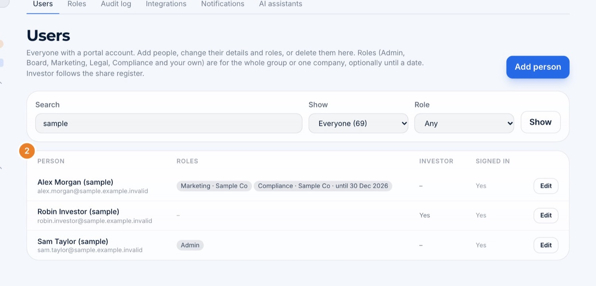

2. **The list:** each person, their roles (for the whole group or one company, and until when), whether they are an investor and whether they have signed in. Search, filter by role, and **Add person** to invite someone.

Open a person:

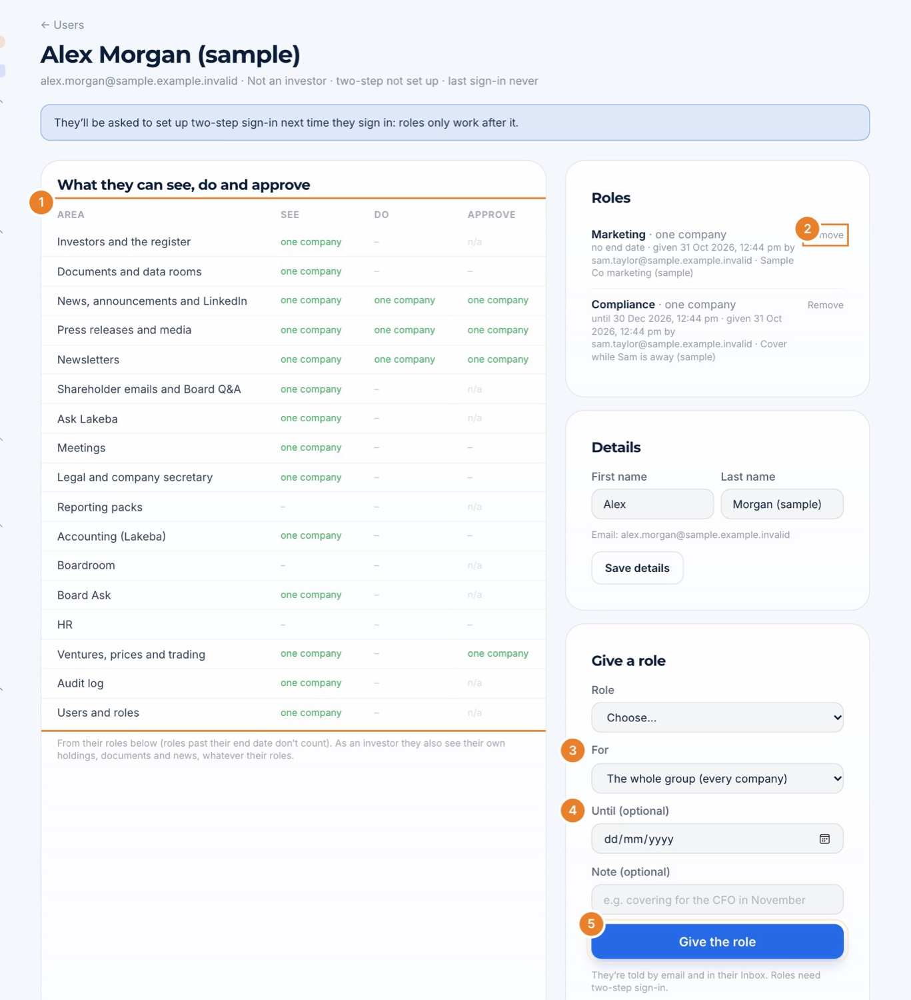

1. **What they can see, do and approve:** area by area, worked out from all their roles.
2. **Roles:** each with its company, end date, who gave it and why. **Remove** takes it away.
3. **Give a role · For:** the whole group or one company.
4. **Until (optional):** an end date, for cover during leave or a project. Add a note saying why.
5. **Give the role.** They are told by email and in their Inbox.

> **Safety rules built in:** only people with Users "do" can give or remove roles; nobody can give permissions they don't hold themselves; the last group Admin can't be removed; and only a group Admin can give themselves a role.

Settings → **Roles**:

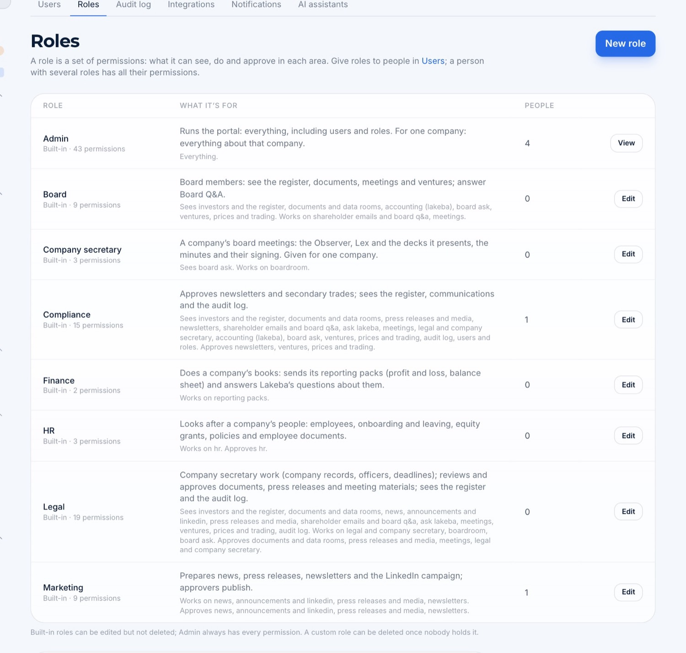

Open a role to see exactly what it allows:

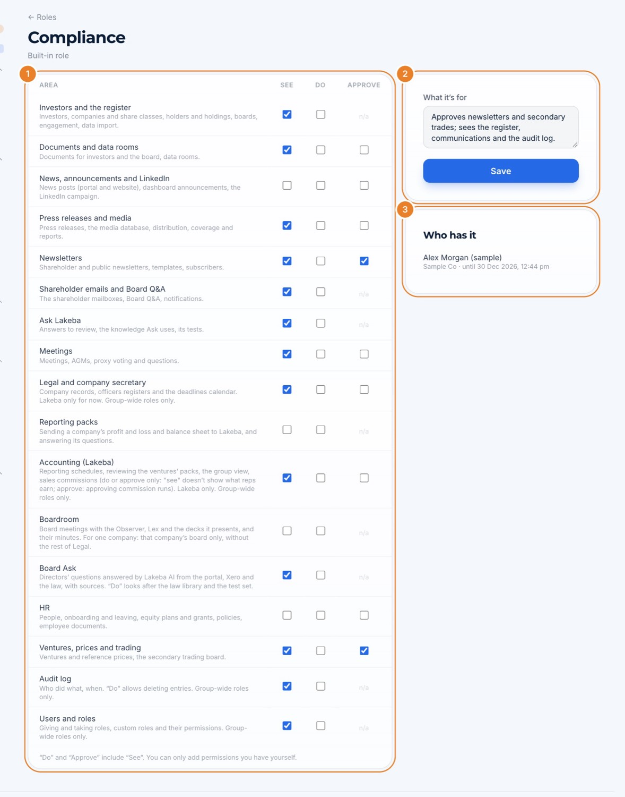

1. **See · Do · Approve** for each area. Built-in roles can be adjusted; Admin can't. You can also create your own roles.
2. **What it's for.**
3. **Who has it.**

> **Why it matters:** access is reviewed in one place, roles can end by themselves, and every change is recorded in the audit log.

## Step 2 · Approvals: four eyes

Anyone preparing a **document, news post, newsletter, meeting or secondary trade** can ask for approval. While it waits, it is held back.

| Item | Held back until approved |
|---|---|
| Document | Publishing it |
| News post | Publishing it |
| Newsletter | Sending or scheduling it |
| Meeting | Opening proxy voting and publishing results |
| Secondary trade | Completing it |

**Approvals** at the top of Admin shows what waits for you:

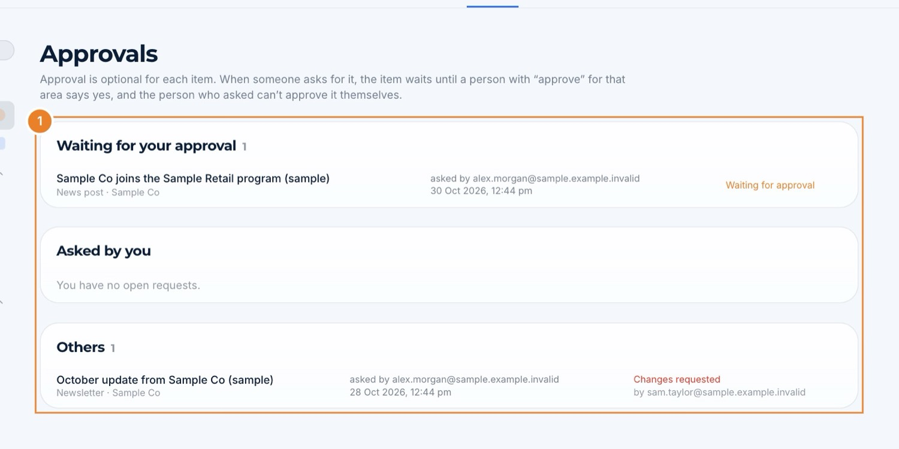

1. **Waiting for your approval · Asked by you · Others.**

Open one:

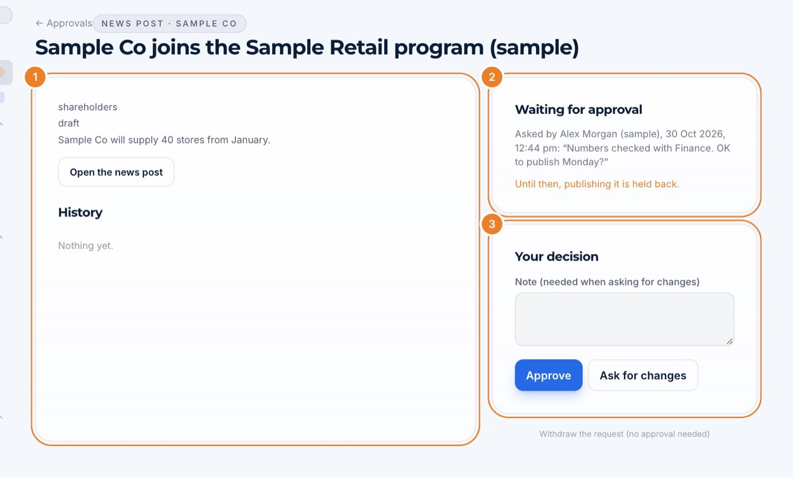

1. **What it is,** with buttons to open it or preview it.
2. **Where it stands,** with the history from the audit log.
3. **Your decision:** **Approve**, or **Ask for changes** with a note saying what to change.

> **Why it matters:** the person who asked can never approve it themselves, and the portal won't take a request if nobody else could approve it. If an approved item is changed, it goes back to waiting. Approvers are told when something waits for them; the person who asked is told the decision.

## Step 3 · The audit log

Settings → **Audit log**: sign-ins, document opens and every admin change.

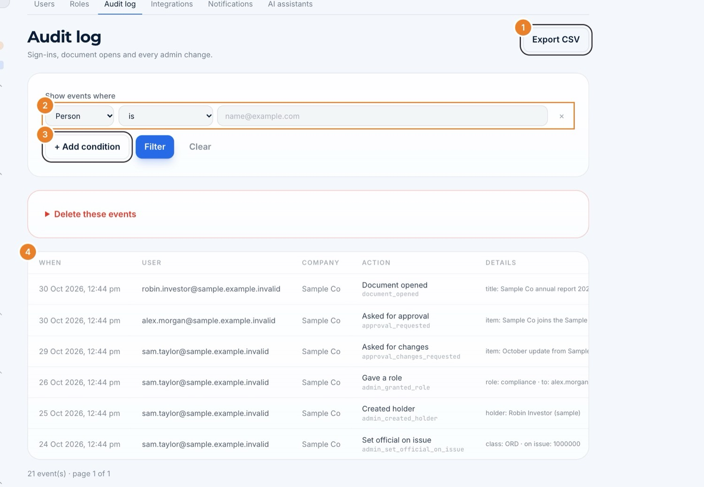

1. **Export CSV:** up to 50,000 rows, ready for a spreadsheet (exporting is itself recorded).
2. **Show events where:** person, action, company or date, with rules such as *is*, *contains*, *on or after*.
3. **+ Add condition** to narrow it further; all conditions must match.
4. **The events:** when, who, which company, what and the details.

> **Why it matters:** it is the evidence trail for audits and disputes. Deleting entries needs Audit log "do" for the whole group, asks you to type a confirmation, leaves a permanent record of the deletion, and alerts every Admin.

## Step 4 · Investors and the register

Investors → **Investors**: everyone with an investor account.

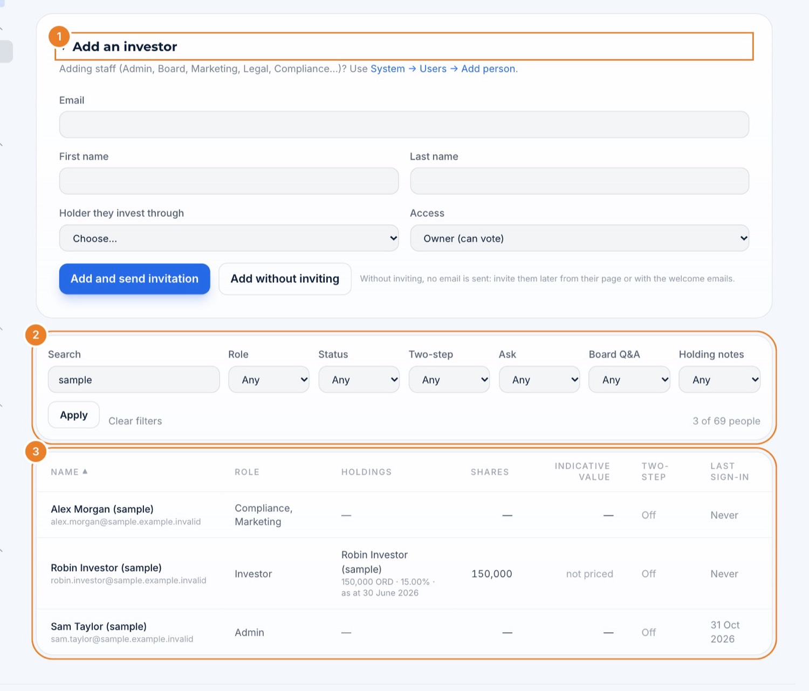

1. **Add an investor:** email, name, the holder they invest through and whether they can vote (Owner) or only view.
2. **Filters:** role, status, two-step, Ask, Board Q&A and holding notes.
3. **The list:** holdings, shares, indicative value, two-step and last sign-in.

Open an investor to manage their account (invitations, two-step reset, disabling access, which features they can use) and which holders they can see:

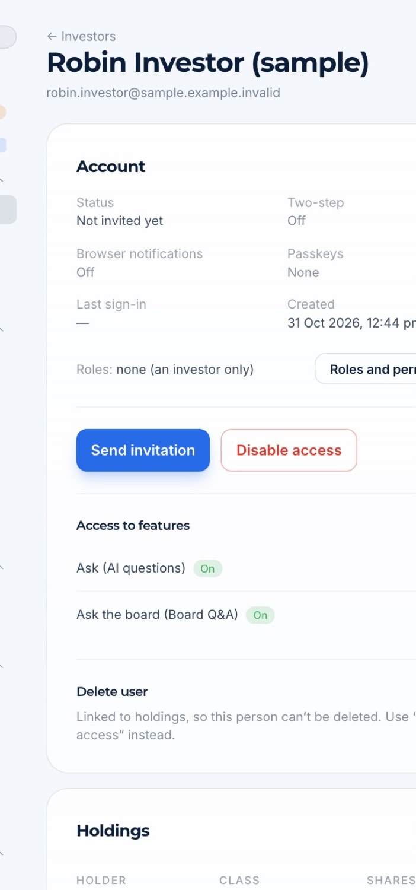

Investors → **Register** lists every share class and holder. Open a holder:

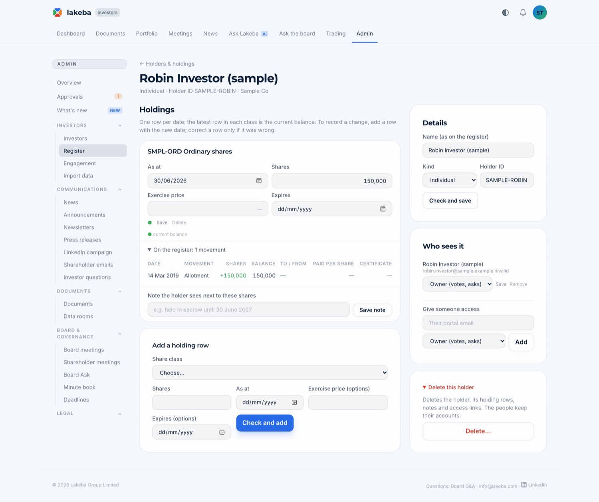

Every change to a holding is shown as old → new before you confirm it. Where a company's holdings come from its register of members, the portal asks why you are changing a figure.

Investors → Import data → **Register of members (PDF)** keeps the portal in step with the share registry:

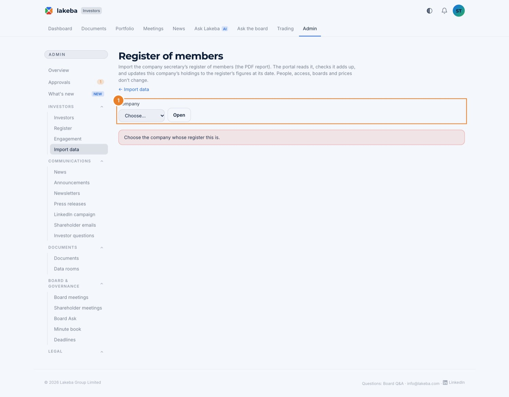

1. **Company,** then the register PDF: the portal matches each holder, shows a preview of every change, and imports only after you confirm you've reviewed it.

> **Why it matters:** holdings drive holding statements, voting rights, percentages and the values shareholders see.

## Step 5 · Companies and integrations

Settings → Companies → the company:

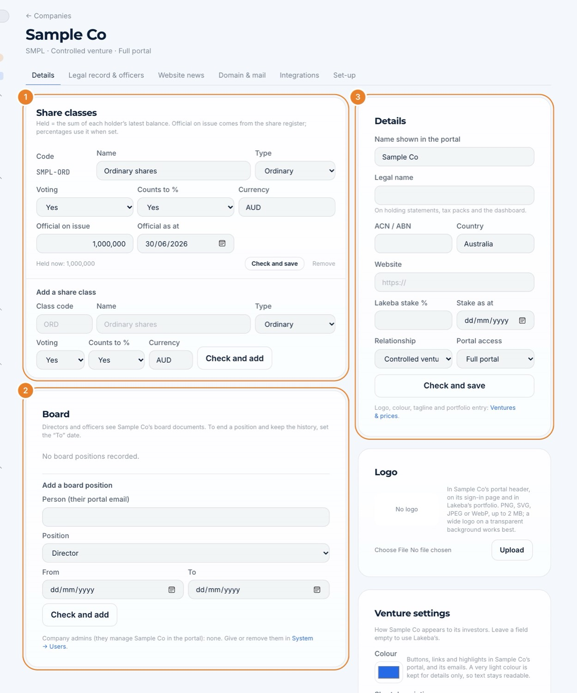

1. **Share classes,** with the official number on issue.
2. **Board:** directors and officers who see the company's board documents.
3. **Details:** names, relationship to Lakeba and portal access.

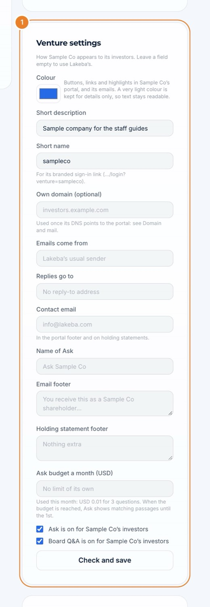

1. **Venture settings:** colour, description, the address it uses, who emails come from and where replies go, footers, Ask's name, and whether Ask and Board Q&A are on.

The **Integrations** tab holds the company's API keys, webhooks, Xero, HubSpot and connected apps:

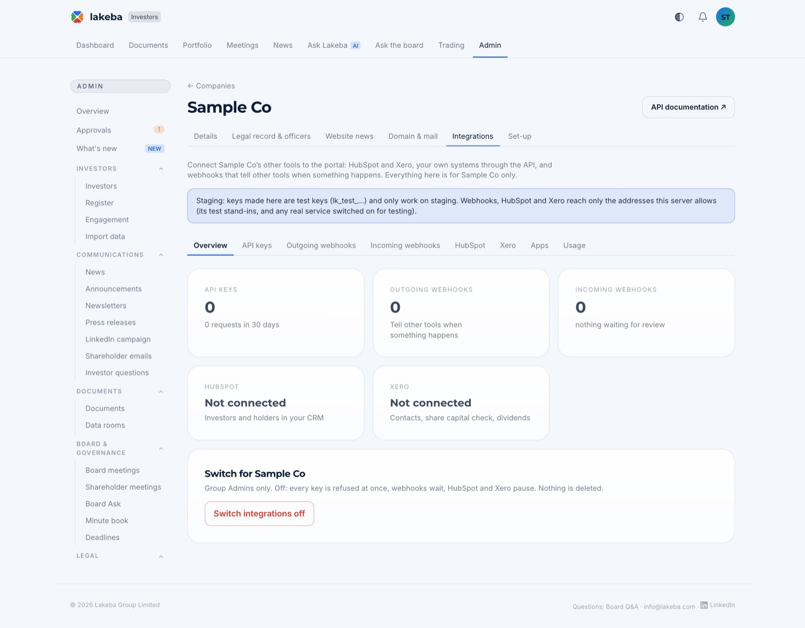

> **Why it matters:** an API key can never do more than the person who made it, can be limited to certain IP addresses, and is shown only once. Webhooks only include names and emails if you tick it. Review keys and connected apps regularly and revoke what isn't used.

## Step 6 · Checking the AI

Settings → **AI assistants** → **Answers to review**: every question investors asked Ask Lakeba, and its answer.

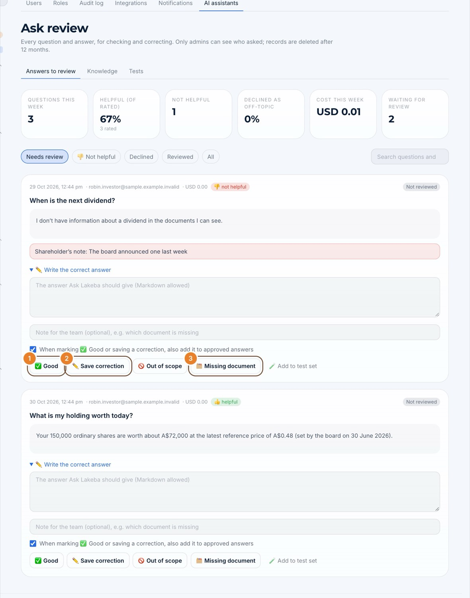

1. **Good:** the answer is right.
2. **Save correction:** write the right answer. With the box ticked, it becomes an approved answer that Ask uses from the next question.
3. **Missing document:** the answer was weak because a document is missing; also **Out of scope** and **Add to test set**.

> **Why it matters:** answers marked *not helpful* come first, with the shareholder's note. **Knowledge** sets the house rules, approved answers and daily limits; nothing on these pages makes a paid AI call except running the test set.

## Secondary trading

Finance → **Secondary trading** (for whoever looks after it): switch the trading board on for a company, set the window, pair a seller with a buyer, then complete the transfer, which updates the register. If approval was asked for, the trade can't be completed until someone with "approve" (Compliance has it) approves it in **Approvals**.

## What it adds up to

| When this is in place… | …you get |
|---|---|
| Roles given per company, with end dates | Access that matches the job and expires by itself |
| Approvals used for what goes out | A second person on every publication, newsletter, meeting and trade |
| The audit log reviewed and exported | Evidence of who did what, when, for any audit |
| The register imported and reconciled | Correct statements, votes and values for every shareholder |
| Keys and apps reviewed | No forgotten access into the portal |
| Ask's answers reviewed | Investors get correct answers, and the corrections are reused |

## Checklist

- [ ] Users reviewed: roles, companies and end dates
- [ ] Two-step sign-in on for all staff
- [ ] At least two approvers for each area that needs approval
- [ ] Approvals cleared every week
- [ ] Audit log exported each month or quarter
- [ ] Register imported after each registry update, changes reviewed
- [ ] API keys, webhooks and connected apps reviewed
- [ ] Ask answers reviewed, starting with the "not helpful" ones