# Finance on the Lakeba Portal: what to fill in and why

Every picture below is the real portal, filled with **sample data**: two made-up companies, Sample Co and Sample Labs. The orange numbers match the notes under each picture, and **Why it matters** says what the figures you look after turn into.

> **The idea in one line:** each venture sends a monthly or quarterly **reporting pack** (its P&L and balance sheet). Finance checks it once, and from then on the group view, the consolidated accounts, the board summary and Board Ask all use the same checked figures.

## Before you start

- **Where:** Admin → Finance. Tabs: Group view, Consolidated, Board summary, Reporting packs, Year-end, Commissions, Schedules.
- **Your access:** Lakeba's Finance pages need *Accounting* for the whole group. A portal Admin gives it (the Admin role, or a role made in Settings → Roles with Accounting "do" and, for whoever approves commissions, "approve").
- **The built-in "Finance" role is for the ventures:** it is given to a venture's own finance person, company by company, so they can send that company's packs.

## Step 1 · Set each venture's schedule

**Schedules** tab. Do this once per company: nothing else works until a company has a schedule.

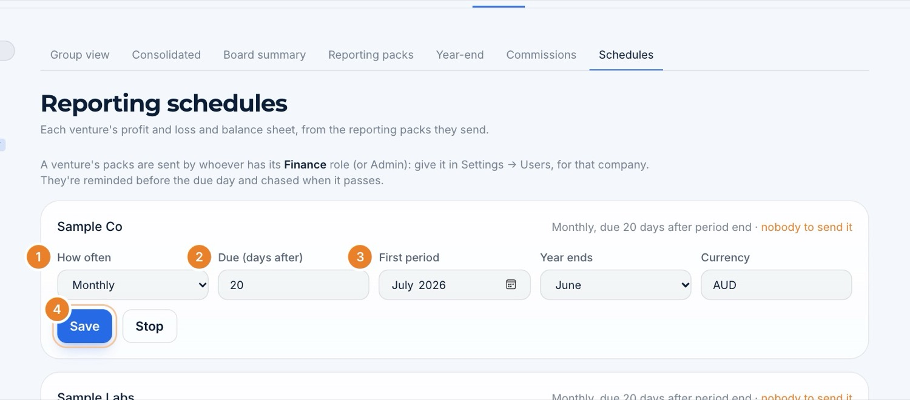

1. **How often:** monthly or quarterly.
2. **Due (days after):** how many days after the period ends the pack is due (1 to 120).
3. **First period:** the first month or quarter to report. Also set **Year ends** and **Currency**.
4. **Save** (or **Start** the first time). **Stop** pauses it.

> **Why it matters:** the schedule opens a pack for every finished period by itself, works out its due date, reminds the venture before the due day and chases it once it is late, with a summary for Finance. "Nobody to send it" (top right) means no one at that company has the Finance role yet: give it in Settings → Users.

## Step 2 · Watch the packs come in

**Reporting packs** tab.

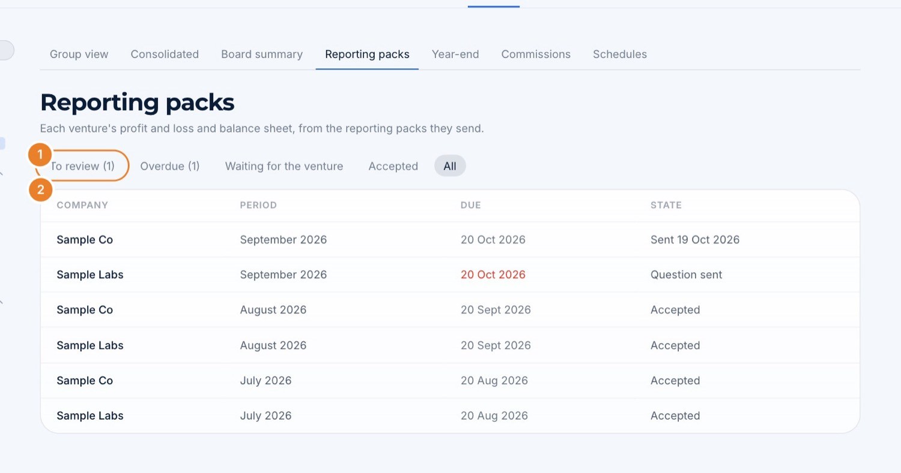

1. **To review · Overdue · Waiting for the venture · Accepted · All:** start each day with *To review*.
2. **The list:** company, period, due date and where each pack stands.

The venture sends its pack from its own page: figures fetched from **Xero**, or a spreadsheet or PDF **read by Lakeba AI** into the standard lines, or typed. It adds a note for you.

## Step 3 · Review a pack

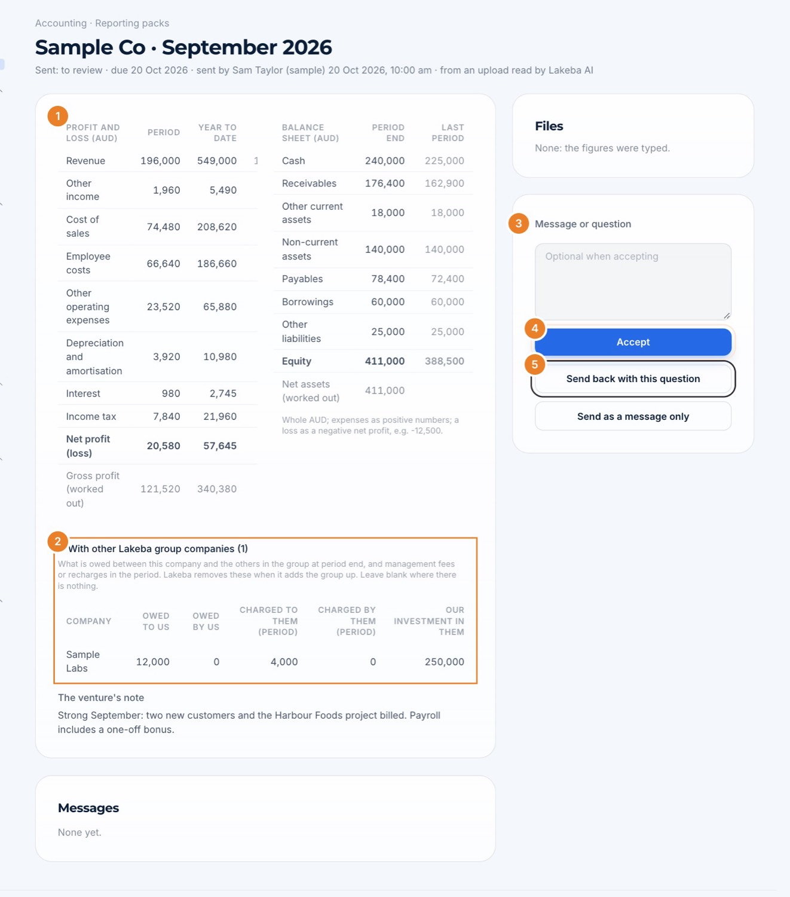

1. **The figures:** profit and loss (period and year to date) and balance sheet, next to the last period. Orange flags at the top point at anything odd: a balance sheet that doesn't balance, a net profit that doesn't add up, negative cash, revenue that moved more than 50%.
2. **With other Lakeba group companies:** what this company owes, is owed, charges or is charged by the others, and its investments in them.
3. **Message or question:** optional when you accept, needed when you send it back.
4. **Accept:** the figures count from now on.
5. **Send back with this question:** it goes back to the venture to fix and send again. **Send as a message only** just talks.

When something is wrong, the question is kept with the pack:

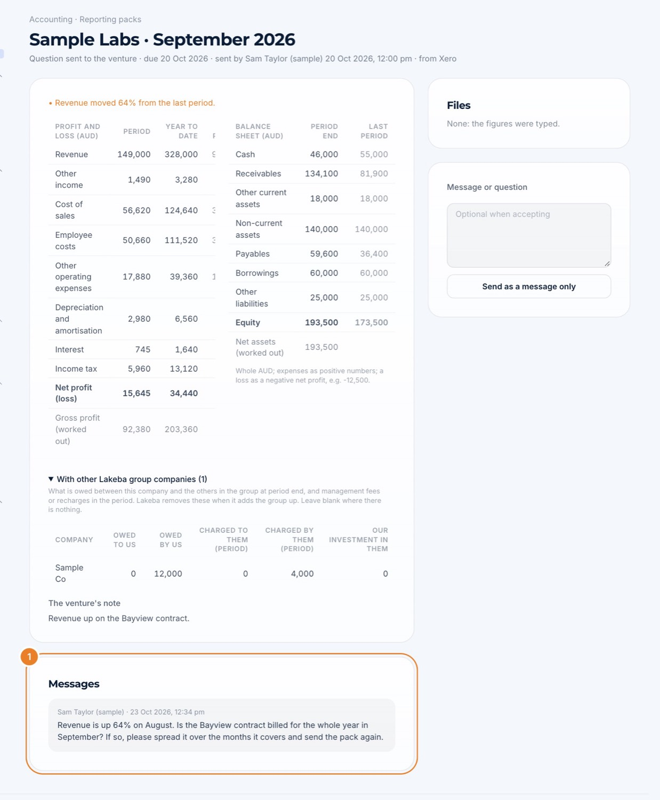

1. **Messages:** every question and answer, with who wrote it and when.

> **Why it matters:** the **group lines** are what lets the portal take out what the companies charge and owe each other when it adds the group up. Ask the venture to fill them in every time. Each action tells the venture's senders straight away.

## Step 4 · The group view

**Group view** tab: every venture on one page.

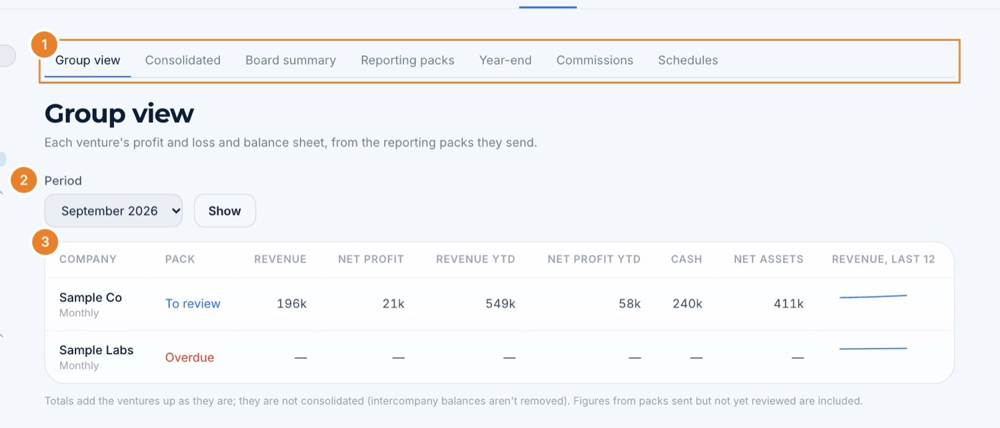

1. **The Finance tabs.**
2. **Period:** choose the month or quarter.
3. **The table:** pack state, revenue, net profit (period and year to date), cash, net assets and a 12-period revenue line for each company. Packs still to review are included, so check the state column.

## Step 5 · The consolidated accounts

**Consolidated** tab.

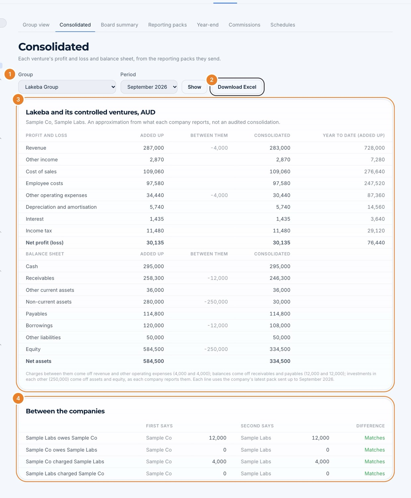

1. **Group:** Lakeba Group, or a venture with companies of its own.
2. **Download Excel** for the workbook.
3. **Added up · Between them · Consolidated:** each line added up, what the companies charge, owe and invest in each other taken out, and the result.
4. **Between the companies:** what each pair says about the other. *Matches* is what you want; a difference means one side's group lines are wrong.

> **Why it matters:** it is an approximation from the packs, not an audited consolidation, but it is the group's numbers in seconds, every month, without a spreadsheet.

## Step 6 · The board summary

**Board summary** tab: one landscape page for the board.

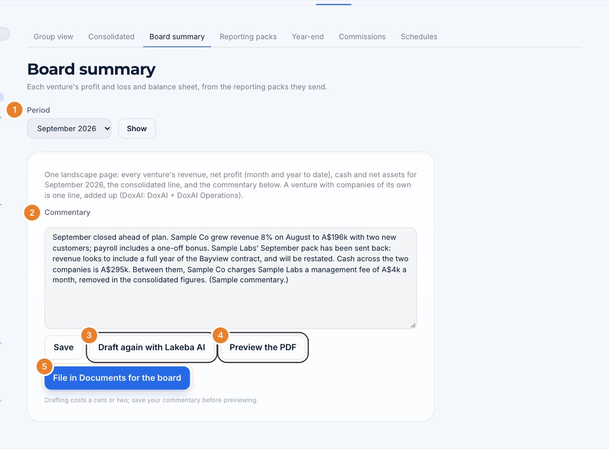

1. **Period.**
2. **Commentary:** write it, or start from Lakeba AI's draft and edit it.
3. **Draft with Lakeba AI:** reads each company's figures and the ventures' notes and writes a 120 to 220 word commentary (a cent or two each time).
4. **Preview the PDF:** save first.
5. **File in Documents for the board:** the PDF goes into Documents, for the board only.

> **Why it matters:** the same checked figures feed **Board Ask**, so directors can ask about any venture's numbers and get answers with sources.

## Step 7 · Year-end and the audit

**Year-end** tab: ask a venture for everything its auditor needs, and track it item by item.

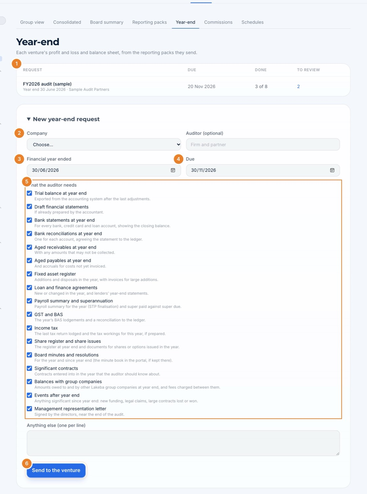

1. **The requests** so far, with how many items are done and how many wait for you.
2. **Company.**
3. **Financial year ended.**
4. **Due.** Add the **Auditor** if you know it.
5. **What the auditor needs:** 17 usual items, all ticked; untick what doesn't apply and add anything else, one per line.
6. **Send to the venture.**

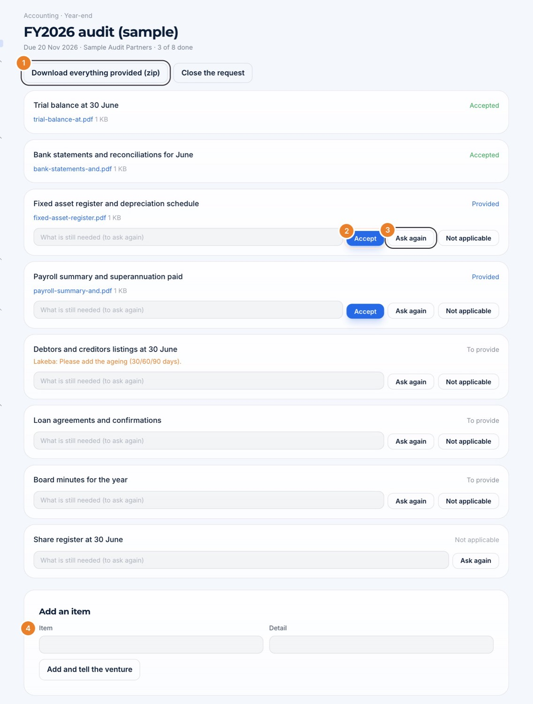

1. **Download everything provided (zip)** for the auditor.
2. **Accept** an item once it is right.
3. **Ask again**, with a note saying what is still needed: the venture is told.
4. **Add an item** at any time; the venture is told.

## Step 8 · Commissions

**Commissions** tab. Commission is worked out from the sales invoices in Xero (or a CSV of invoices). Each plan says when it is earned (**Pays on**): when an invoice is **raised**, or only once it is **paid in full**, which is when the CRM counts a deal as won.

First the plan and the people on it:

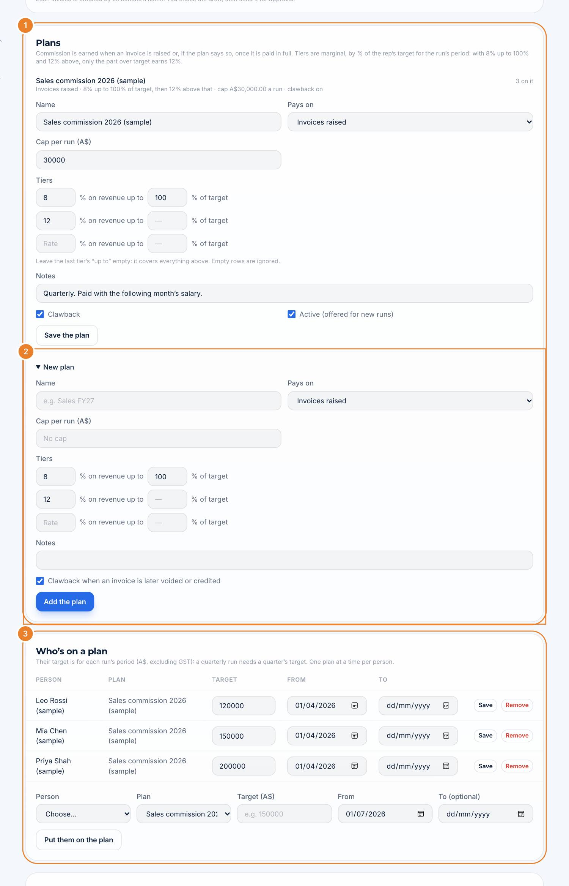

1. **Plans:** name, **Pays on** (invoices raised or paid in full), cap per run, and tiers as a % of each rep's target (for example 8% up to 100% of target, then 12% above). Tick **Clawback** to take commission back when an invoice is later voided or credited.
2. **New plan.**
3. **Who's on a plan:** each rep, their target for each run's period (a quarterly run needs a quarter's target) and from when.

Then who sold to whom, which Xero doesn't know:

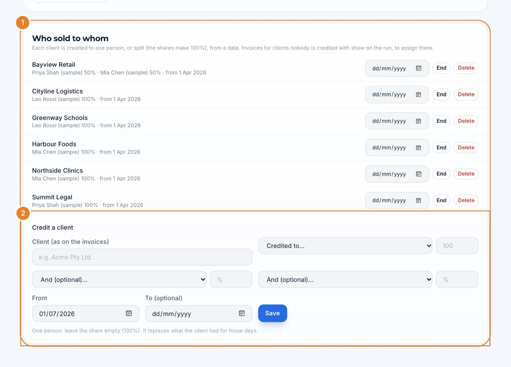

1. **Who sold to whom:** each client and the rep (or reps, with shares) credited from a date.
2. **Credit a client:** search the Xero contact, or type the name as it appears on invoices, choose the rep and share, and save.

Then each period's run:

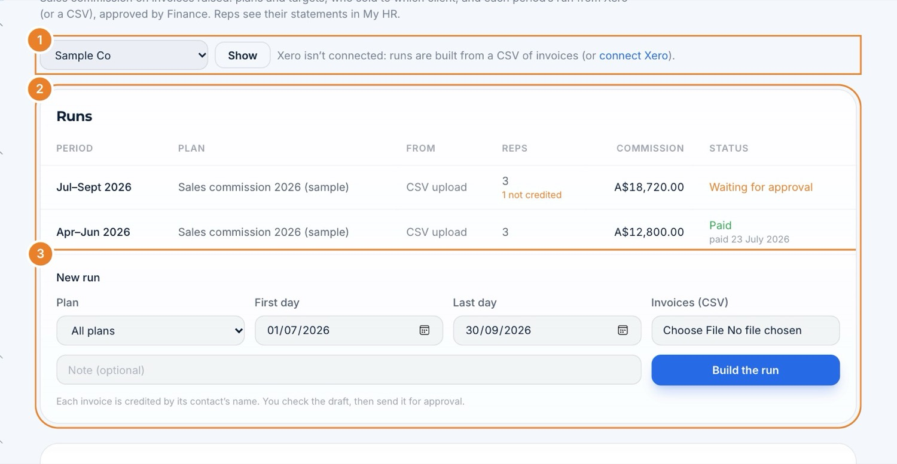

1. **Company.** It says whether Xero is connected.
2. **Runs:** period, plan, reps, commission and status (Draft, Waiting for approval, Approved, Paid).
3. **New run:** plan, first and last day, then **Build from Xero** (or upload a CSV).

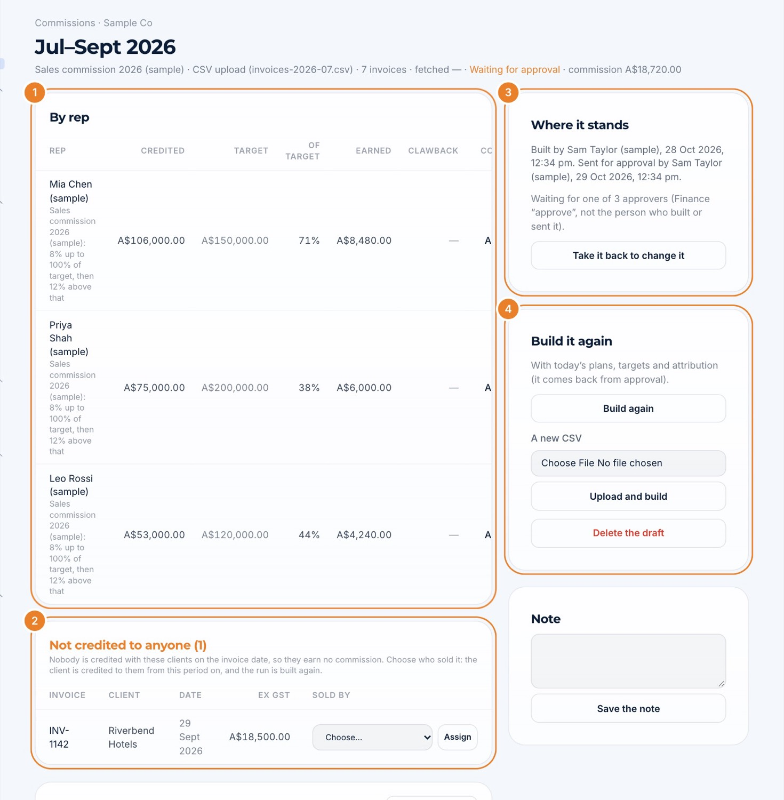

1. **By rep:** revenue credited, target, % of target, earned, clawback and commission.
2. **Not credited to anyone:** invoices whose client has no rep. Choose who sold it and press **Assign**: the client is credited from then on and the run is built again.
3. **Where it stands:** **Send for approval**. Someone else with Finance "approve" approves it (four eyes: never the person who built or sent it), then **Mark paid**.
4. **Build it again** with today's plans, targets and credits, or from a new CSV. **Delete the draft** if it was a mistake.

> **Why it matters:** when a run is approved, each rep sees it line by line in **My HR → My commissions**, a scorecard with *Sales credited (A$)* fills that result in by itself, and the board summary shows commission by company.

## What it adds up to

| When this is in place… | …you get |
|---|---|
| Every venture has a schedule | Packs opened, reminded and chased for you |
| Packs are reviewed and accepted | One set of checked figures for the group view, consolidation, board summary and Board Ask |
| Group lines are filled in | Charges and balances between companies taken out automatically, with a check that both sides agree |
| Year-end requests go through the portal | Every auditor item tracked, chased and downloadable in one zip |
| Plans, targets and credits are set | Commissions worked out from real invoices, approved by a second person, and explained to each rep |

## Checklist

- [ ] Accounting access for the whole group (and "approve" for whoever approves commissions)
- [ ] A schedule for every venture, and someone at each with the Finance role
- [ ] Packs reviewed: accepted or sent back with a question
- [ ] Ventures fill in their group lines
- [ ] Board summary commentary written and filed each period
- [ ] Year-end requests sent before the audit starts
- [ ] Commission plans, reps' targets and who sold to whom set up
- [ ] Each run built, checked, sent for approval and marked paid