# HR on the Lakeba Portal: what to fill in and why

Every picture below is the real portal, filled with **sample data** (a made-up company, Sample Co). The orange numbers on each picture match the numbered notes under it, and **Why it matters** says what your colleagues get from what you fill in.

> Pay, leave, tax and bank details stay in payroll, not in the portal.

## Where HR lives

**Admin → HR.** You need the HR role for the company; a portal Admin gives it. HR has four tabs: People, Equity plans, Policies and Performance.

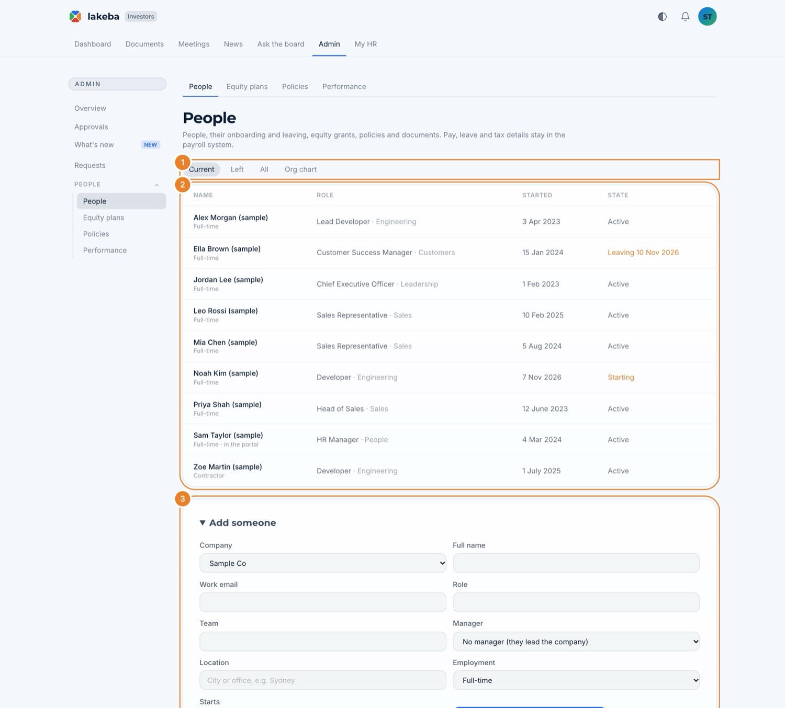

1. **Current · Left · All · Org chart:** who works here now, who has left, everyone, or the org chart.
2. **The list:** each person's role, team, start date and where they stand (Starting, Active, Leaving).
3. **Add someone** opens the form in Step 1.

## Step 1 · Add each person

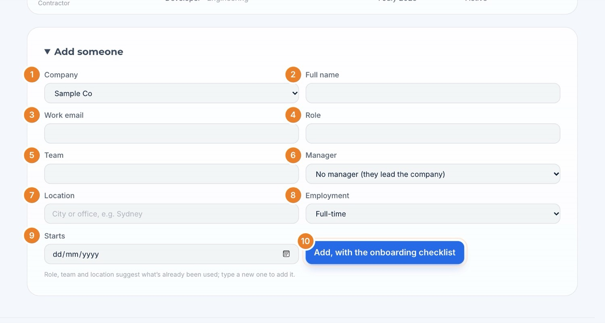

1. **Company:** the one that employs them.
2. **Full name:** as on their contract.
3. **Work email:** their company address.
4. **Role:** their job title. The portal suggests titles already used.
5. **Team:** for example Sales. Suggested too.
6. **Manager:** leave "No manager" only for the person who leads the company.
7. **Location:** city or office.
8. **Employment:** Full-time, Part-time, Casual, Contractor or Advisor.
9. **Starts:** their first day.
10. Press **Add, with the onboarding checklist**.

> **Why it matters:** the **work email** lets them into My HR and is where reminders go. The **manager** builds the org chart and gives that manager *My team*: their people's scorecards, check-ins and alerts. The **start date** sets the due dates of their checklist.

## Step 2 · Complete their record

Open the person from the list.

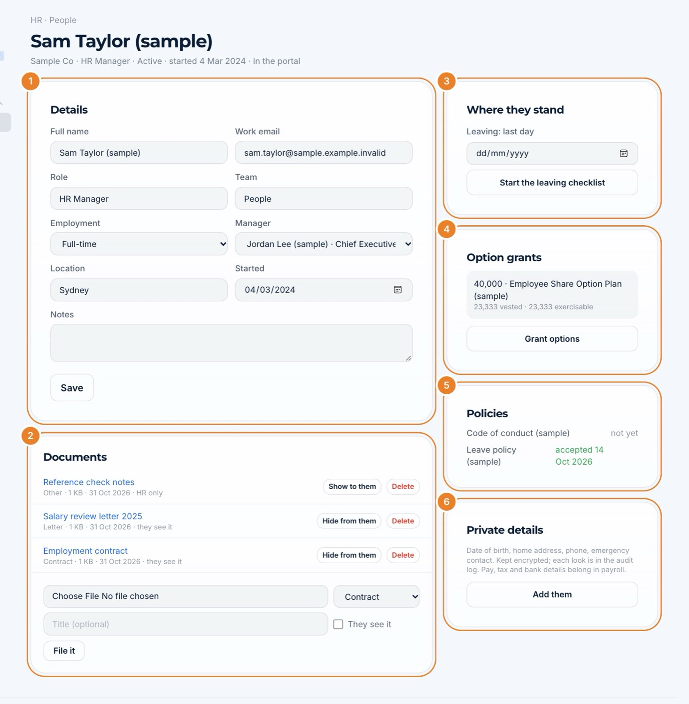

1. **Details:** correct anything here and press Save. Notes are for HR.
2. **Documents:** file contracts and letters (up to 25 MB). Tick **They see it** to show one in their My HR; **Show to them** and **Hide from them** change it later.
3. **Where they stand:** start the leaving checklist here when the time comes (Step 7).
4. **Option grants:** what they hold and how much has vested (Step 5).
5. **Policies:** which ones they have accepted.
6. **Private details:** date of birth, home address, phone and emergency contact. Kept encrypted, and each look is logged.

> **Why it matters:** every contract and letter in one place, found in seconds, and employees open their own copies without asking. Add at least the **emergency contact**, so it is there on the day it is needed.

### Invite them to My HR

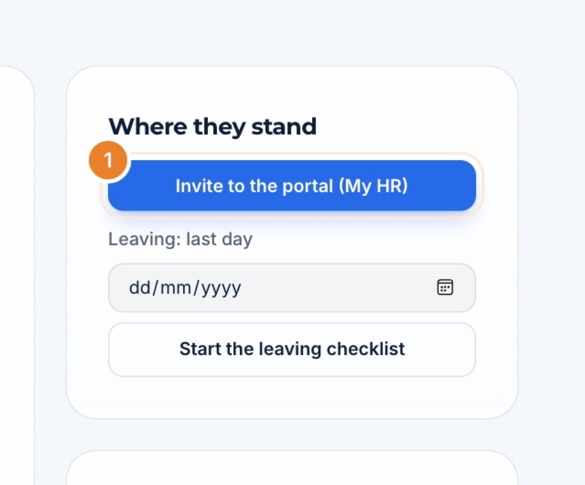

1. **Invite to the portal (My HR):** they get an email and their own space (see *What staff see* below). It needs their work email.

## Step 3 · Check the org chart

The chart draws itself from Step 1: each person under their manager, with role, team and location.

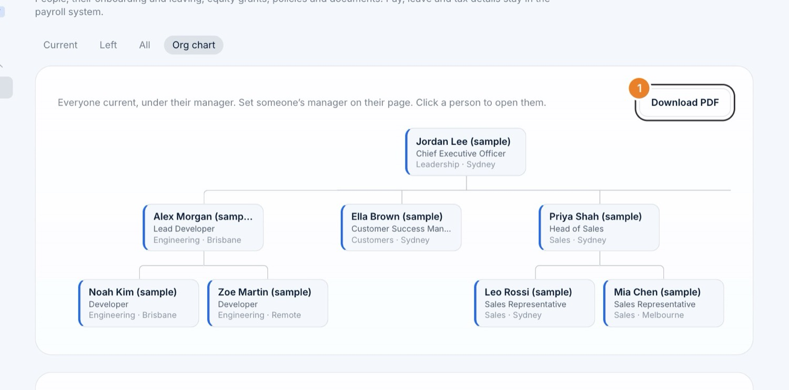

1. **Download PDF** for a printable copy, ready for a board pack or a new starter.

> **Check it after each batch:** only the company's leader should sit at the top. Anyone else up there is missing a manager.

## Step 4 · Policies

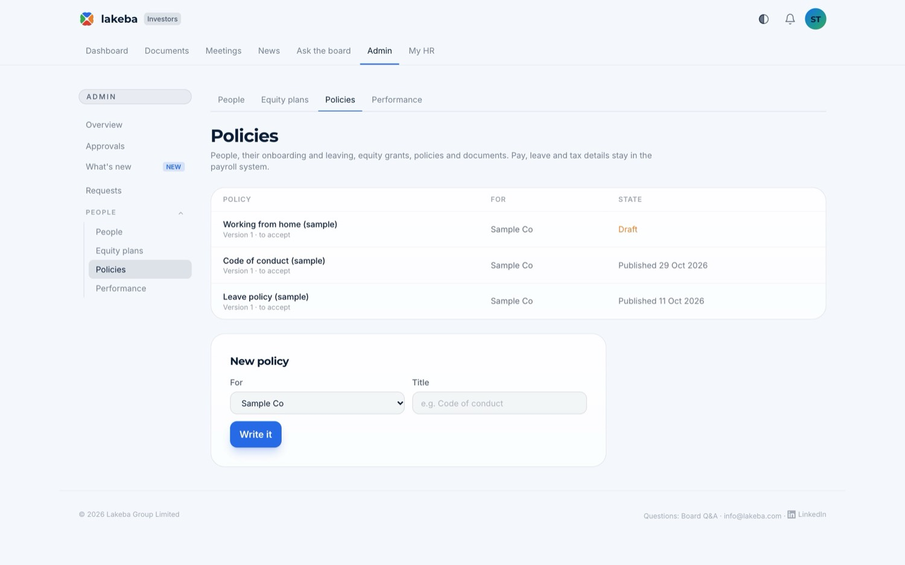

Open a policy, or add one:

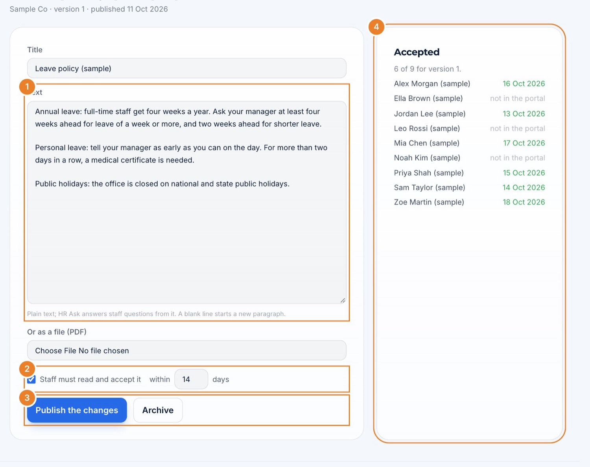

1. **Text:** paste the full text. You can attach the PDF below it too.
2. **Staff must read and accept it** within a number of days (14 unless you change it).
3. **Publish:** everyone who must accept it is told. Changing a published policy makes a new version, which everyone accepts again.
4. **Accepted:** who has accepted this version, and who isn't in the portal yet.

> **Why it matters: paste the text, not only the PDF.** HR Ask, the AI in My HR, answers staff questions from the policy *text* only, so a policy uploaded only as a file is invisible to it. People who are late get a reminder each Monday.

## Step 5 · Equity plans and grants

**Equity plans** tab. Enter the plan once:

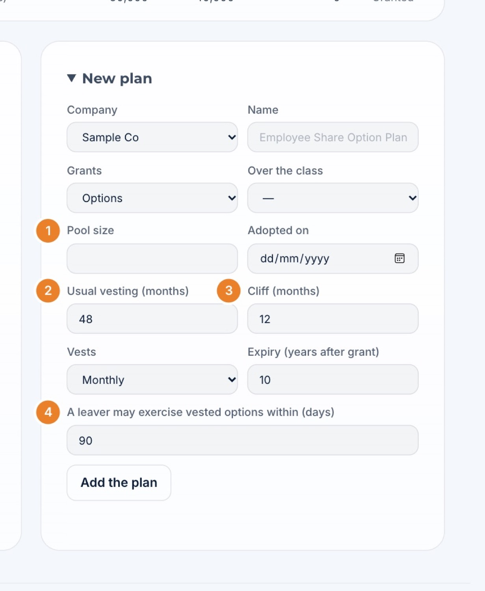

1. **Pool size:** how many the plan may grant in all.
2. **Usual vesting:** in months (48 unless you change it).
3. **Cliff:** nothing vests before it (12 months unless you change it).
4. **Leaver window:** days a leaver has to exercise vested options (90 unless you change it).

Then each grant:

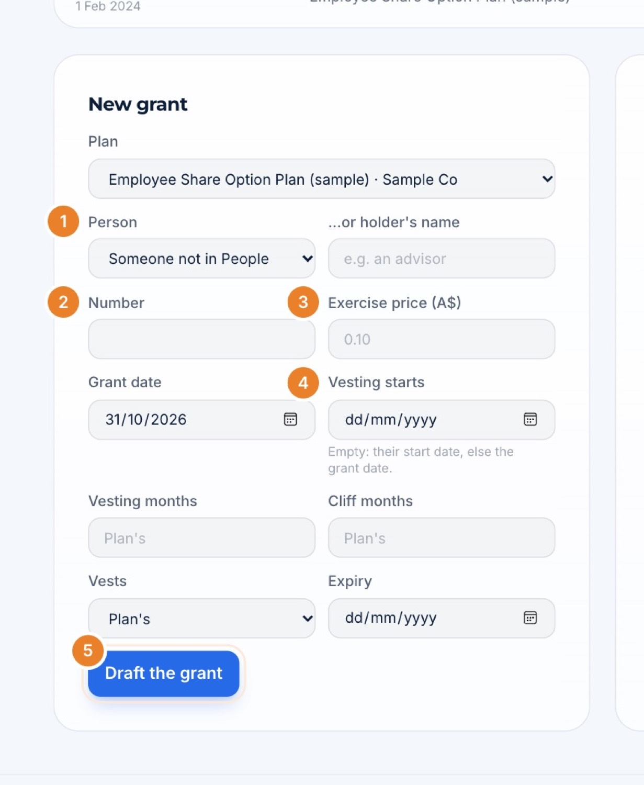

1. **Person:** from People, or a holder's name (for example an advisor).
2. **Number** of options.
3. **Exercise price** in A$.
4. **Vesting starts:** left empty, it is their start date, else the grant date.
5. **Draft the grant.** Legal prepares the board resolution. Once granted, the letter is filed in their documents and they accept it in My HR.

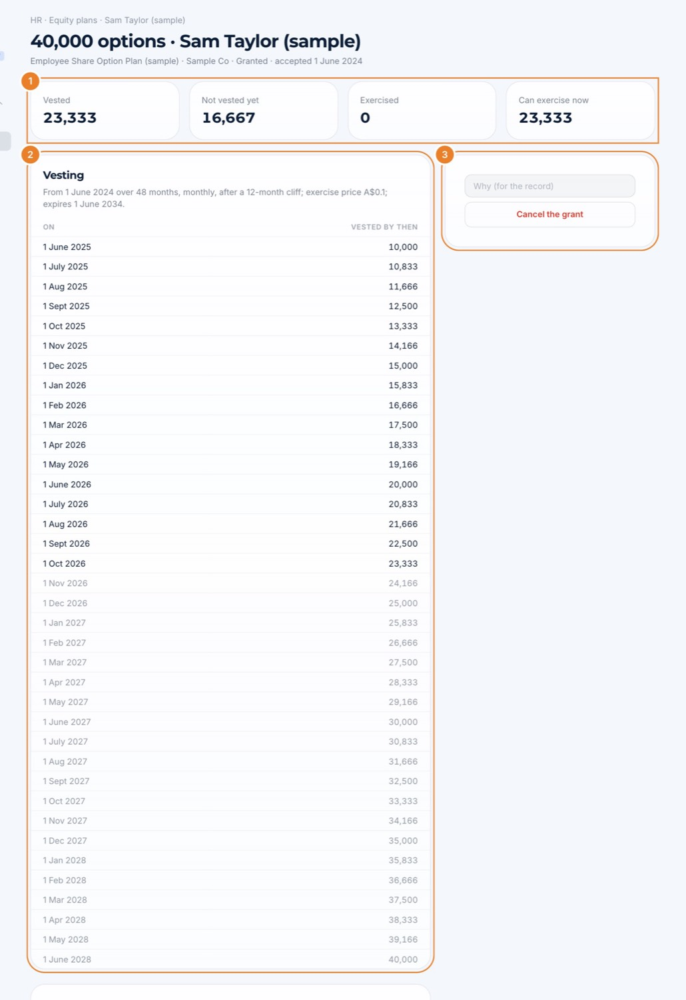

1. **Where it stands:** how many have vested and can be exercised.
2. **Vesting:** the schedule, date by date.
3. **Actions:** the board resolution, recording their acceptance, and exercises.

> **Why it matters:** each person sees exactly what has vested. When someone leaves, vesting stops on their last day and options that can no longer be exercised lapse by themselves. An approved exercise puts "issue the shares and tell ASIC" on the Legal calendar.

## Step 6 · KPIs and scorecards

**Performance** tab → **KPI library** first:

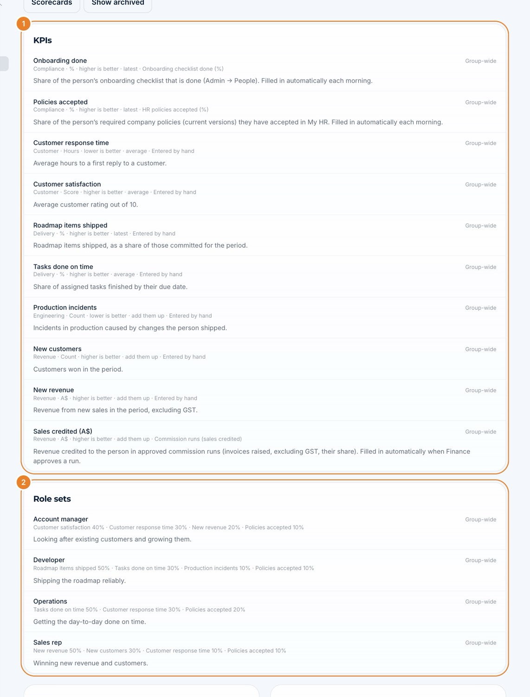

1. **KPIs:** what each one measures, its unit, whether higher or lower is better, and where results come from (by hand, or automatic).
2. **Role sets:** bundles of KPIs with weights, such as "Sales rep", to give someone sensible KPIs in one click.

Then the period and its scorecards:

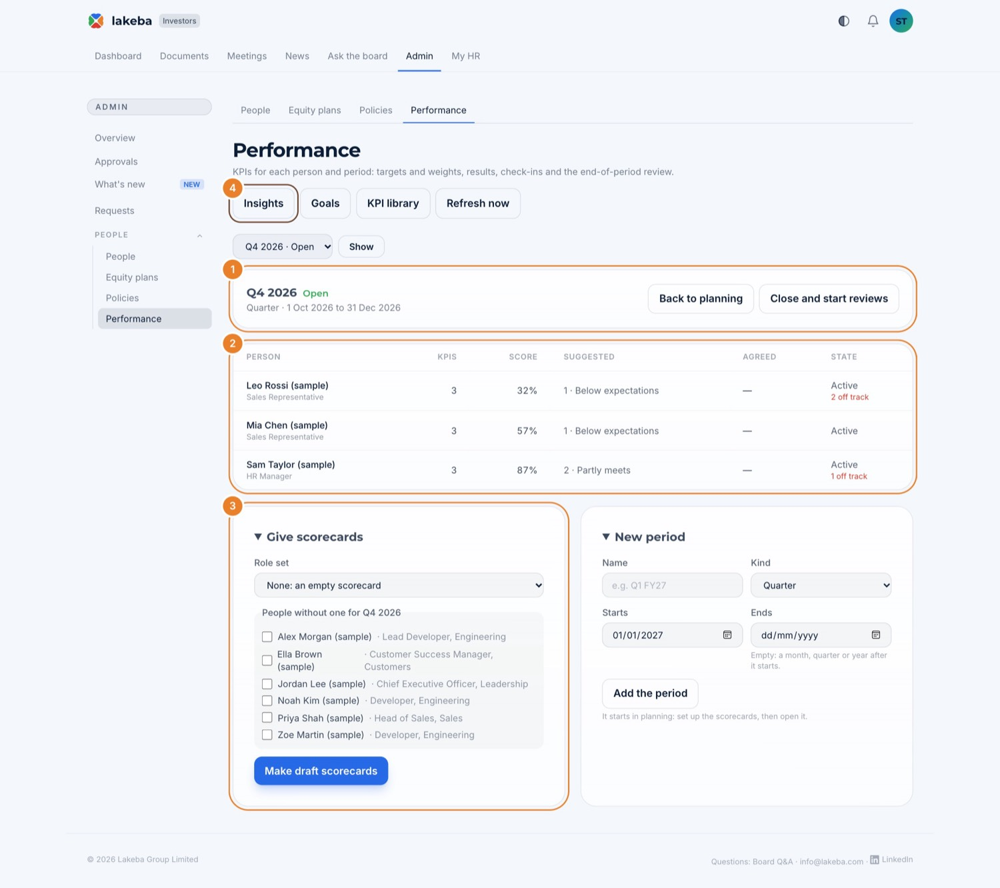

1. **The period:** a month, quarter or year. It goes from planning to open; **Close and start reviews** ends it.
2. **Scorecards:** each person's score, suggested rating, and anything off track.
3. **Give scorecards:** choose a role set and the people.
4. **Insights**, **Goals** and the **KPI library**.

Open a scorecard:

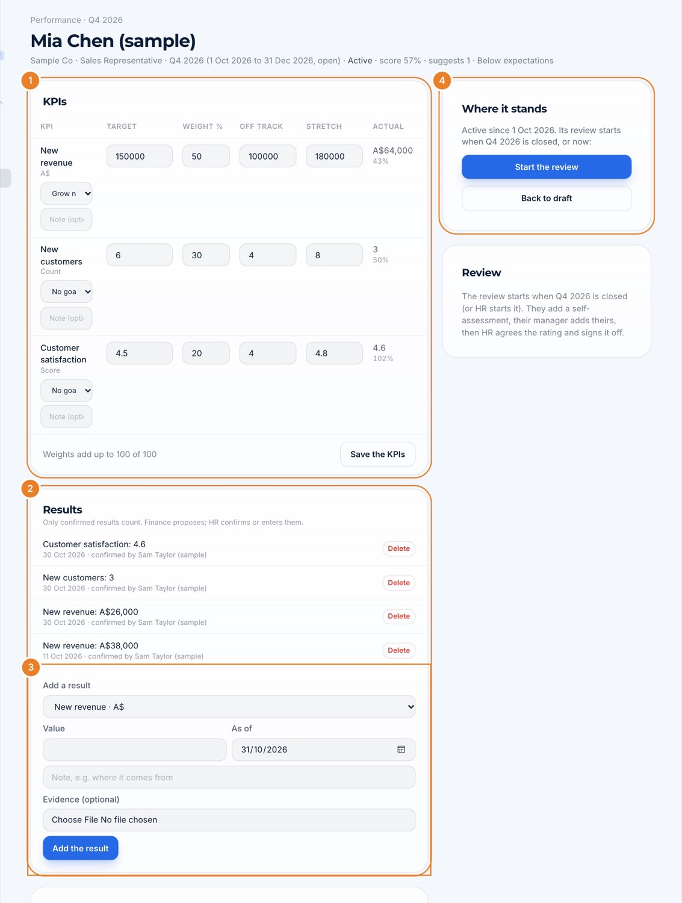

1. **KPIs:** target, weight (they add up to 100), the off-track level and the stretch level.
2. **Results:** only confirmed results count. Finance can propose them; HR confirms or enters them.
3. **Add a result.**
4. **Where it stands:** start the review when the period closes.

> **Why it matters:** the score *suggests* a rating, but people decide it. Automatic results (sales credited, policies accepted, onboarding done) refresh every morning. When a KPI slips off track, HR and the manager get one message, at most every 14 days.

**Insights** shows trends against target and ratings by manager, so reviews are fair across teams:

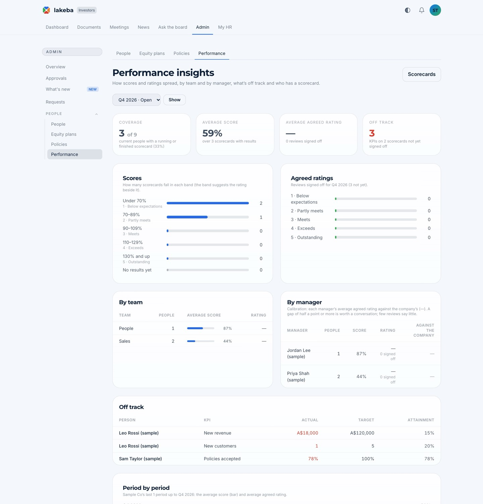

## Step 7 · Joining and leaving

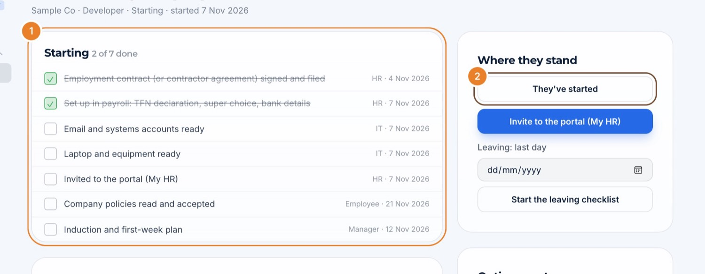

1. **Starting checklist:** seven tasks, each with an owner (HR, IT, manager or employee) and a due date counted from the start date. Tick them as they are done.
2. **They've started:** press it on their first day.

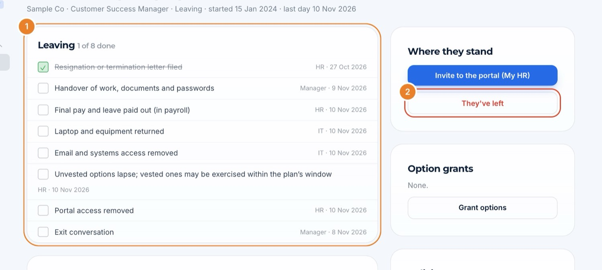

1. **Leaving checklist:** it appears when you enter their last day. It covers the letter, handover, final pay, equipment, access, options and an exit conversation.
2. **They've left:** vesting stops on their last day, and their portal access ends unless they still need it (for example, they hold shares).

> **Don't delete people who leave.** Their record and history stay, marked as left.

## Commissions (with Finance)

Finance runs commissions under Admin → Finance. HR's part: each rep has a work email and is invited, so they see their statement in **My HR → My commissions**. A scorecard with **Sales credited (A$)** fills that result in by itself when a run is approved.

## What staff see: My HR

Everyone you invite gets this page:

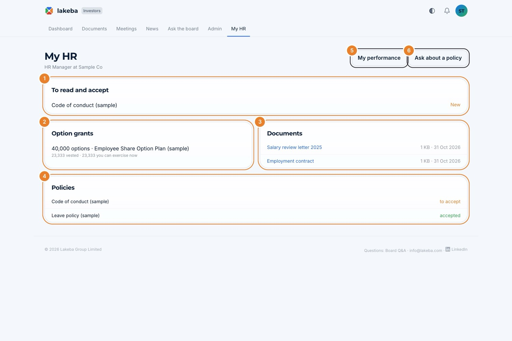

1. **To read and accept:** new or updated policies.
2. **Option grants:** what has vested and what they can exercise now.
3. **Documents:** the ones you marked **They see it**.
4. **Policies:** all of them, and which they have accepted.
5. **My performance:** their scorecards, results, check-ins and reviews.
6. **Ask about a policy:** HR Ask.

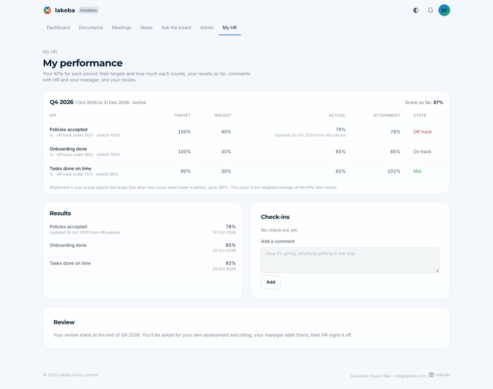

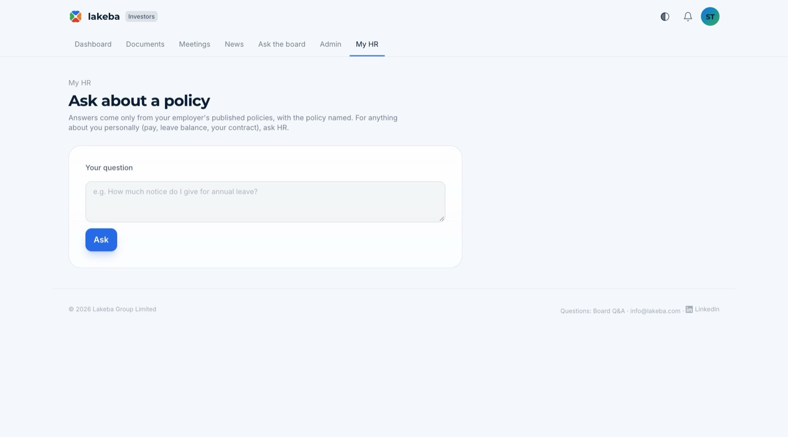

> **HR Ask** answers from the text of published policies, with its sources, at any hour. Private check-ins never show here.

## What it adds up to

| When this is complete… | …you get |
|---|---|
| Everyone has a manager, role, team and location | An org chart that is always current, My team for every manager, and alerts that reach the right person |
| Everyone has a work email and is invited | Staff serve themselves: policies, documents, grants, performance, commissions and answers |
| Start dates and last days are set | Checklists with due dates, so nothing is forgotten |
| Policies are published with their text | HR Ask answers at any hour, and acceptance is tracked and chased for you |
| Plans and grants are entered | Vesting is always up to date, and leaver rules apply by themselves |
| Scorecards are set each period | Reviews on real numbers, early warnings, and commissions that count towards performance |

## Checklist

- [ ] HR role given to you for each company you look after
- [ ] Everyone added: name, work email, role, team, employment, manager, location, start date
- [ ] Private details: at least the emergency contact
- [ ] Org chart checked: only the company's leader has no manager
- [ ] Everyone invited to My HR
- [ ] Contracts and letters filed, with **They see it** set as it should be
- [ ] Policies published with their full text
- [ ] Equity plans and existing grants entered
- [ ] KPI library, role sets, the first period and scorecards
- [ ] Sales reps on a commission plan (with Finance)