# Legal on the Lakeba Portal: what to fill in and why

Every picture below is the real portal, filled with **sample data** (a made-up company, Sample Co). The orange numbers match the notes under each picture, and **Why it matters** says what the portal does with what you enter.

> **The idea in one line:** keep each company's record, officers and contracts right, and the portal works out what is due, reminds the right people, keeps the proof and answers questions about it. Lodging with ASIC stays with you.

## Before you start

- **Where:** Admin → Legal. Tabs: Overview, Contracts, Requests, Legal Ask. Each company's record is under Settings → Companies → the company → **Legal record & officers**. Deadlines, board meetings and the minute book are under **Board & governance**.
- **Your access:** the built-in **Legal** role, given for the whole group (Legal pages don't open with a role for one company).
- **Reminders** go to the person an item is given to, or else to everyone with Legal: 30, 7 and 1 days before it is due, then weekly while it is overdue.

## Step 1 · Complete each company's record

Settings → Companies → the company → **Legal record & officers** → **Record**.

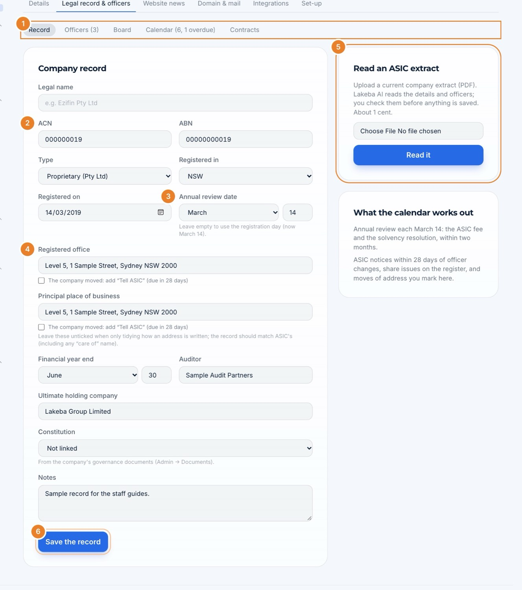

1. **Record · Officers · Board · Calendar · Contracts:** everything about the company in one place.
2. **Legal name, ACN, ABN, type, where and when registered.**
3. **Annual review date:** the date ASIC's annual statement is issued.
4. **Registered office and principal place of business.** Tick *The company moved* and a "Tell ASIC" item is added, due in 28 days.
5. **Read an ASIC extract:** upload a current extract and Lakeba AI reads it (about 1 cent). You then see each line next to what the record says, tick the ones to keep and save. Nothing changes until you confirm.
6. **Save the record.** Also fill in the financial year end, auditor, ultimate holding company and the constitution.

> **Why it matters:** the calendar can only work out deadlines from what the record says. From the review date and the company type, it adds the annual review and the solvency resolution every year; for a public company also the financial report and the AGM.

## Step 2 · Officers

**Officers** tab.

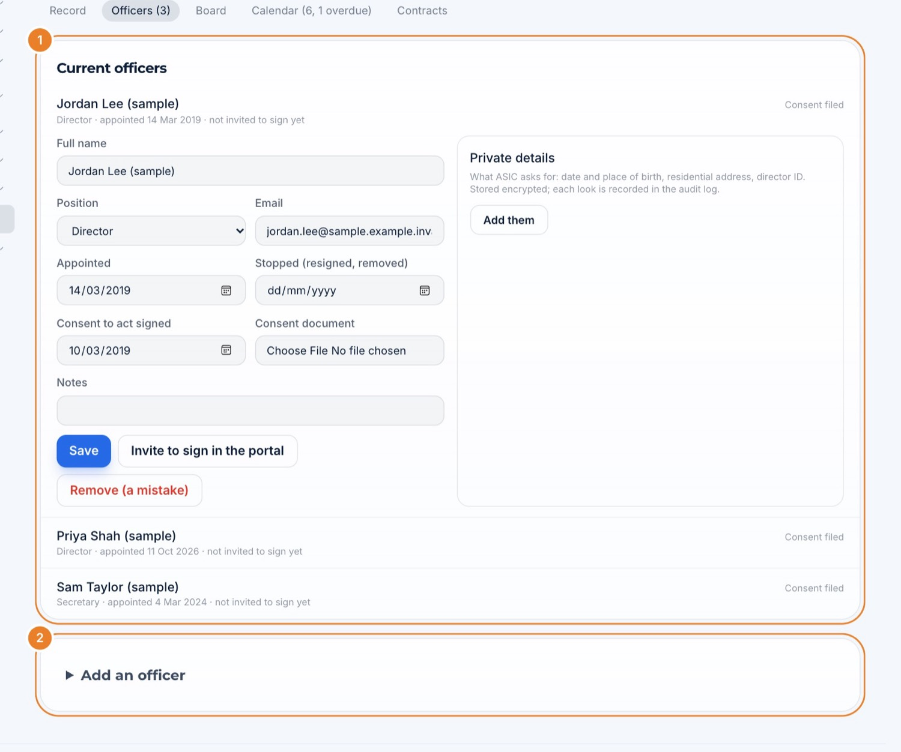

1. **Current officers:** for each director, alternate director and secretary: name, position, email, appointed and stopped dates, the date their consent to act was signed and the consent document. **Private details** (date and place of birth, residential address, director ID) are kept encrypted, and each look is recorded in the audit log. **Invite to sign in the portal** lets them sign board papers.
2. **Add an officer.**

> **Why it matters:** an appointment or a resignation adds a "Tell ASIC" item due within 28 days. Board meetings take their attendees from this list, and directors sign resolutions and minutes in the portal.

## Step 3 · Deadlines

The **Calendar** tab of each company:

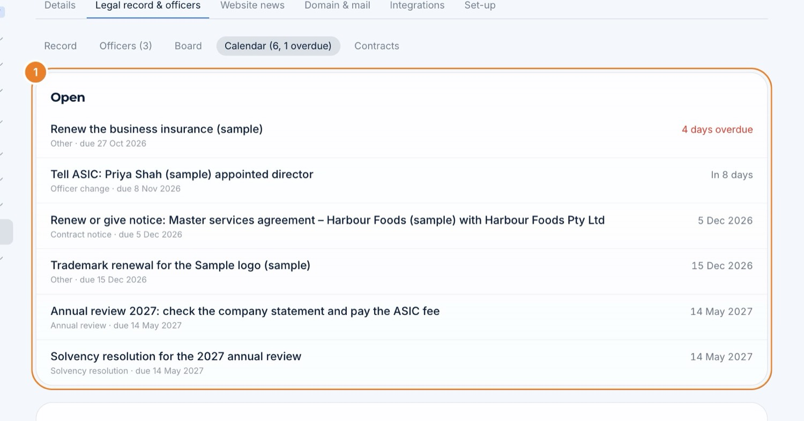

1. **Its deadlines:** those the portal worked out and those added by hand, with **Add an item** for anything else (insurance, trademarks, licences…).

The **Overview** shows the whole group:

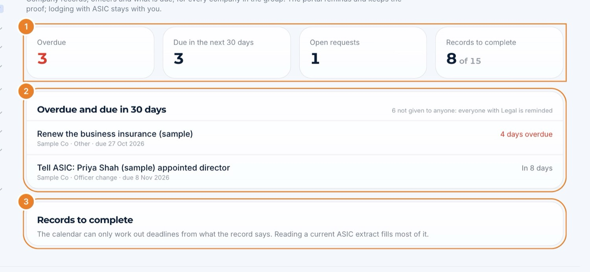

1. **Overdue · Due in the next 30 days · Open requests · Records to complete.**
2. **Overdue and due in 30 days:** open an item to deal with it.
3. **Records to complete:** companies whose record is missing something the calendar needs.

Open an item:

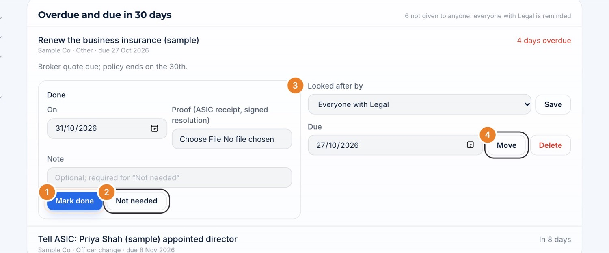

1. **Mark done:** with the date and the proof (the ASIC receipt or signed resolution).
2. **Not needed:** with a note saying why.
3. **Looked after by:** give it to one person; otherwise everyone with Legal is reminded.
4. **Move** the due date (it stays where you put it), or **Delete** an item added by hand.

Board & governance → **Deadlines** lists every company's deadlines:

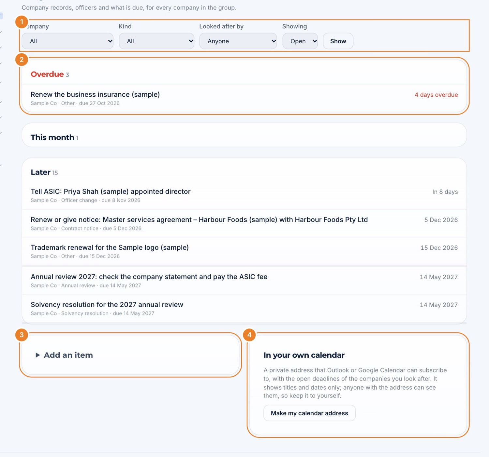

1. **Filters:** company, kind, who looks after it, open or done.
2. **Overdue · This month · Later.**
3. **Add an item** for any company.
4. **In your own calendar:** make a private calendar address and add it to Outlook or Google Calendar, so the deadlines appear there too.

> **Why it matters:** contracts, board meetings (minutes due in 30 days), share issues and option exercises add their own items too. Everything due is in one list, reminded automatically, with the proof kept beside it.

## Step 4 · Contracts

**Contracts** tab.

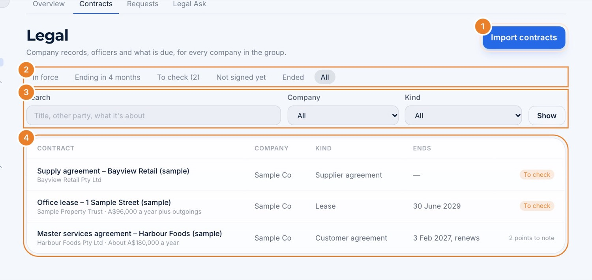

1. **Import contracts:** drop PDFs or Word files and Lakeba AI reads each one (about 1 to 5 cents a contract) into its parties, dates, value and key clauses. It starts as soon as a file is dropped, so drop each file once.
2. **In force · Ending in 4 months · To check · Not signed yet · Ended · All.**
3. **Search** by title, other party or subject; filter by company and kind.
4. **The list.**

Open a contract to check what was read:

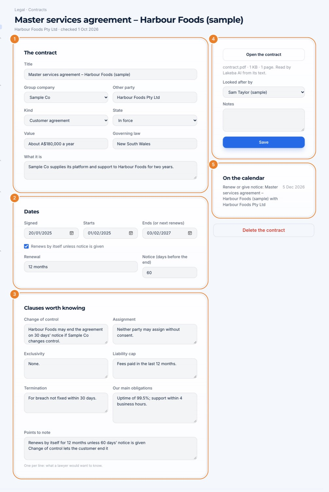

1. **The terms:** title, company, other party, kind, state, value, governing law and what it is.
2. **Dates:** signed, starts, ends (or next renews), whether it renews by itself, and the notice period.
3. **Clauses:** change of control, assignment, exclusivity, liability cap, termination and our main obligations, plus **Points to note**.
4. **Save and mark checked** once it is right (or **Save, check later**).
5. **On the calendar:** the notice date and end date it has added.

A contract still **to check** shows what Lakeba AI wasn't sure about:

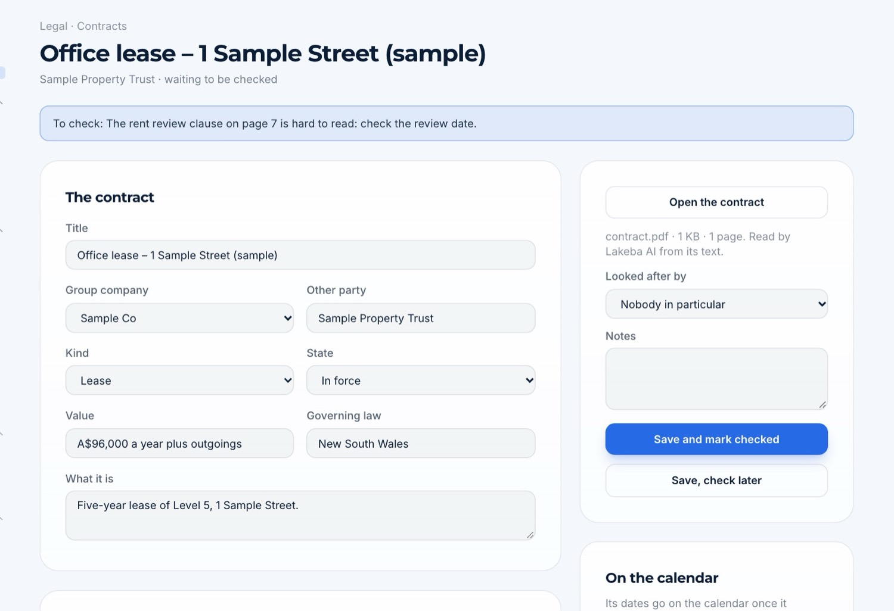

> **Why it matters:** only **checked** contracts add their notice and end dates to the calendar, so nothing renews by surprise. Board Ask and Legal Ask answer from them too.

## Step 5 · Legal requests

Anyone on staff, at Lakeba or a venture, asks Legal from **Legal requests**:

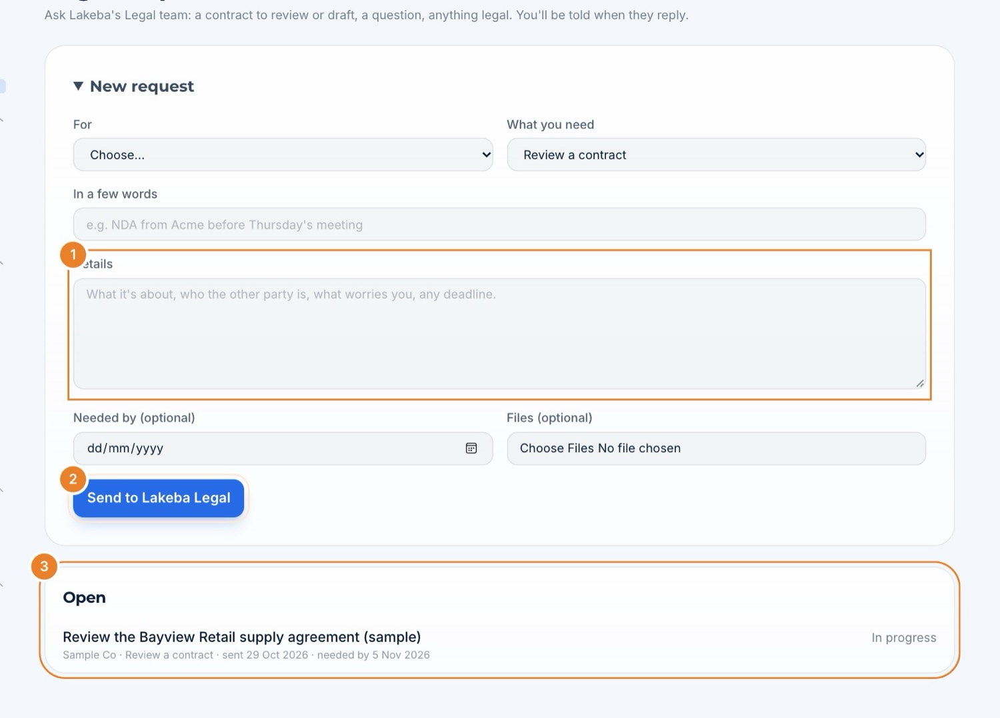

1. **What you need, in a few words, the details,** when it's needed by and any files.
2. **Send to Lakeba Legal:** Lakeba AI reads it first and prepares a triage for the Legal team.
3. **Open** requests and their state.

Legal sees them all under **Requests** (Open, Mine, Not given to anyone, Closed):

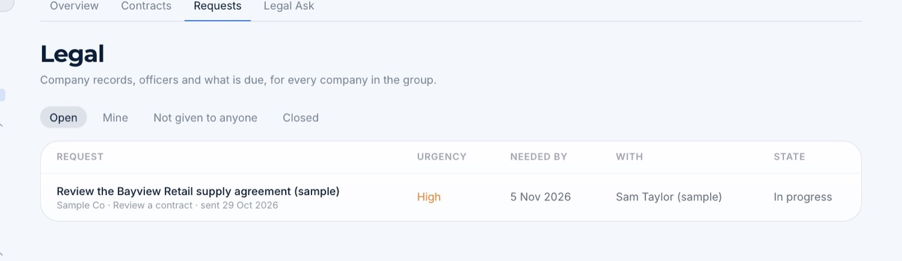

Open a request:

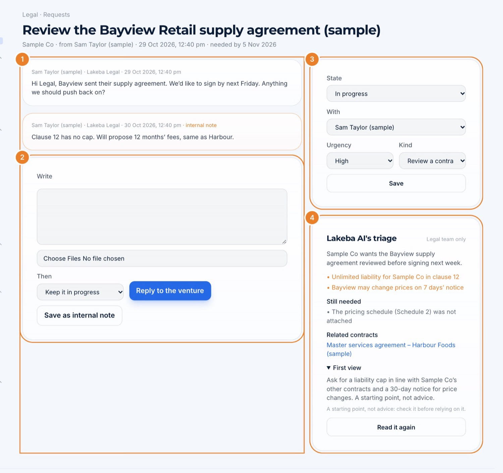

1. **The conversation.** Internal notes, in orange, are never shown to the person who asked.
2. **Write:** **Reply to the venture**, or **Save as internal note**, and choose what happens next (keep it in progress, waiting for the venture, done).
3. **State, with whom, urgency and kind.**
4. **Lakeba AI's triage** (Legal team only): a summary, points to watch, what is still needed, related contracts and a first view. It is a starting point, not advice.

## Step 6 · Legal Ask

**Legal Ask** tab: ask in plain words about the group's contracts, records, deadlines and board papers.

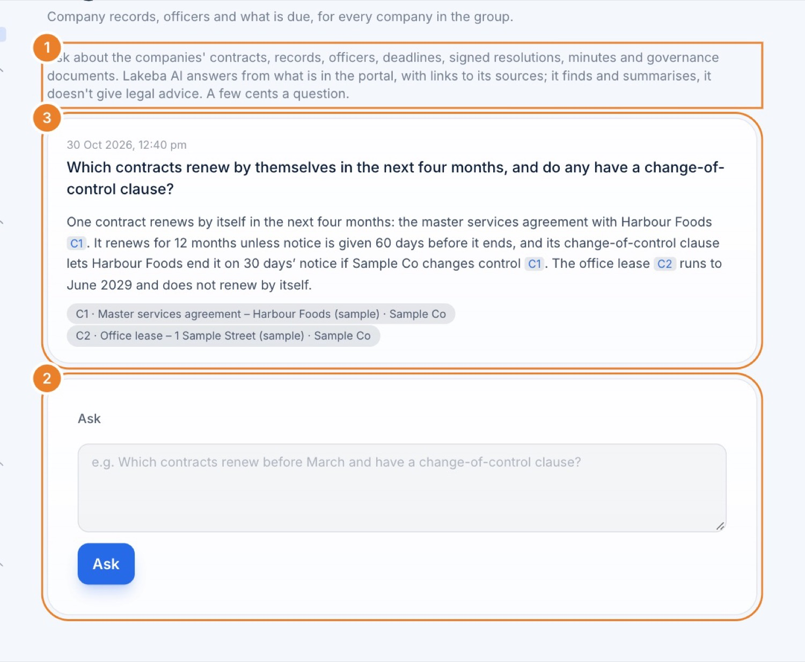

1. **What it reads:** the portal's own legal records.
2. **Ask**, or ask a follow-up (each question costs a little).
3. **The answer**, with numbered sources you can open.

## What it adds up to

| When this is in place… | …you get |
|---|---|
| Every company's record is complete | The annual review, solvency resolution and other deadlines worked out for you |
| Officers are up to date | "Tell ASIC" items for every change, the right attendees at board meetings, and signing in the portal |
| Contracts are imported and checked | Notice and end dates on the calendar, and answers about any clause in seconds |
| Items are given to someone and closed with proof | Reminders to the right person, and the evidence kept beside each deadline |
| Staff ask through Legal requests | One queue, triaged before you open it, with nothing lost in email |

## Checklist

- [ ] Legal role for the whole group
- [ ] Each company's record complete, ideally from a current ASIC extract
- [ ] Directors and secretaries with appointment dates and consents
- [ ] Contracts imported and each one checked
- [ ] Open deadlines given to someone, and done ones closed with proof
- [ ] Your private calendar address added to your own calendar
- [ ] Staff told to send legal questions through Legal requests