# Marketing and press on the Lakeba Portal: announcements, news, newsletters and press releases

Every picture below is the real portal, filled with **sample data** (a made-up company, Sample Co, with its own press desk, sample journalists and readers). The orange numbers match the notes under each picture. **Why it matters** says who sees what you publish, and when.

## First: which tool, when

The portal has four ways to tell people something. Choosing the right one is half the job.

| Tool | What it is | Who sees it | Use it for |
|---|---|---|---|
| **Announcement** | A banner at the top of the dashboard, optionally a one-time pop-up | One company's shareholders, staff, or both | Short, time-limited notices: "AGM papers are ready", "Office closed". Nothing is emailed |
| **News post** | An article | **Shareholder post:** that company's shareholders, in the portal. **Public post:** also on the company's website (and lakeba.com, for group news) | Updates, results, milestones. Can notify shareholders when it goes live |
| **Newsletter** | An email issue, with tracking | One company's shareholders, or the public subscriber list | The regular update that brings people back |
| **Press release** | A formal release with quotes, approval and a press kit | Journalists, the newsroom, social and wires; it also becomes a public news post | Announcements for the media |

> **The golden rules:** prepare, then let someone else approve; check where it will appear before you press Publish; and remember that shareholders can be notified once only.

## Before you start

- **Where:** Admin → **Communications**: News, Announcements, Newsletters, Press releases, LinkedIn campaign.
- **Your access:** the built-in **Marketing** role prepares news, newsletters and press releases. **Approvers** publish: by default Admins approve news posts, Admins and Compliance approve newsletters, and Admins and Legal approve press releases. A role can be given for one company only.
- **Two-step sign-in** is needed for the news and newsletter editors.

## Part 1 · Announcements

Communications → **Announcements**.

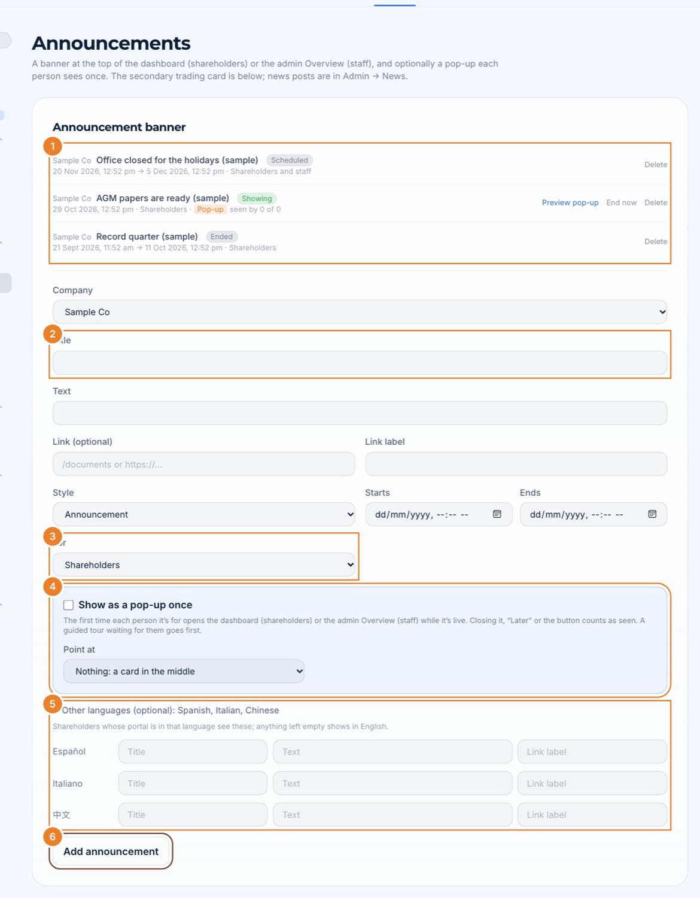

1. **The banners:** each with its company, dates and state (Showing, Scheduled, Ended), how many saw the pop-up, and **Preview pop-up**, **End now** or **Delete**.
2. **Title and text,** with an optional link and its label, and the **Style** (Announcement, Good news, Important). Set when it **starts** and **ends**.
3. **For:** shareholders, staff, or both (for staff, choose which area's staff).
4. **Show as a pop-up once:** each person sees it the first time they open the dashboard while it is live; it can point at a part of the page.
5. **Other languages:** Spanish, Italian and Chinese. Shareholders whose portal is in one of these see it in their language; anything left empty shows in English.
6. **Add announcement.**

> **Why it matters:** announcements are the quickest way to reach people who sign in, and they disappear by themselves on the end date. Nothing is emailed: for that, use a news post with notification, or a newsletter.

## Part 2 · News posts

Communications → **News**.

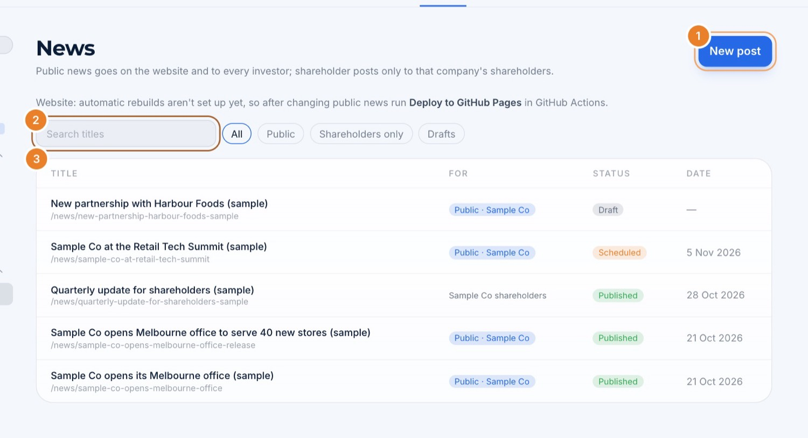

1. **New post.**
2. **Search,** and filter by All, Public, Shareholders only or Drafts.
3. **The list:** who each post is for, and whether it is a draft, scheduled or published.

Write the post:

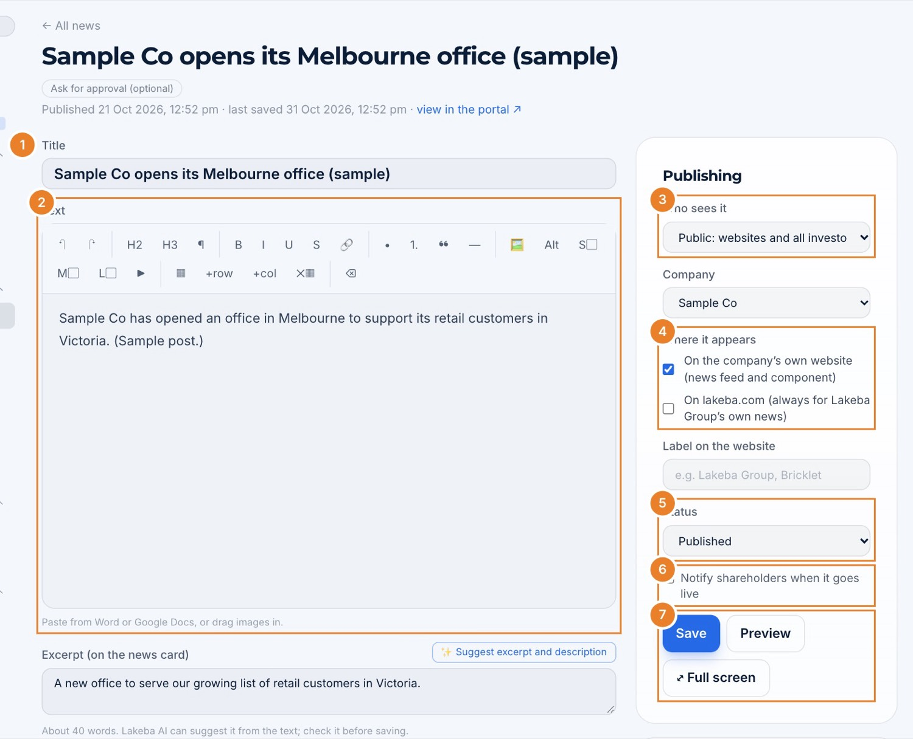

1. **Title.**
2. **Text:** paste from Word or Google Docs, or drag images in. Under it, the **Excerpt** for the news card (**✨ Suggest excerpt and description** drafts it from the text), and a **cover image**.
3. **Who sees it:** *Shareholders of the company* (in the portal only), or *Public: websites and all investors*.
4. **Where it appears** (public posts): *On the company's own website* (its news feed and component), and *On lakeba.com*, which only Lakeba's group editors can tick.
5. **Status:** Draft (not visible), Publish now, or Schedule.
6. **Notify shareholders when it goes live:** an Inbox message, a phone alert and an email (or a mention in the Monday digest, if that's what they chose).
7. **Save**, **Preview** and **Full screen**.

Further down: the web address and search description, categories, a social share image, and **Earlier versions** to restore. For press coverage you want to list, tick **Link only** and give the story's address and publication.

Scheduling a post:

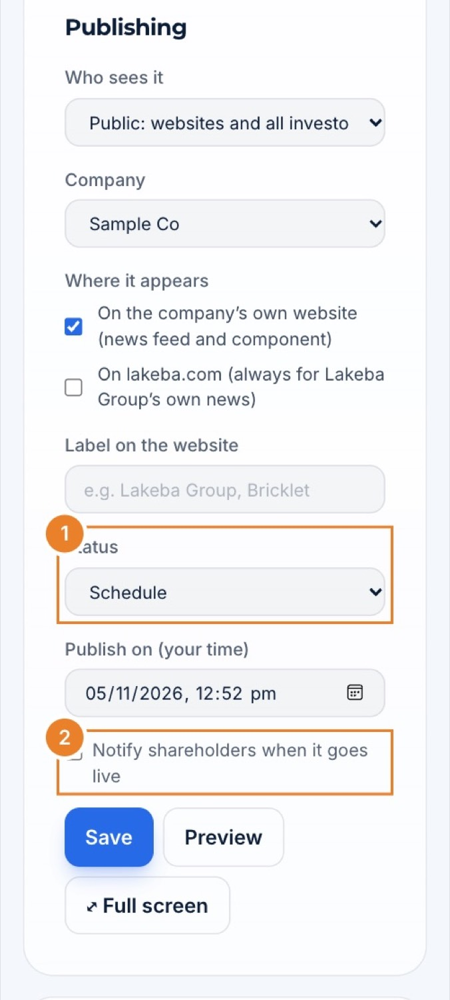

1. **Schedule,** with the date and time (your time).
2. **Notify** happens when it goes live.

> **Why it matters:** shareholders are notified **once**, so get the post right before it goes live. If approval was asked for, the post waits until it is approved; changing an approved post sends it back for approval. Public posts reach the website through its news feed, and appear on lakeba.com only when that box is ticked.

**Website news** (for whoever looks after the website, under Settings → Companies → the company → **Website news**): keys for the company's website to show its public posts, with the code snippets for the news component, the news API and the RSS feed.

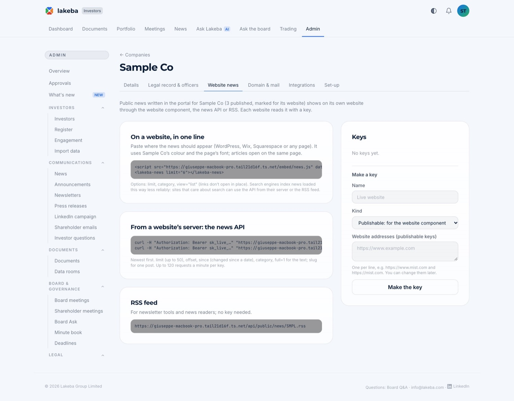

## Part 3 · Newsletters

Communications → **Newsletters**.

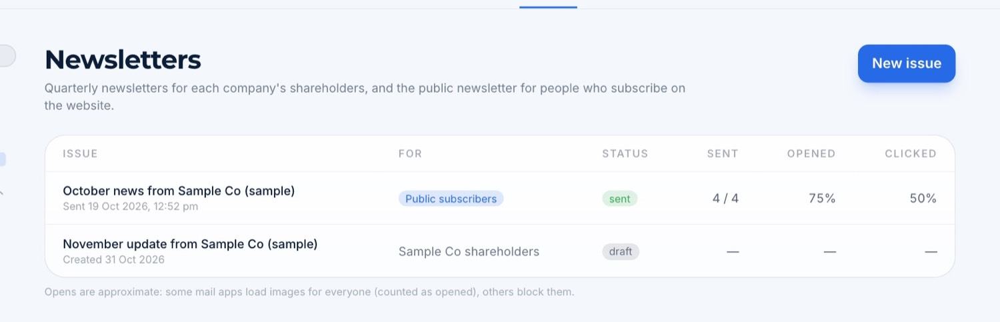

The list shows each issue's audience, status (draft, scheduled, sending, sent), and how many opened and clicked. Below it are your templates and the subscriber list.

### Start an issue

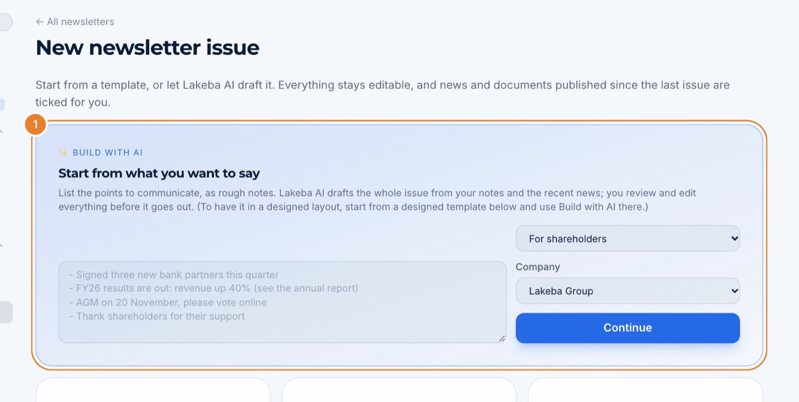

1. **✨ Build with AI:** write a short brief, choose shareholders or the public list and the company, and press **Continue**. Or start from a template.

### Write it

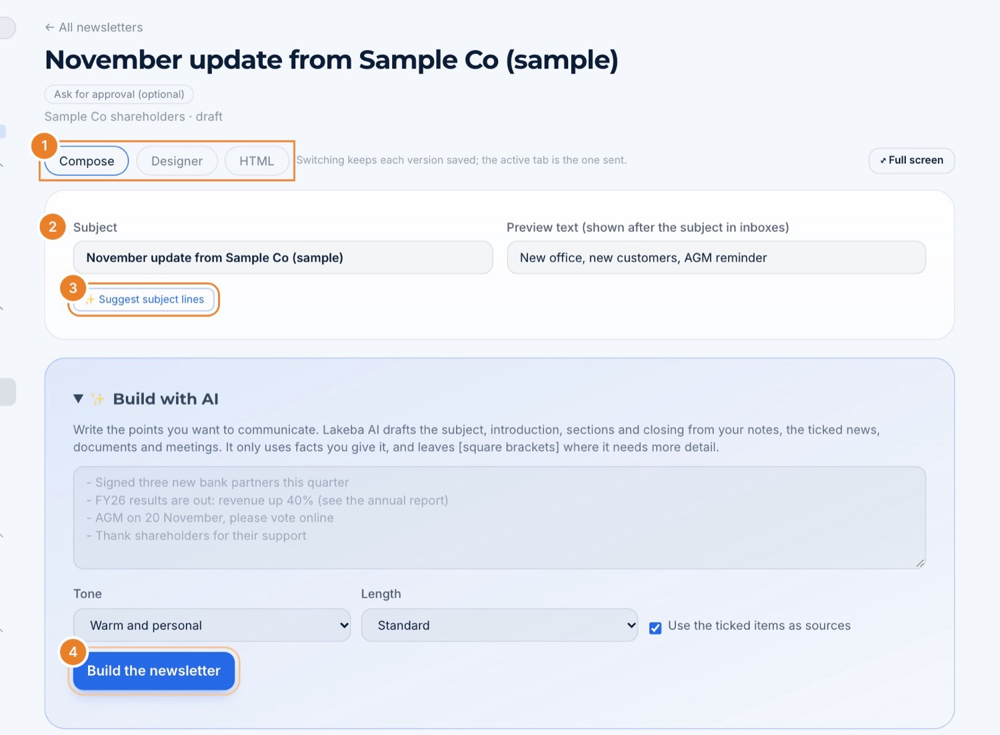

1. **Compose · Designer · HTML:** Compose fills a ready-made layout; Designer lets you arrange blocks; HTML is for a design made elsewhere.
2. **Subject** and **preview text** (shown after the subject in inboxes).
3. **✨ Suggest subject lines.**
4. **Build the newsletter:** Lakeba AI writes it from your brief and the items you tick, in the tone and length you choose. **Undo AI build** puts it back.

Then the introduction, your sections, and a closing button with its link.

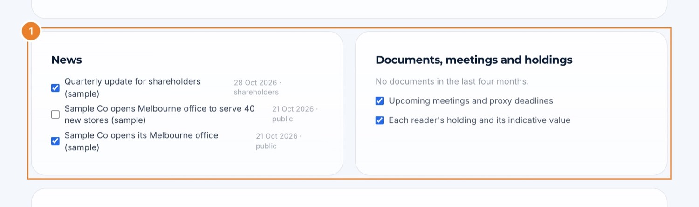

1. **Content:** tick news posts to include; for shareholders also documents, upcoming meetings and proxy deadlines, and **each reader's own holding and its indicative value**. **✨ Check the wording** reads it through.

### Send it

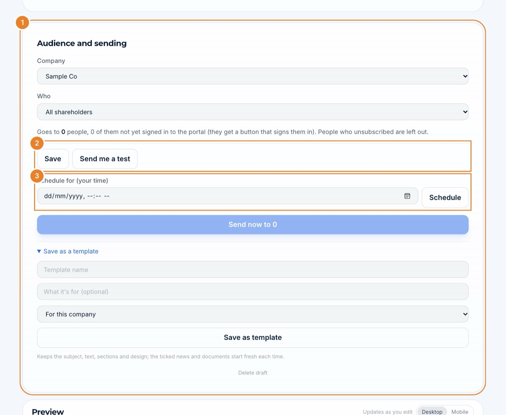

1. **Audience:** the company, and who: all shareholders, those who haven't signed in for 90 days, or holders of one share class. It shows how many it will go to.
2. **Save** and **Send me a test**: always read the test in your own inbox first.
3. **Schedule** for a date and time, or **Send now** to everyone.

After sending, the issue shows its results:

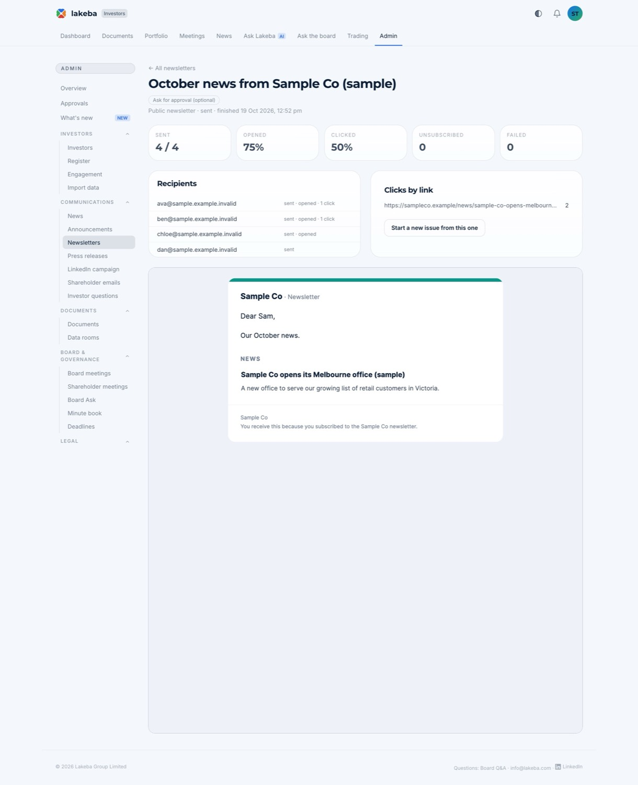

> **Why it matters:** shareholder issues go to the company's shareholders, except anyone who switched newsletters off. Public issues go to subscribers who confirmed their address. Every email has an unsubscribe link, opens and clicks are counted per link, and approval, when asked for, holds back scheduling and sending. **Start a new issue from this one** saves time next month.

## Part 4 · Press releases

Communications → **Press releases**. If you work for more than one press office, choose it at the top (**Press office:** Lakeba, or a venture with its own desk).

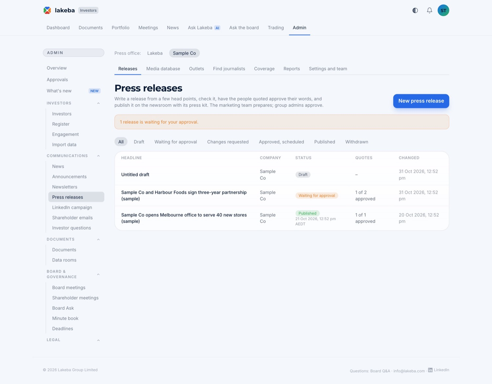

The list shows each release's state: Draft, Waiting for approval, Changes requested, Approved (scheduled), Published or Withdrawn, and whether its quotes are approved. Approvers see a banner when something waits for them.

### Write it

Press **New press release**.

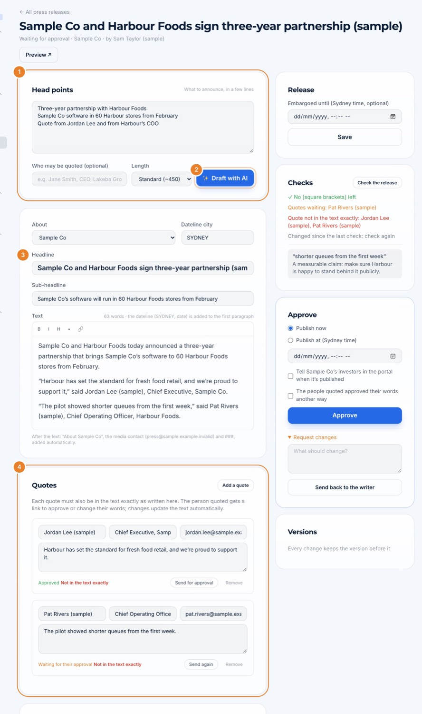

1. **Head points:** the facts, one per line, and who may be quoted. Choose the length.
2. **✨ Draft with AI:** Lakeba AI writes the headline (with alternatives), sub-headline and text in press-release style, from your points only.
3. **About** (the company), **dateline city**, **headline**, **sub-headline** and **text**: edit everything.
4. **Quotes:** each person's name, title, email and words. **Send for approval** emails each person a private link to approve or change their words.

Further down: a summary for newsrooms, the LinkedIn and X / Bluesky posts, and the picture and press kit.

### Check and approve it

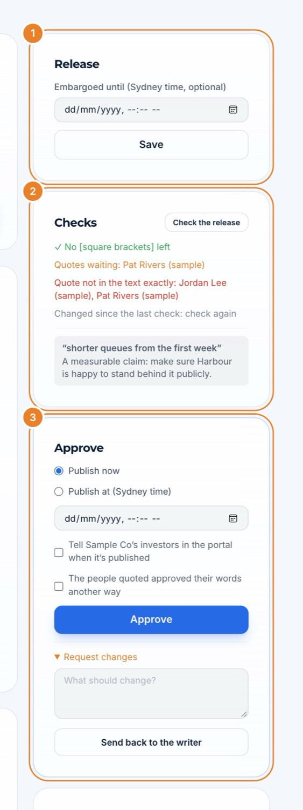

1. **Release:** an optional embargo (Sydney time), **Save**, and **Send for approval**: approvers are told.
2. **Checks:** **Check the release** reads it for problems: square brackets left in, quotes not yet approved, quotes not word-for-word in the text, and claims that need care.
3. **Approve** (approvers): publish now or at a set time; whether to tell the company's investors in the portal when it is published; confirm the quoted people approved their words; then **Approve**. Or write what should change and **Send back to the writer**.

> **The release can't be approved until** no brackets are left, it has been checked since the last change, serious points are ticked off, every quote appears exactly in the text and is approved, and any embargo has passed. Make it a rule that the person who approves is not the person who wrote it. Editing an approved release sends it back for approval.

### What publishing does

Once published, the release is on the newsroom with its PDF, and it becomes a **public news post** (category "Press release") with the dateline, the "About" text and the media contact.

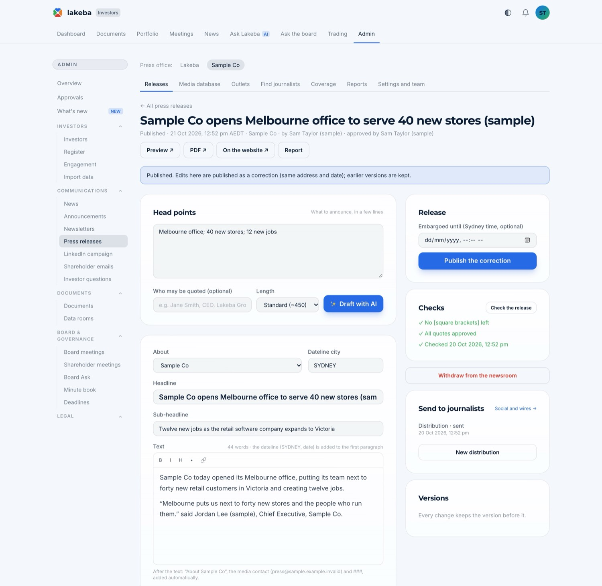

## Part 5 · Sending it to journalists

### The media database

**Media database** tab.

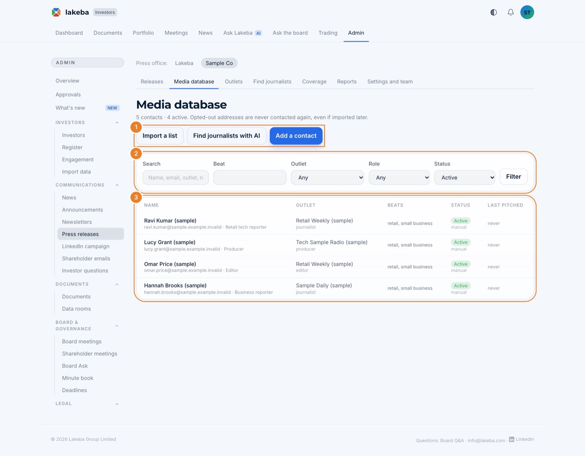

1. **Import a list** (a spreadsheet, with its columns matched), **Find journalists with AI**, or **Add a contact**.
2. **Filters:** search, beat, outlet, role and status.
3. **The contacts:** outlet, beats, status and when they were last pitched.

Each contact:

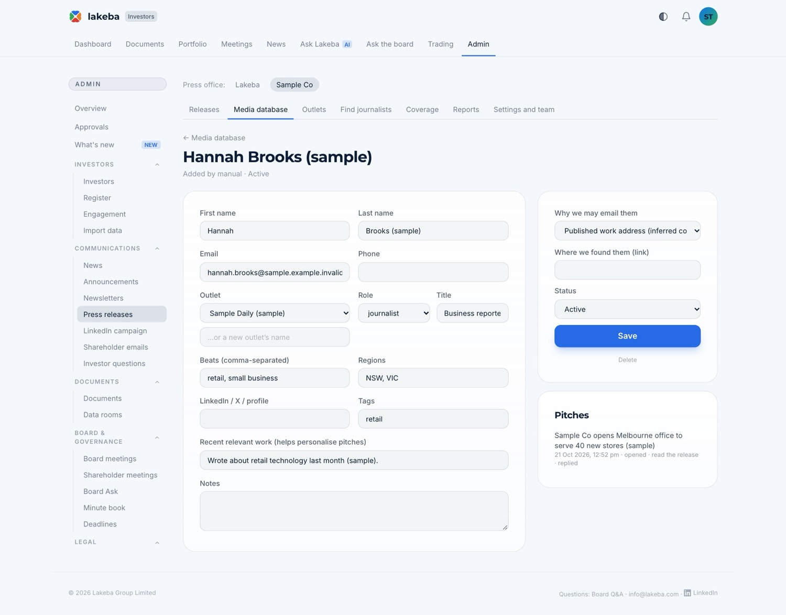

Keep **Why we may email them** and **Where we found them** filled in. Someone who opts out is never contacted again, even if imported later. **Outlets** keep each publication's type, reach, region and newsroom tip-line.

**Find journalists** searches the web for people who recently wrote about your topics, and lists them with what they wrote and why they fit; tick the right ones to add them.

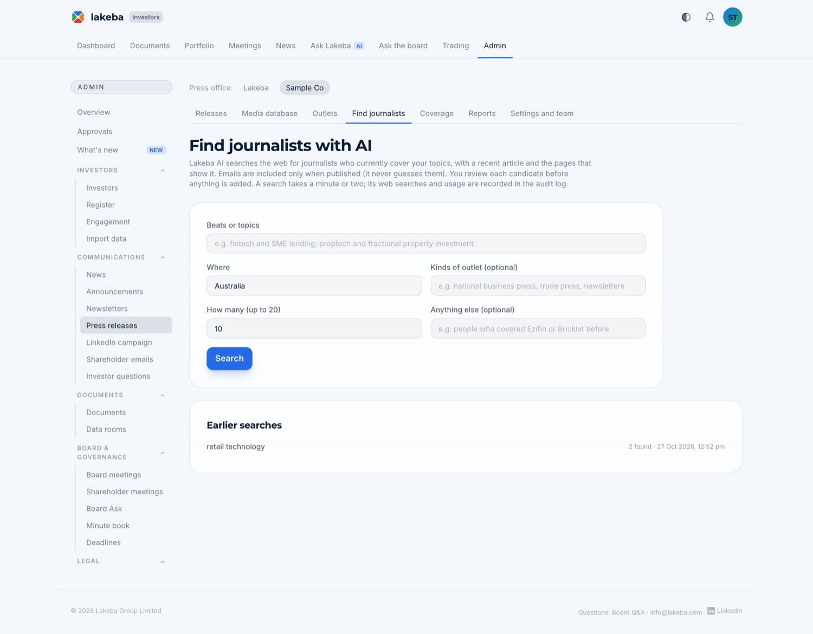

### A distribution

On the release, **New distribution**: choose who (beats, regions, tags, roles, outlets, newsroom tip-lines), write the subject and opening line, and say who is available for interviews. With **personalise** on, Lakeba AI writes each journalist a short opening based on their recent work. **Prepare the pitches**, read them, then an approver presses **Send**.

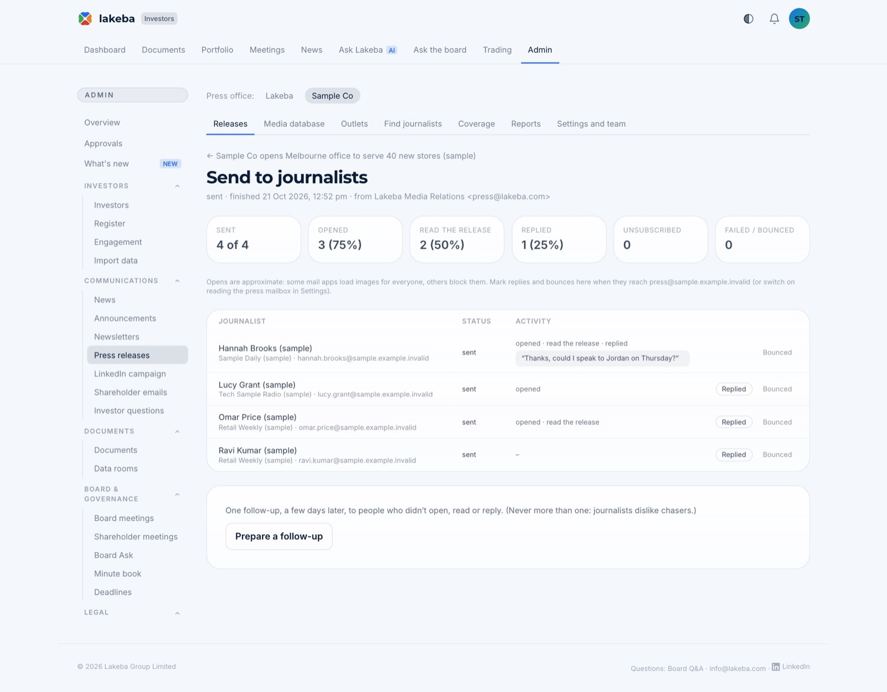

After sending you see who received, opened and replied, and you can mark replies and bounces and prepare **one** follow-up.

## Part 6 · Social media and wires

On an approved or published release, **Social and wires**:

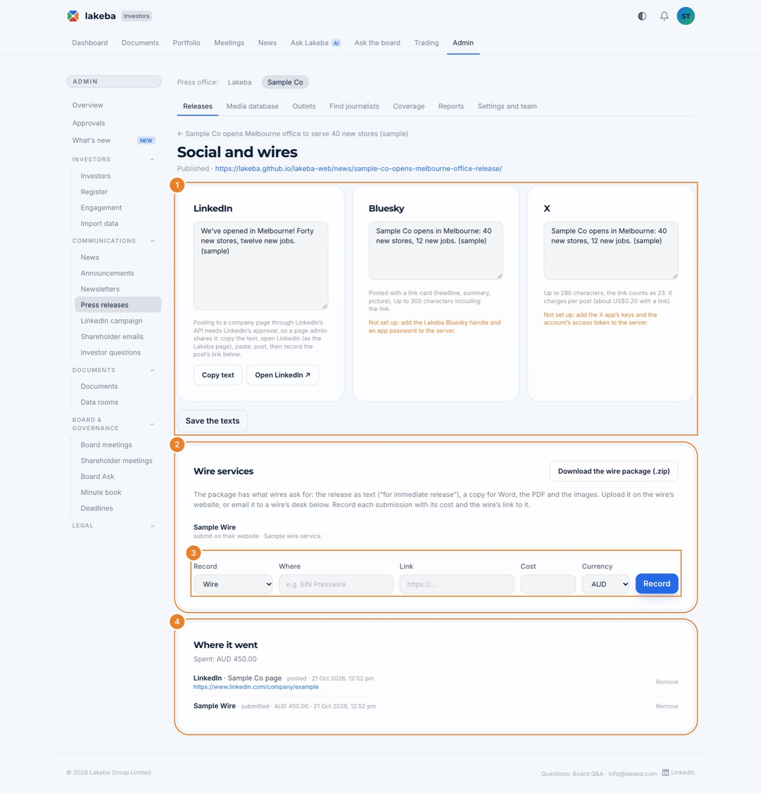

1. **Social:** the LinkedIn text (copy it and open LinkedIn), and post to Bluesky or X from here once published.
2. **Wires:** download the wire package (.zip) or email it to a wire service.
3. **Record** anywhere else it went, with the link and the cost.
4. **Where it went:** the full list, which feeds the reports.

## Part 7 · Coverage and reports

**Coverage** collects articles about the company: found by the monitor (feeds you list in Settings) or added by hand. Confirm what is real, dismiss the rest, and note the sentiment.

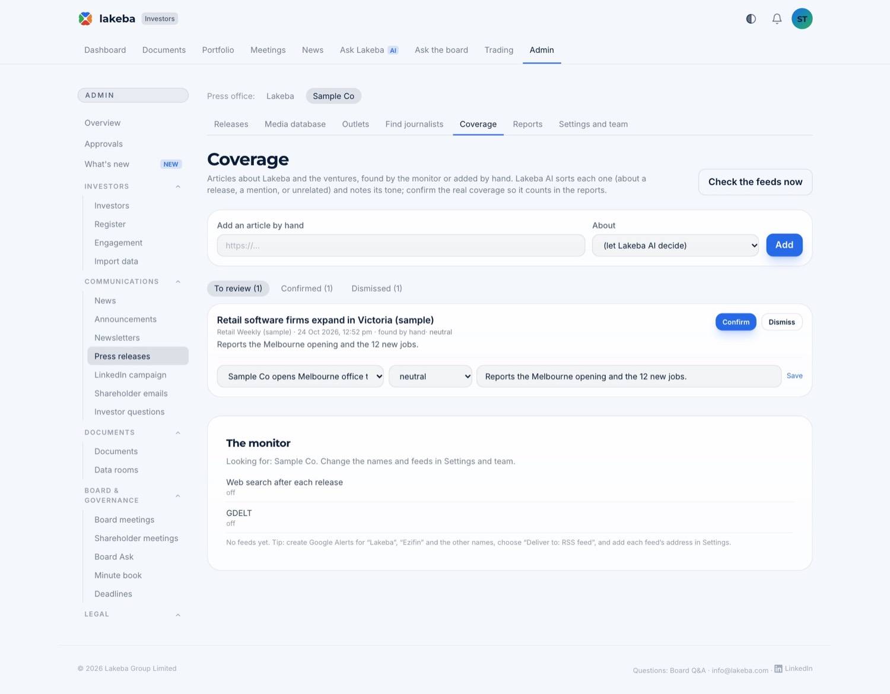

**Reports** shows, for any period, the releases published, pitches sent and opened, coverage confirmed and what distribution cost. Print it, save it as a PDF, or download the coverage as a spreadsheet.

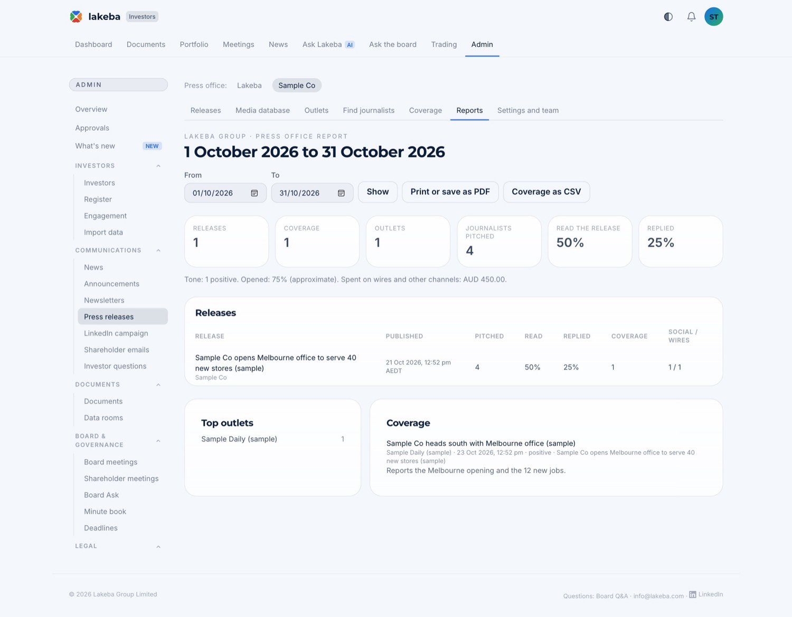

## Part 8 · Press office settings

**Settings and team** (approvers): the "About" text added to every release, the media contact, the usual dateline city, the names to watch for in the news, the feeds to monitor, wire services, and the press team.

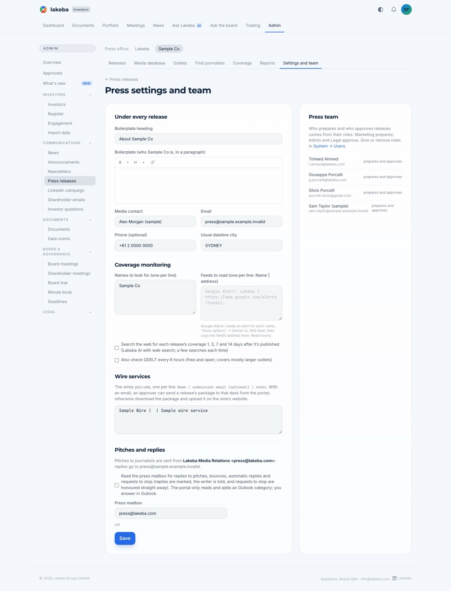

## A launch, start to finish

1. **Two weeks before:** write the release from head points; send the quotes for approval; find journalists and check the media list.
2. **One week before:** **Check the release**, send it for approval, prepare the distribution, and write the news post for shareholders and the newsletter item.
3. **On the day:** the approver approves (with an embargo or a publish time); the release goes to the newsroom and becomes a public news post; pitches go out; post on LinkedIn; add a dashboard announcement for shareholders.
4. **After:** mark replies, confirm coverage as it arrives, send one follow-up, include the story in the next newsletter, and run the report.

## What it adds up to

| When this is in place… | …you get |
|---|---|
| The right tool for each message | Shareholders, the public and the media each hear what they should, once |
| Approval used every time | A second person on everything that goes out, with the history kept |
| A clean media database | Pitches to the right people, and opt-outs respected automatically |
| Releases checked and quotes approved | No wrong numbers, no unapproved quotes, no brackets left in |
| Coverage confirmed and channels recorded | A report of reach and cost for every launch |

## Checklist

- [ ] Marketing role given, and an approver for each tool
- [ ] Press office settings: "About" text, media contact, dateline, team
- [ ] Media database imported or built, with "why we may email them" filled in
- [ ] News posts: audience and "where it appears" checked before publishing
- [ ] Newsletters: test sent to yourself before scheduling
- [ ] Releases: quotes approved and "Check the release" run before approval
- [ ] Coverage reviewed each week, report after each launch