# Selling with the Lakeba CRM: deals, quotes, Xero, your phone and marketing

Every picture below is the real CRM, filled with **sample data** (DoxAI Operations with made-up buyers marked "(CRM test)"). The orange numbers match the notes under each picture. **Why it matters** says what happens next, and who sees it.

## First: how the CRM works

The CRM keeps itself up to date. Emails, meetings, WhatsApp messages, deal-room visits and Xero changes land on each deal's timeline without anyone typing them. Lakeba AI reads it all and suggests the next step; **you decide**, and nothing goes to a buyer or to Xero without a person.

| You do | The CRM does |
|---|---|
| Create the deal, move it on, send quotes | Logs emails, meetings and calls; reminds you when a deal goes cold |
| Say how a meeting went (voice, WhatsApp or typed) | Files the note, updates the deal, proposes tasks |
| Prepare the quote | Copies it to Xero once approved; the buyer accepts it in the deal room |
| Nothing | Marks the deal **won when Xero says the invoice is paid** |

> **The golden rules:** one deal per opportunity, always with a next step and a date; tell the CRM after every meeting (20 seconds of voice is enough); and remember that won means paid.

## Before you start

- **Where:** Admin → **Sales** → **CRM**. If your company has its own CRM address (for example `crm.doxai.com`), you can open it there too, and install it on your phone (Part 6).
- **Your access:** the **Sales** role works on their own deals and unassigned ones and sees the team's pipeline. **Sales lead** also sees every deal, approves discounts over the limit and sets up the CRM. The **Marketing** role sees only the marketing pages (Part 8).
- **Several companies?** Use **Switch** at the top. Each company's deals, quotes and settings stay apart; people and companies are known once across the group.

## Part 1 · Today

The CRM opens on **Today**.

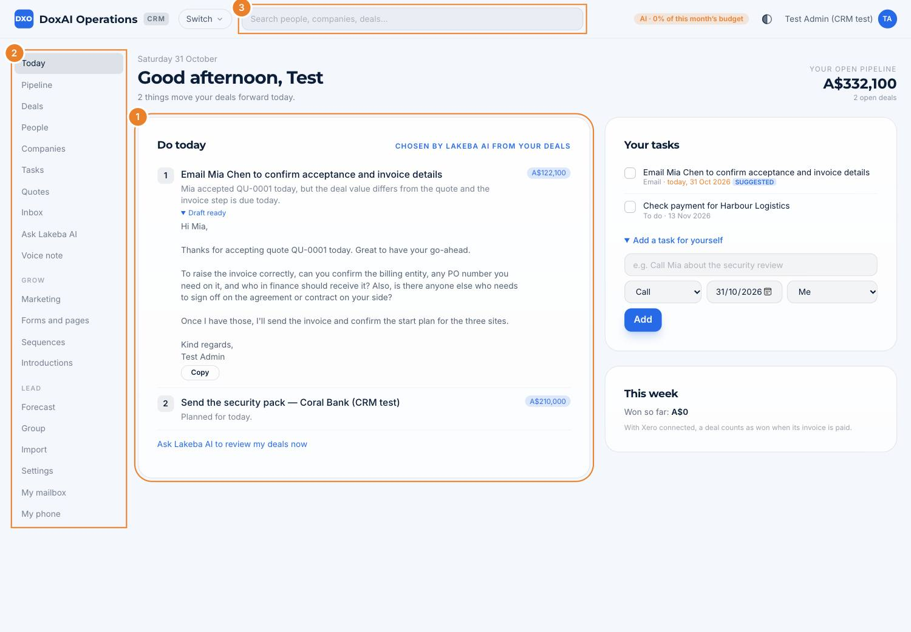

1. **Do today:** the few things that move your deals forward, chosen by Lakeba AI each morning. A ready email draft sits under its step: **Copy** it into your mailbox, check it, send it.
2. **The menu:** Today, Pipeline, Deals, People, Companies, Tasks, Quotes, Inbox (emails from unknown business people found in your mailbox), Ask Lakeba AI and Voice note; then **Grow** (marketing) and **Lead** (forecast, settings, your mailbox and phone).
3. **Search** people, companies and deals from any page.

On the right: **Your tasks**, with **Add a task for yourself**, and **This week**: what you've won so far.

> **Why it matters:** five minutes on Today each morning is the habit the CRM is built around. The suggestions come from what's in the CRM, so the more it knows, the better they get.

## Part 2 · The pipeline and new deals

**Pipeline**: every open deal by stage.

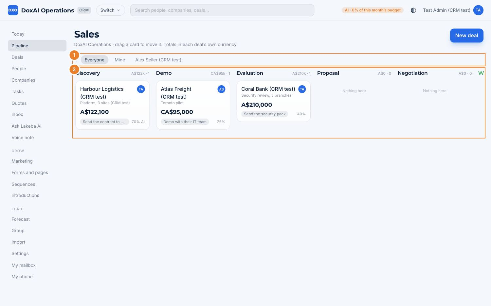

1. **Everyone**, **Mine**, or one salesperson.
2. **The stages,** with each column's total and count. **Drag a card** to move a deal on. Each card shows the value (in the deal's own currency), the next step and the chance of winning (marked **AI** where Lakeba AI's view differs from the stage's).

New deal: **Deals** → **New deal**.

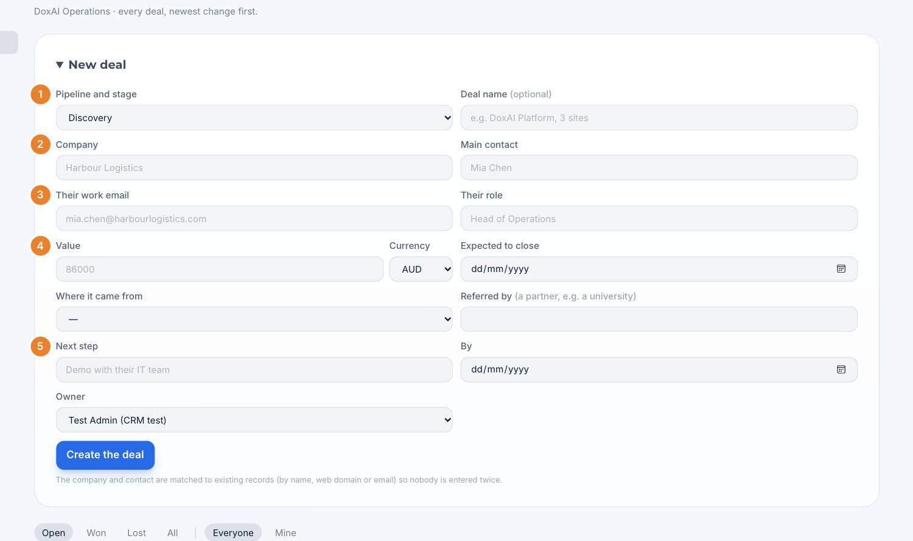

1. **Pipeline and stage.**
2. **Company** and **main contact.**
3. **Their work email** and **role.** The company and person are matched to existing records (by name, web domain or email), so nobody is entered twice.
4. **Value, currency** and **expected to close.** Also **where it came from** and **referred by** (a partner, such as a university).
5. **Next step** and **by** when. Choose the **owner** and **Create the deal**.

> **Why it matters:** the value, close date and next step drive the forecast, Today's suggestions and the "going cold" reminders. A deal without a next step is a deal nobody is working on.

## Part 3 · A deal

Open any deal.

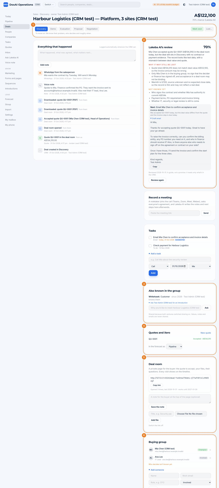

1. **The stages:** click one to move the deal on. Under them, **what must be true to move on** (your sales lead sets these). **Mark won** by hand only when there's no Xero invoice; **Lost…** asks why.
2. **Lakeba AI's review:** its chance of winning, why it may still be lost, what isn't known yet, and the next step, with a draft email. **Review again** after big changes. It is a guide, not a promise: it only reads what's in the CRM.
3. **Also known in the group:** another Lakeba venture knows this company or person, and who owns that relationship. **Ask for an introduction** goes to that owner. Values, notes and emails are never shared.
4. **Quotes and Xero:** the deal's quotes and their state; **New quote**. **In the forecast as:** Pipeline, Best case or Commit.
5. **Deal room:** a private page for the buyer (Part 4). Copy the link, add a note at the top, add files (a security pack, a case study). Every visit shows on the timeline.
6. **Buying group:** everyone involved, with their part (Decides, Champion, Influences, May block, Will use it, Involved). The CRM warns when nobody who decides is known yet.

On the left, **Everything that happened**: notes, emails, meetings, WhatsApp messages, voice notes and deal-room visits, newest first, with **Add note**. On the right, **Record a meeting** (a notetaker joins the call and writes the notes and next steps here afterwards, after asking everyone's agreement) and the deal's **Tasks**.

## Part 4 · Quotes, the deal room and Xero

From a deal: **Quotes and Xero** → **New quote**.

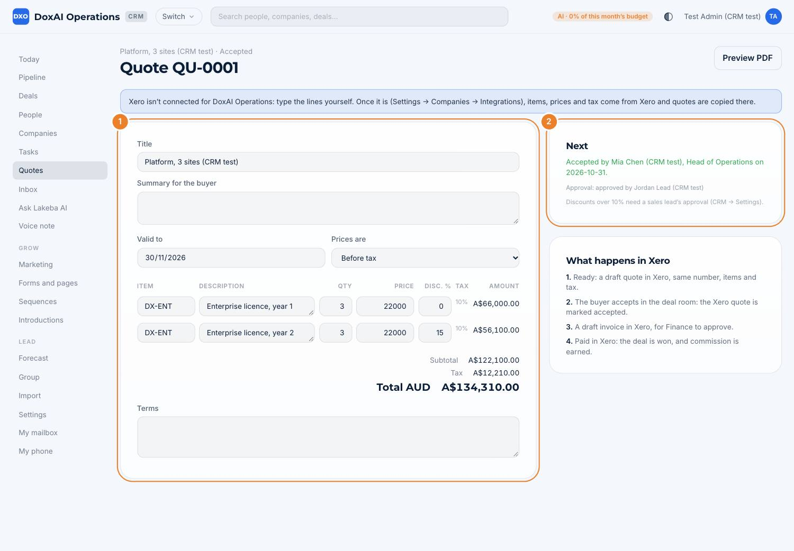

1. **The quote:** title, a summary for the buyer, valid to, prices before or after tax, and the lines. With Xero connected, items, prices and tax rates come from Xero. Totals add up as you type; **Preview PDF** shows what the buyer gets.
2. **Next:** where the quote stands. Discounts above the company's limit (10% here) need a sales lead's approval first; they're asked in Approvals and you're told when it's done.

**What happens in Xero:**

1. **Ready:** a draft quote is created in Xero with the same number, items and tax.
2. The buyer **accepts** in the deal room: the Xero quote is marked accepted and the deal moves to its last stage.
3. **Raise the invoice** creates a draft invoice in Xero, for Finance to approve.
4. **Paid in Xero:** the deal is **won**, and commission is earned.

What the buyer sees, without an account:

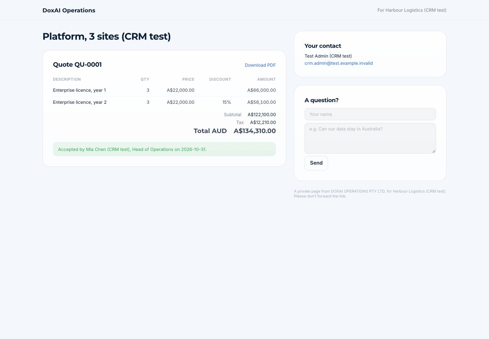

The quote with **Download PDF**, the button to accept it (name and role), their contact at your company, and **A question?**, which comes to you as a notification and lands on the timeline.

> **Why it matters:** quotes are prepared once and Xero stays consistent with the CRM, so the forecast, the board's figures and commissions all use the same numbers. Never re-type a CRM quote in Xero.

## Part 5 · Telling the CRM how it went

**Voice note** (also on your phone).

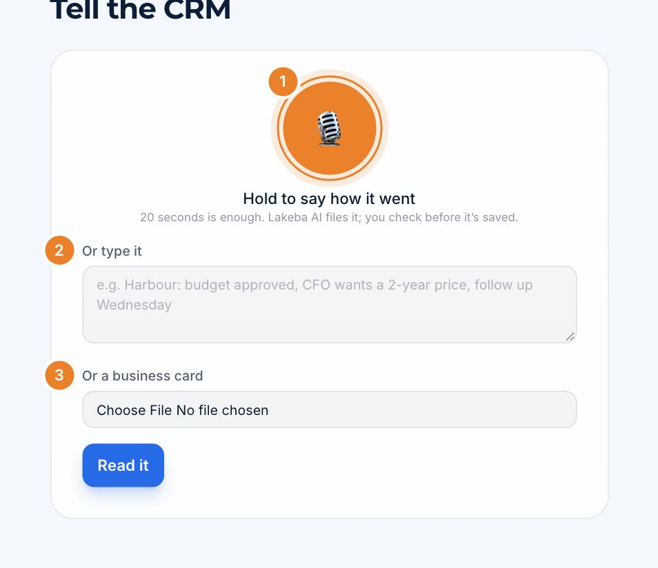

1. **Hold to say how it went:** "Harbour: budget approved, the CFO wants a two-year price, follow up Wednesday."
2. **Or type it.**
3. **Or a business card:** a photo of it adds the person.

Lakeba AI shows what it understood (which deal, a note, a stage change, new tasks, new people) and **you check before it's saved**.

## Part 6 · Your phone: WhatsApp and the app

**My phone**.

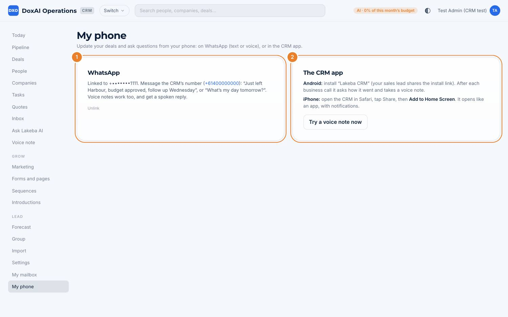

1. **WhatsApp:** link your mobile once (the page gives you a code to send). Then message the CRM's number in text or voice: "Just left Harbour, budget approved, follow up Wednesday", or ask "What's my day tomorrow?". Voice notes get a spoken reply. Only your own deals are updated.
2. **The CRM app:** on **Android**, install "Lakeba CRM" (your sales lead shares the link); after each business call it asks how it went and takes a voice note. On **iPhone**, open the CRM in Safari, tap Share, then **Add to Home Screen**.

**My mailbox** connects your work mailbox and calendar, so emails with known people and your meetings appear on their timelines by themselves, and Lakeba AI can prepare a brief before each meeting.

> **Why it matters:** the CRM is only as good as what it knows. Sixty seconds after each meeting, from wherever you are, keeps your deals, the forecast and your Today list right.

## Part 7 · For sales leads: forecast and settings

**Forecast**: the quarter.

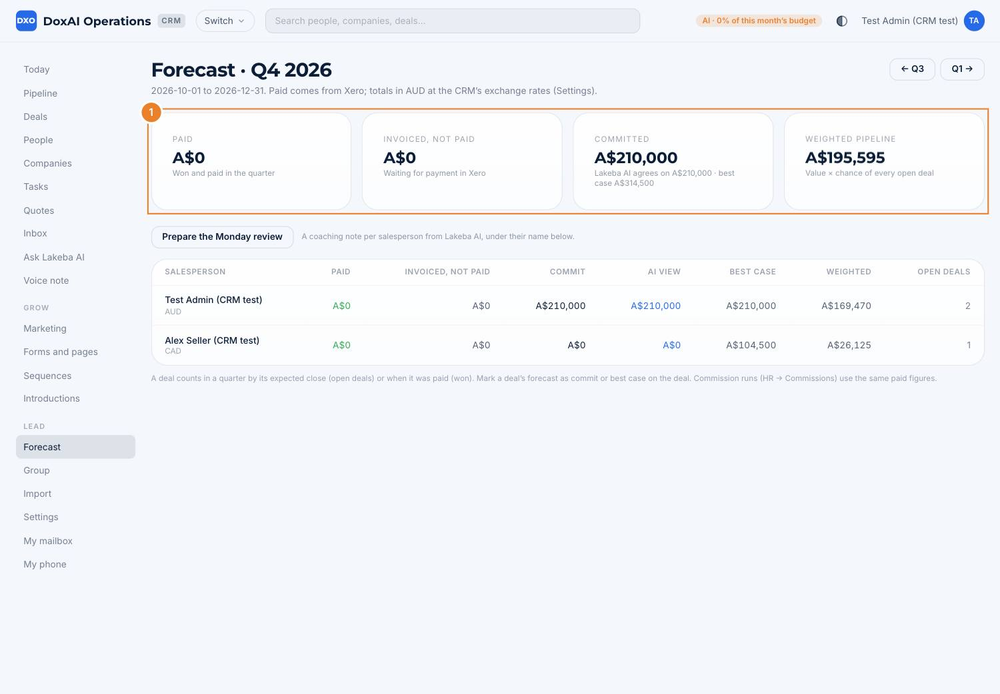

1. **Paid** (won and paid in the quarter, from Xero), **Invoiced, not paid**, **Committed** (deals marked Commit, with Lakeba AI's view and the best case) and the **Weighted pipeline** (value × chance of every open deal). All in A$ at the CRM's exchange rates.

Under it, each salesperson's figures, and **Prepare the Monday review**: a coaching note per salesperson from Lakeba AI. **Group** shows every venture's CRM side by side (Lakeba's group staff only).

**Settings** (sales leads and Admins):

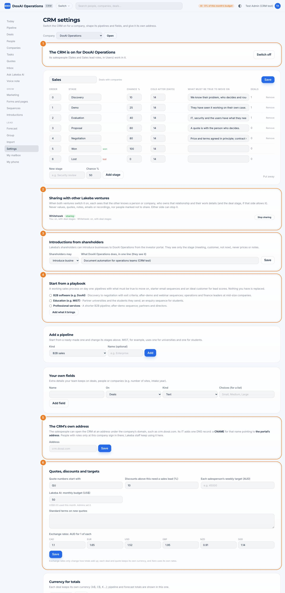

1. **The CRM is on** for the company; its salespeople are given the **Sales** and **Sales lead** roles in Users.
2. **Sharing with other Lakeba ventures:** starts only when both ventures switch it on; either can stop it. Choose whether your deal stages are shared too.
3. **Introductions from shareholders:** whether shareholders may introduce businesses from the investor portal, and the one line they see about what you do.
4. **Start from a playbook:** ready-made pipelines with exit criteria, starter email sequences and an ideal customer (B2B software, education, professional services).
5. **The CRM's own address,** such as `crm.doxai.com`: your IT person adds one DNS record.
6. **Quotes, discounts and targets:** quote numbers, the discount above which a sales lead approves, each salesperson's weekly target, Lakeba AI's monthly budget (Admins set it), standard quote terms and exchange rates.

Above these: the pipelines and their stages (chance, days before a deal is "cold", what must be true to move on), extra pipelines and **your own fields**. **Import** brings in spreadsheets or CSV exports from HubSpot, Salesforce or Pipedrive, or HubSpot directly; importing again adds only what's new.

## Part 8 · Marketing: campaigns, forms and sequences

**Marketing** (Grow). Measured in cash paid in Xero, not clicks.

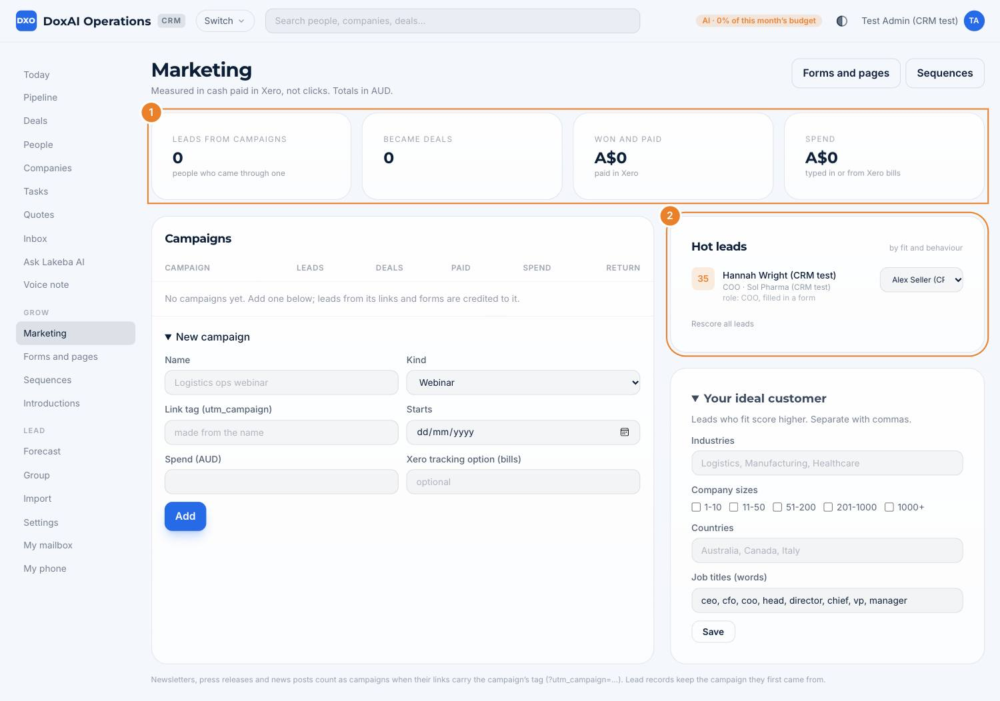

1. **Leads from campaigns, became deals, won and paid, spend.** Each campaign has a link tag (`utm_campaign`): newsletters, press releases and posts count as campaigns when their links carry it. Spend is typed in, or read from Xero bills tagged with the campaign.
2. **Hot leads:** scored by how well they fit **your ideal customer** (set on the right) and what they've done. Give one to a salesperson from the list.

**Forms and pages**: a form for your website, or a page of its own.

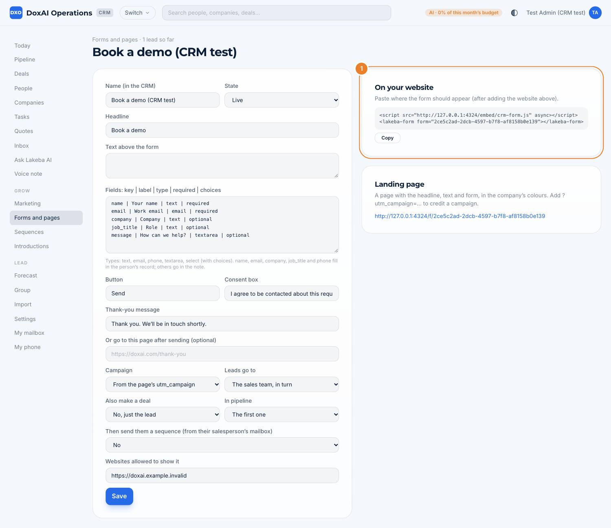

1. **On your website:** paste the two lines where the form should appear (after adding the website under **Websites allowed to show it**). Or use the **Landing page** link.

Each form sets its fields, consent box and thank-you message, the **campaign** it credits, **who gets the leads** (one person, or the team in turn), whether it **also makes a deal**, and whether to **send a sequence**. **Sequences** are short series of emails sent from the salesperson's own mailbox; they stop on a reply, a meeting or an opt-out, and every email has an opt-out link.

> **Why it matters:** every lead lands in the CRM with its campaign, its owner and a notification, so nobody has to copy a form into a spreadsheet, and the marketing report shows which campaigns brought customers who paid.

## Quick reference

| I want to… | Go to |
|---|---|
| See what to do today | **Today** |
| Move a deal on | **Pipeline** (drag), or the stages on the deal |
| Log a meeting | **Voice note**, WhatsApp, or **Add note** on the deal |
| Send a quote | Deal → **New quote** → approval if needed → deal room link |
| Know when a deal is won | Automatically, when its Xero invoice is paid |
| Meet someone another venture knows | Deal or company → **Also known in the group** → ask for an introduction |
| See the quarter | **Forecast** |
| Capture website leads | **Forms and pages** |
