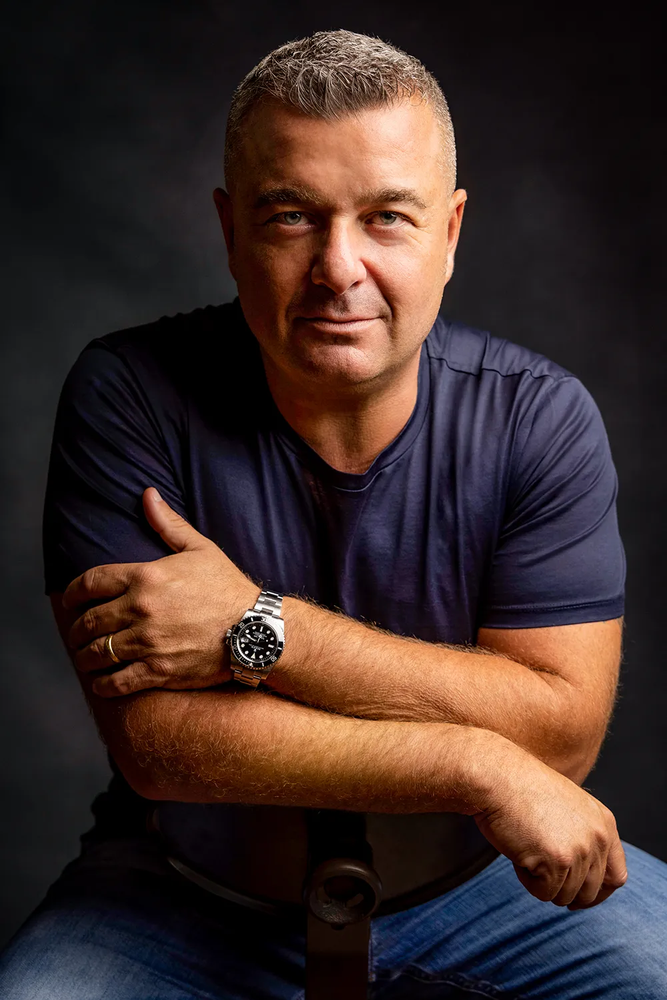
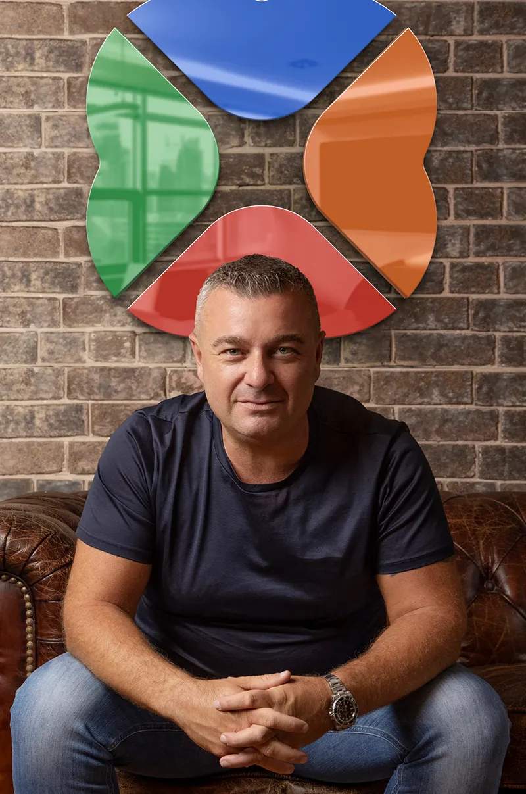

GIUSEPPE PORCELLI: THE WORLD'S A STAGE

*Words: Tinni Bhattacharya*

The story started in one of the most vibrant and dynamic metropolises of Italy, ‘Naples’. Growing up on the tough streets of Italy and with entrepreneur parents, Giuseppe knew the plot of his life from the very beginning. From a very young age, he knew he was destined to drive revolutionary change that would contribute much to transforming people’s lives. 

He has always been at the forefront of delivering change through the insights, innovations, and relevance of his products to the world. Giuseppe has always had the right formulaic blend of entrepreneurial skills. His first product, back in Italy got commercial acceptance in no time. 

He is continually exploring for new business and ideas together with expanding his already far-reaching network. He achieves this through his strong sense of knowing what people and the market want, which is supported by his focus on research to confirm his thoughts. This combination is the driver for his new ideas for business and products. 

Since the beginning of this century, as technology started becoming increasingly important, Giuseppe knew his true calling lay in this world of automation. In no time he was helping businesses “Win with IT”. Gradually Giuseppe started developing tech-enabled products and business models. Just like technology his presence was increasingly felt in society. 

“Technology can be found anywhere from phones to cars that people drive every day. As technology started advancing, scientists, businessmen, bankers and doctors started believing in new tech. This is where I started building technology platforms as new technologies have been the centre of the trend. From mobile-first consumers to the promise of critical decisions making... all have reshaped the competitive landscape and disrupted the business model. Ultimately it is the technology which will drive the business”. 

Giuseppe’s steadfast unfaltering drive brought him to Australia which he believes is the land of opportunity. Lifestyle, people, climate and landscape together make this continent special. Nature has always been his kin; he has always felt a sense of belonging as a part of this wider universe. Coming from Naples, Giuseppe felt a close connection with the sea. 

“All the reason why I created this insulated enclosure on the seaside of Sydney where I can curate and seed promising new ventures or many more complex technologies under a controlled and protective environment. Each of these ventures is like my baby whom I want to keep safe and cozy before they independently go out into the globally competitive hi-tech world. These advanced technologies are often derived out of thorough research and development.” 

“I've always liked to see this creative space of mine as a small open island and not a closed apparatus. Hence, I have built it in an open space surrounded by sea on all sides. I chose Manly and named my business after an island called "Lakeba", a small island in Fiji, where there is blissful, turquoise water and pure white sand......a jewel in the South Pacific. 

> *“The Lakeba I created is a technology haven connecting people and the universe. As I believe in this venture catalyst firm; with technology, we will be able to create a forest of sunflowers in an oasis of the future”.*  

Given the strength of its intellect and a new global reality, Lakeba is an all-purpose incubator that considers all kinds of technologies regardless of industry. 

“Here we conceive, create, and commercialise digital technologies into successful businesses. There are various ventures we have created that have later transformed into mature revenue and profit generating businesses. The technologies are developed in Sydney, Australia and supported by other offices in Italy, India, the UK and the US. Here we are engineering future technologies and accelerating business towards a better tomorrow”. 

Blessings and acknowledgement have always paved his way. This has ignited Giuseppe's passion to continue to explore and seek new and vibrant pathways. 

 “Right from the days when I conceived ‘Voice Pro’, which was highly acknowledged by Google, to the development of Senior card with the Australian Government support, I could see the guiding light which has always been there for me to drive my businesses. Priorities and opportunities evolve naturally and simplify our path. For me, it has always been about exploring the soul”. 

Lakeba's partnership with the tech giant, Microsoft has also been fortuitous. It has allowed us to leverage, speed up, integrate and scale our services and capacity to provide many more tailor-made technical business environments which have ultimately helped businesses reach their full potential. 

I aim to develop many more businesses in a short time. That is only possible when technology meets business. At Lakeba, whether it’s finance, property, retail, vehicles, or mobile app, we have created youthful, engaging, sophisticated, galactic technology as the most functional element for various business sectors. 

The longevity of his presence has made him realise that there is no future in doing what you have always done. You must continue to listen and evolve. 

“I always been chasing change. Today my concentration is on AI and quantum computing and I have been successful in transforming financial sectors and many more by introducing various aspects of technology to them". Artificial intelligence algorithms are designed to make decisions, often using real-time data. They are unlike passive machines that are capable only of mechanical or predetermined responses. 

Using sensor digital data, or remote inputs, they combine information from a variety of different sources, analyse the material instantly, and act on the insights derived from the data. With massive improvements in storage systems, processing speed, and analytical techniques, they are capable of tremendous sophistication in analysis and decision making. AI can learn and adapt as they make decisions. So, it is Man’s newfound friend. 

The Midas of the software sector, Giuseppe is transforming the digital world into one of innovation, collaboration and efficiency. Living with the pandemic for the past three years, the business sectors have realised physical proximity in business is getting difficult. With his Midas touch, he has provided digital solutions to every service sector. He strongly believes that technology has the power to alter the financial industry and many others. 

By using technologies like quantum technology, artificial intelligence, machine learning, virtual reality and blockchain, Giuseppe is the only answer for the new tomorrow. 

> *“The New Era computing, which I believe will be the next thing which will alter the world and will raise new questions for the society. And I aim to make use of it and keep connecting the two worlds of business and technology, thus ushering in a new age of human civilisation".*  

"This computing environment will be leveraging and addressing a significant demand for a secured computational habitat. We will be able to showcase to various new business entrepreneurs how to explore the landscape of today’s ever- evolving world through technical rationale and roadmap”. 

Giuseppe's closeness and attachment to his family has augmented Lakeba's growth even more. 

He has been able to create a perfect blend of work and home. The involvement of all the members of his family in Lakeba has made everyone realise that they are dealing with a company that’s going to be around for a long time. 

“I love to spend a lot of time with my family. I have never felt the need to create a separate world between the two. Even when it comes to business talk and meetings, I always invite my business friends or colleagues to my home and cook food for them myself. I prefer closing any business deal in my house around my dinner table with a pallet of food that I have cooked myself. I am a wonderful chef”. 

“My next destination will be New York. Relying on the significant influence that New York has on finance, commerce, culture, and technology today, operating an office also in New York I believe, will give me more centralised hold in the world market". 

He wants to grow Lakeba as a diverse and prolific business builder. From Italy to Australia to New York, the whole world is his workplace. But his holiday destination will always be his home ‘Naples’.

> *“A perfect Italian at heart, Giuseppe is making the whole world his home. But Naples remains his holiday destination always.”*  

“It is the roads of Naples surrounded by gorgeous mansions and tall palm trees, where I always want to return after every new journey.” 

**Author**:  
Tinni Bhattacharya  
Communication Specialist  
Lakeba Group
