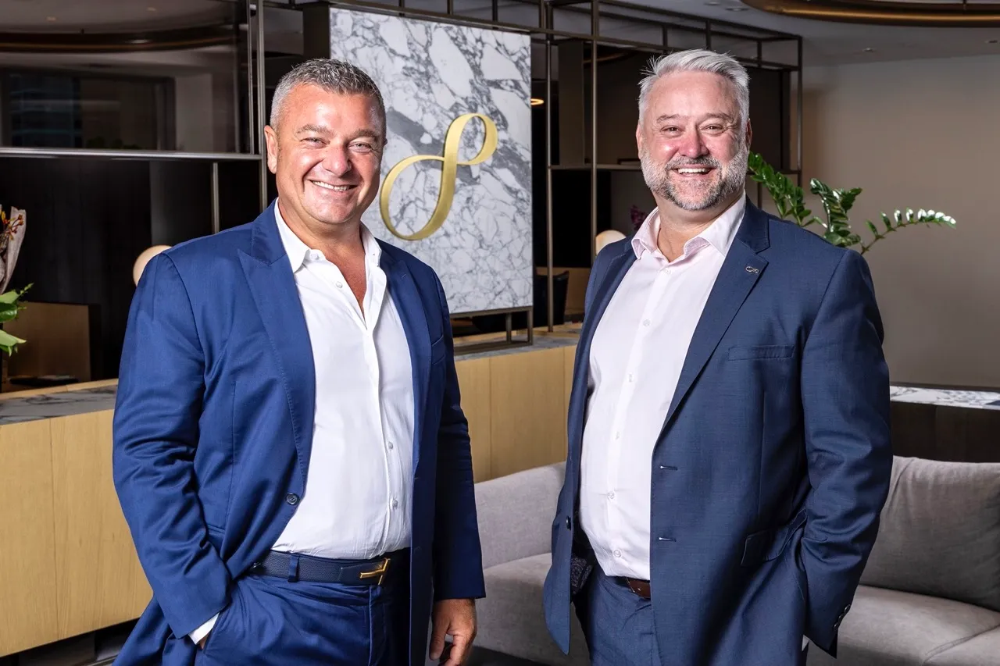

Global software giant Microsoft has joined forces with DoxAI, a venture of Australia’s Lakeba Group, and Perpetual Limited (ASX:PPT) to provide financial services companies with access to cutting-edge technology that can help them grow and evolve.

This collaboration unites Perpetual’s 137 years of experience in financial services, Lakeba’s expertise in AI and Technology with DoxAI, and Microsoft’s cloud infrastructure to create a marketplace of technology solutions for the financial services industry in Australia.

Marking a significant step towards evolving the financial services sector in Australia, the collaboration will bring together the best of financial services, AI and Technology, and cloud infrastructure, to create solutions that are both innovative and scalable.

The marketplace of technology solutions will enable the industry to quickly adapt to the changing demands of consumers and the market and stay ahead of the competition.

The collaboration’s first AI project, QAAI, is a quality check on securitised loans and mortgages. It uses AI and machine learning technologies to provide a comprehensive analysis of loan and mortgage portfolios, helping financial institutions identify potential risks and improve loan performance. The goal of QAAI is to provide financial services companies with the insights they need to make informed decisions about their loan and mortgage portfolios and to help improve overall loan performance.

Giuseppe Porcelli, CEO and Founder of Lakeba Group and Chairman of DoxAI says:

***“We are excited to be working with Perpetual and Microsoft, to bring the best of AI and technology to the financial services sector in Australia. This collaboration will enable us to deliver solutions that are not only innovative, but also scalable, and we are confident that it will drive positive change in the industry.”***

Richard McCarthy, CEO of Perpetual Corporate Trust (PCT) says:

***“It’s exciting to see PCT’s innovation company, Perpetual Digital join forces with Microsoft and digital disruptors like Lakeba to enhance our document custody business operations and explore other applications of AI technology across our business.***

***This collaboration is a clear articulation of our strategy to enable our business, our clients and the broader market to be more effective, efficient, economical, while managing ever-increasing cyber security risks and maintaining compliance.”***

Vanessa Sorenson, Chief Partner Officer ANZ MD Microsoft NZ says:

***“Microsoft is committed to empowering organisations with the tools and technology they need to succeed in the digital age. This collaboration with Perpetual and Lakeba is a major step forward in our efforts to support the financial services industry in Australia, and we look forward to the impact it will have on the industry.”***

**About DoxAI**

DoxAI uses AI/ML technology to transform and automate a clients disconnected and repetitive workflows. With its team of experts, DoxAI provides businesses with innovative solutions that help them manage their growth and compliance risks more effectively.

**About Perpetual Limited**

Perpetual Limited is a leading provider of financial services in Australia, with a strong focus on investment management, wealth advice, and superannuation. The company has a long-standing reputation for providing high-quality services and delivering outstanding results for its clients.

**About Lakeba Group Limited**

Lakeba is a leading provider of AI and technology solutions, with a focus on developing and delivering innovative solutions that help organizations harness the power of technology. The company has a proven track record of delivering results for its clients and is committed to driving positive change in the world through technology.

**About Microsoft**

Microsoft Corporation is a leading technology company that develops, manufactures, licenses, supports, and sells computer software, consumer electronics, personal computers, and related services. Its mission is to empower every person and organisation on the planet to achieve more through its innovative products and services.

**Author:** 

BlueChip Communication  
Sydney NSW 2000

 [Read Full "The Australian" Media Release here](../files/AI-verifies-mortgages-within-seconds-in-Perpetual-Lakeba-and-Microsoft-partnership-The-Australian.pdf)
