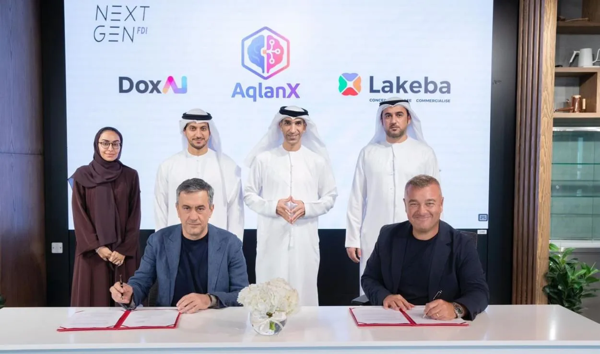
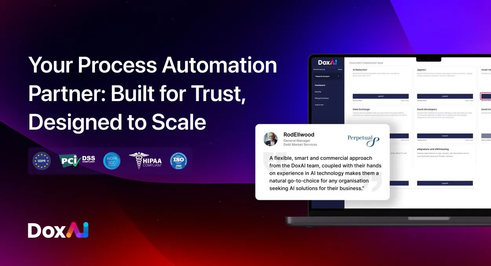

[DoxAI](https://www.doxai.co/) is executing a transformative growth strategy that will see the company establish a strong, diversified presence across three of the world’s fastest-growing AI markets, ASEAN, North America and the United Arab Emirates (UAE). The multi-pronged expansion, underpinned by new partnerships and product launches, positions DoxAI to scale rapidly while meeting unprecedented global demand for sophisticated AI-powered workflow solutions. 

***Strategic Market Entry: UAE, Canada, Singapore & Indonesia***  

-   **UAE foothold:** DoxAI has invested **USD 10 million** in Abu-Dhabi-based [**AqlanX**](https://aqlanx.com/), a leader in Arabic-language AI, to accelerate local R&D and market penetration.   
      
    “With DoxAI behind us, AqlanX is equipped to deliver Arabic-first AI that is not only world-class, but also born in, and for, the UAE,” said **Demetrio Russo, Founder & CEO, AqlanX**. “We are building an innovation hub that reflects the ambitions of this region and empowers its enterprises to lead globally.”  
      
-   **North American & ASEAN scale-ups:** Concurrently, DoxAI has expanded its teams in **Canada, Singapore and Indonesia**, establishing regional hubs that bring engineering, sales and customer support closer to local clients.  
     
-   **Diversification beyond Australia:** The combined footprint substantially reduces geographic concentration risk while aligning DoxAI with institutions actively seeking next-generation AI technologies.  
      

***Partnership Momentum — A Key Pillar of Global Expansion*** 

Partnerships sit at the heart of DoxAI’s growth playbook, and the past quarter has seen a deliberate acceleration of this strategy. By finalising four channel agreements that cover integrations, reselling and co-selling models, DoxAI has multiplied the routes through which customers can access its solutions, shorten sales cycles and widen adoption. Collaboration with government and industry bodies such as Austrade, FinTech Australia and Investment NSW is opening regulated markets in the likes of financial services, logistics and public administration prioritising trust and compliance.    
Beyond these wins, DoxAI has launched a global partner-sourcing programme to scout best-in-class system integrators, independent software vendors and value-added resellers across ASEAN, North America, the Middle East and Europe, underpinned by a rigorous enablement framework of training, joint-marketing funds and technical certification. This partner-first approach extends DoxAI’s reach well beyond its direct sales force but also embeds its technology in the ecosystems enterprises already trust, laying a durable foundation for diversified, worldwide growth. 

**Product expansion:** 

DoxAI has successfully launched its new products, Fraud Check AI and Agents Marketplace. 

Fraud Check AI is the first document agnostic fraud activity detection model designed to detect fraudulent activities in any document type, understand the specific document category and subsequentially automatically execute fraudulent cheeking rules designed for the specific document type. 

[Agent Marketplace](https://www.doxai.co/) is a new platform designed by DoxAI to allow its enterprise customers to build AI services and agents with confidence in data security, privacy, and speed, by simplifying the process of creation of these models by handling the full data anonymisation process, data set creation and knowledge base management, and allowing customers to simplify expose this new service and agents via a self-service deployable API. 

**Asset Verification**:   
   
DoxAI’s [Asset Verification](https://doxai.co/product/asset-verification/) platform introduces first of its kind tamper proof inspection reports with secure shield digitally signed by DoxAI. Asset verification (previously verimoto) is widely known for its instant digital inspections is taking AI to new heights to meet the demands of Finance market’s operations. 

*Explore product details:* ***[Fraud Check AI](https://www.doxai.co/)*** *|* ***[Agent Marketplace](https://www.doxai.co/)*** *|* ***[Asset Verification](https://doxai.co/product/asset-verification/)***

***Looking Ahead***  

With expanded global workforce and a rapidly growing partner ecosystem, DoxAI is entering its next phase of acceleration. The company will channel new resources into deepening R&D for multilingual, domain-specific AI models, ensuring its technology remains both globally relevant and locally nuanced. At the same time, joint go-to-market programmes with an ever-broader network of channel partners will amplify the reach and impact of DoxAI’s solutions. These combined efforts will pave the way for a steady stream of vertical offerings aimed at the most pressing enterprise pain point including fraud detection, regulatory compliance and operational efficiency cementing DoxAI’s position as a leader in trusted, transformative AI. 

“DoxAI’s mission is to re-imagine how enterprises adopt and implement AI securely, responsibly and at scale,” said Alfonso Porcelli, **Co-CEO DoxAI**. “Our latest expansion and product rollouts demonstrate that vision in action.” 

For media enquiries or partnership opportunities, please contact **[s.shakir@doxai.co](mailto:s.shakir@doxai.co)**. To learn more about our solutions, visit **[www.doxai.co](https://doxai.co)**
