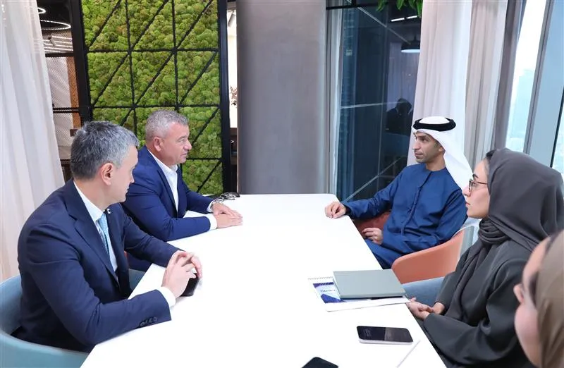

\- *DoxAI to establish regional headquarters in Dubai, leveraging AI-driven* *automation and insights to streamline business operations*

\- *Move supports the UAE’s vision to become a global hub for advanced technology* *and innovation*

\- *HE Al Zeyoudi: “DoxAI will strengthen the UAE’s innovation ecosystem and* *contribute to the digital transformation of industries, reinforcing our position as a* *global technology leader.”*

**Abu Dhabi, UAE – 28th January 2025:** The UAE Ministry of Economy has announced that DoxAI, a provider of AI solutions designed to simplify business processes and reduce operational complexities, has joined its NextGen FDI initiative. The program, which seeks to attract high-growth advanced technology companies to the UAE, will support DoxAI in establishing its regional headquarters in Dubai and scaling its operations to serve regional and global markets. DoxAI applies AI and machine learning to streamline document processing, automate data extraction, and enhance identity verification, delivering real-time, actionable insights for businesses. By reducing the need for human intervention and integrating seamlessly with existing business systems, DoxAI enables organisations to optimise their operations, reduce costs, and focus on strategic initiatives that drive growth. DoxAI is part of the Global Tech Builder Lakeba Group.

His Excellency Dr Thani bin Ahmed Al Zeyoudi, UAE Minister of State for Foreign Trade, said, “We are delighted to welcome DoxAI to the NextGen FDI initiative. Their expertise in AI-driven automation will play a vital role in supporting the UAE’s digital transformation journey and further strengthening our advanced technology ecosystem. This collaboration not only aligns with our vision to foster a knowledge-based economy but also reaffirms our commitment to positioning the UAE as a global hub for innovation and entrepreneurship.”

The company’s regional headquarters will initially be based in Dubai’s iconic Rolex Tower, with plans to deploy its first 15 units from Australia and India. DoxAI also aims to expand its presence in the UAE by forming strategic partnerships with local universities, such as the University of Wollongong, and developing a talent recruitment plan for the 2025-2026 period.

Giuseppe Porcelli, Founder and Chairman of DoxAI, stated, “The UAE is a dynamic and forward-thinking market, offering unparalleled infrastructure, a business-friendly environment, and access to a vibrant technology ecosystem. Joining the NextGen FDI program is a game-changer for DoxAI. The UAE’s visionary approach to AI and innovation provides the perfect environment for us to scale our technology, forge new partnerships, and contribute to the region’s digital transformation.”

The UAE’s focus on artificial intelligence aligns with its broader ambitions to enhance digital infrastructure, create smart industries, and attract cutting-edge technology companies. By fostering public-private partnerships and supporting businesses like DoxAI, the UAE is strengthening its leadership in emerging technologies that drive economic growth and diversification.

Launched in 2022, the NextGen FDI initiative is designed to attract high-growth and high- potential advanced technology companies to the UAE. The initiative provides fast-tracked and simplified licensing, visa processes, accelerated access to banking services, and competitive rates for commercial and residential leases. It has already welcomed global innovators across sectors such as robotics, precision fermentation, hybrid aviation, and renewable energy.

**Read all published article here**

EMIRATES NEWS AGENCY – WAM  
[https://www.wam.ae/article/bi2e97h-doxai-join-uae%E2%80%99s-nextgen-fdi-initiative](https://www.wam.ae/article/bi2e97h-doxai-join-uae%E2%80%99s-nextgen-fdi-initiative)

One Arabia  
[https://www.onearabia.me/business/doxai-joins-uae-nextgen-fdi-initiative-011-97333.html](https://www.onearabia.me/business/doxai-joins-uae-nextgen-fdi-initiative-011-97333.html)

Emirates7  
[https://en.emirates7.com/article/4078](https://en.emirates7.com/article/4078)

GCC Business News  
[https://www.gccbusinessnews.com/doxai-joins-nextgen-fdi-initiative/](https://www.gccbusinessnews.com/doxai-joins-nextgen-fdi-initiative/)

Middle East AI News  
[https://www.middleeastainews.com/p/ai-company-doxai-joins-uae-nextgen-fdi](https://www.middleeastainews.com/p/ai-company-doxai-joins-uae-nextgen-fdi)

HiDubai Focus  
[https://focus.hidubai.com/doxai-joins-uaes-nextgen-fdi-initiative-to-drive-ai-innovation/](https://focus.hidubai.com/doxai-joins-uaes-nextgen-fdi-initiative-to-drive-ai-innovation/)

PR Newswire

[https://www.prnewswire.com/apac/news-releases/doxai-to-join-uaes-nextgen-fdi-initiative-to-drive-ai-powered-business-transformation-302370686.html](https://www.prnewswire.com/apac/news-releases/doxai-to-join-uaes-nextgen-fdi-initiative-to-drive-ai-powered-business-transformation-302370686.html)

[Download PDF Here](../files/280125_NextGenFDI_DoxAi_PR_ENG_v1-1.pdf)
