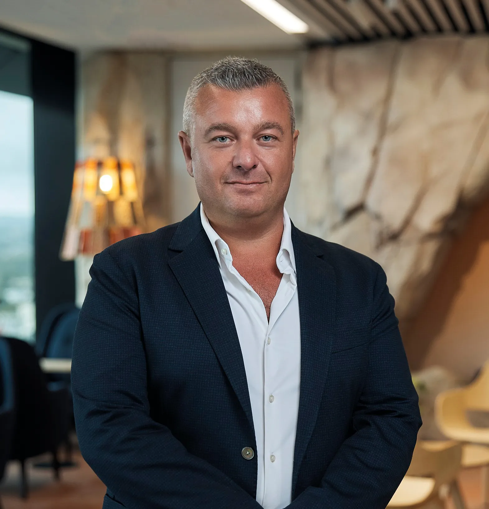

As CEO and Founder of Lakeba, a company dedicated to embracing innovation and technology, I've travelled extensively in search of new opportunities and ideas. My journey has taken me across continents, but the Middle East has truly captivated my imagination. The rapid growth in technology and the modern way of life I encountered here left me inspired and eager to establish roots in this dynamic region.

**A New Horizon of Possibilities**

When I first set foot in the Middle East, I was struck by the energy and ambition that pulsed through its cities. The skylines were filled with cranes, building new infrastructure to support the burgeoning population and economy. It was clear that this was a region on the move, with a vision for the future that was both ambitious and innovative.

Dubai, with its iconic Burj Khalifa piercing to the clouds, epitomised this spirit of progress. The city's commitment to technology and innovation was evident at every turn, from the autonomous taxis on the streets to the bustling tech hubs filled with startups. In this city, I saw a glimpse of what the future could look like - modern, connected, and forward-thinking.

**Technology as a Catalyst for Change**

The Middle East has been historically known for its rich cultural heritage and traditional values, but in recent years, it has embraced technology with open arms. Countries like the United Arab Emirates and Saudi Arabia are leading the charge, investing heavily in technology and innovation. From AI to Blockchain, the region is positioning itself as a hub for cutting-edge technologies.

One of the most compelling aspects of this transformation is the region's focus on smart cities. I was fascinated by how cities like Dubai and Abu Dhabi are integrating technology into every aspect of urban life. Smart transportation systems, digital governance, and AI-powered services are just a few examples of how technology enhances the quality of life for residents and visitors alike. Things can be set up in real-time, and I mean in real-time.

**A Culture of Innovation**

What struck me most about the Middle East was the culture of innovation. The region is home to some of the world's largest technology conferences, attracting Thought leaders and Entrepreneurs from around the globe. At these events, I met innovators who were driven by a passion for solving real-world problems with technology. Their enthusiasm was infectious, and I knew that Lakeba had to be part of this exciting journey. It is part of who we are.

One of the key factors driving this culture of innovation is the support from governments and institutions. The Middle East's leadership understands that technology is the key to future prosperity, and they are investing heavily in education and infrastructure to support this vision. Programs like Saudi Vision 2030 and the UAE's National Innovation Strategy are laying the groundwork for a tech-driven future.

**A Business-Friendly Environment**

As a business owner, I was pleased to find that the Middle East offers a business-friendly environment. The regulatory frameworks are designed to encourage entrepreneurship, and the tax structures are often more favourable compared to other regions. This approach has attracted global companies, and the business culture in the Middle East is also uniquely welcoming. I found that partnerships and collaborations are highly valued, and business leaders are open to sharing ideas and exploring new opportunities. This collaborative spirit made it easy for Lakeba to establish connections and build a network of like-minded professionals.

**A Region of Endless Potential**

As I reflect on my journey through the Middle East, I am filled with excitement about the future. The region's rapid growth in technology and its modern way of life are just the beginning. With its commitment to innovation, a supportive business environment, and a culture that embraces change, the Middle East is poised to become a global leader in technology and entrepreneurship.

For entrepreneurs and business leaders looking to make their mark, the Middle East offers a world of possibilities. At Lakeba, we are excited to be part of this journey, and we look forward to contributing to the region's continued growth and success.

[Lakeba forges Dubai partnership with AstroLabs - Digital - CRN Australia](https://www.crn.com.au/news/sydneys-lakeba-group-forges-dubai-partnership-with-astrolabs-602076)

[Lakeba Group expands tech ventures to Middle East on ausbiz](https://ausbiz.com.au/media/lakeba-group-expands-tech-ventures-to-middle-east?videoId=32934)

[Lakeba Group Expands Shelfie Operations to EMEA](../lakeba-group-expands-shelfie-operations-to-emea/)
