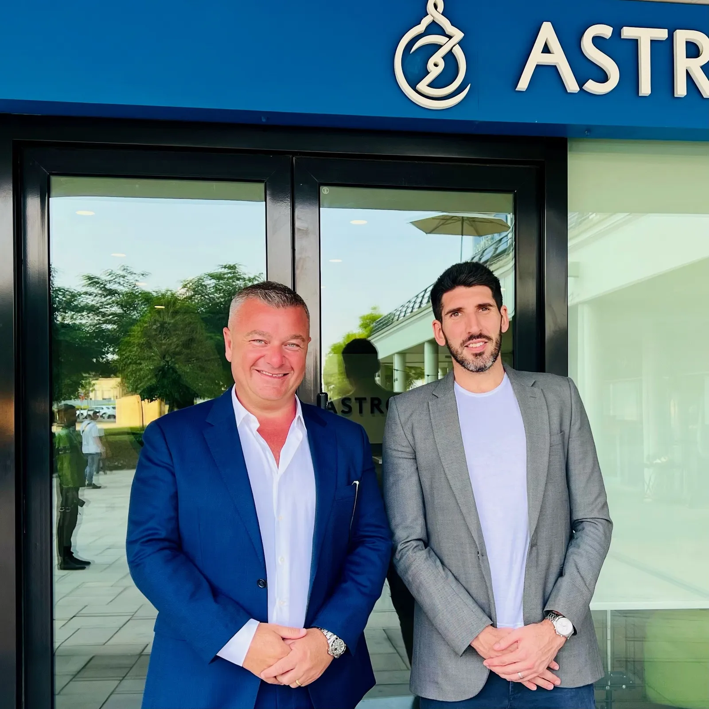

Australian-based technology venture studio, Lakeba Group, has announced its partnership with Dubai-based AstroLabs as it expands its operations into the Middle East. 

Lakeba says that as Dubai continues to grow its ambitions and scale as a technology powerhouse, the AstroLabs partnership will help Lakeba accelerate the growth of its technology businesses, including mobile security tool, Quixxi Security; and digital document verification system, DoxAI. 

Lakeba Founder and CEO Giuseppe Porcelli said, “We are delighted to be collaborating with AstroLabs in Dubai, by joining a thriving local ecosystem that fosters AI, machine learning and tech-driven solutions.” 

“Our aim is to accelerate the growth of several of our digital ventures in the Middle East, in addition to the U.S and India. Astrolabs is the perfect partner for us, as both companies have deep expertise in nurturing tech start-ups and a culture of innovation.” 

AstroLabs’ Director of Community & Dubai Expansion Andrea Trevisi said: “We’re excited to welcome Lakeba to the AstroLabs community because we share a vision in fostering digital innovation. We look forward to supporting Lakeba’s growth in the UAE and the impact and contribution it will make to the region’s AI sector.”

For more information on Astrolabs, visit [https://astrolabs.com](https://astrolabs.com/)  

**About AstroLabs**

AstroLabs is an ecosystem builder that enables the growth of people, companies, and innovation capacities on a regional level. With 10 years of active building in MENA and a vibrant community across three coworking spaces in the UAE & KSA, AstroLabs is MENA’s trusted partner in solving the innovation challenges of tomorrow by navigating the entrepreneurial landscapes of today.  

Partnering with key industry shapers, including governmental entities, corporates & enterprises, and the entrepreneurial ecosystem, AstroLabs designs and facilitates ecosystem transformations through business expansion and market entry operations, SME ecosystem building, digital upskilling, entrepreneurship, and innovation programs, as well as value-focused talent recruitment practices.

**Author:** 

BlueChip Communication  
Sydney NSW 2000

[Download PDF here](../files/Media-Release-Lakeba-AstroLabs-November-202334.pdf)
