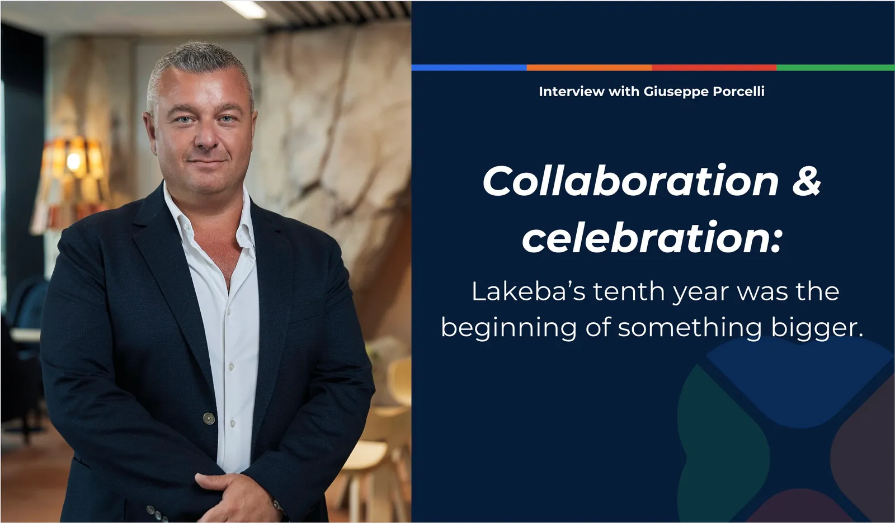
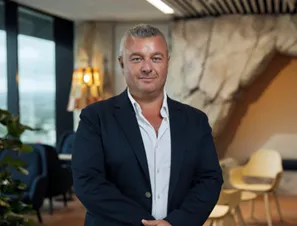

**Collaboration and celebration: Lakeba’s tenth year was the beginning of something bigger.**

**Heading into the holiday season as we reflect on Lakeba’s 10th anniversary, we sat down with CEO Giuseppe Porcelli to discuss his home-grown roots in Naples, Italy and his start as an entrepreneur, both of which have seen him drive the success of multiple ventures and the Lakeba portfolio to date.**

Naples is known for its lively markets, busy streets, and a culture as rich and varied as its signature pizza. Growing up in the midst of this Italian gem was Giuseppe Porcelli, who shares that same charm and energy his hometown is known for.

In a family of five, alongside his mum, dad, and two sisters, Giuseppe experienced a challenging environment and culture during his upbringing. "It's a very tough town \[Naples\], where people have to fight every day to bring bread back home, you know. It's not comparable to the lifestyle we have here in Australia - it's like another world," Giuseppe shares.

“Italy is a very old country; the culture is so profound. So, it's quite impossible to escape from the learning curve from that journey.”

Amidst these challenges, Giuseppe learned resilience and adaptability, which became the pillars defining his later successes. However, his childhood also saw him entrenched in the family business, sparking his passions for entrepreneurship early on. Toiletries, detergents, and cosmetics were more than just necessities in Giuseppe’s family; they were a legacy, which began from his father Alfonso.

“In my family, business wasn't just a 7am-to-7pm job; it was a way of life,”

“In 1995, I left the family business to start something more interesting and I started trading by myself in 1997. By 1999, I had decided to start my own brand.”

Giuseppe had started Fresh-Up, an oral care brand inspired by his collaboration with Colgate Palmolive, where it had also become the catalyst for his endeavours to be a CEO.

“My friend at Colgate said, "Look, you are not made for a corporate, you are made to run a business, your own business, so go and make it happen." His advice was the best I ever received in life, because I went out and I did it.”

***“Where I grew up has given me the opportunity to be who I am today.”***

Giuseppe engrossed himself in the business's logistics and operations. He felt the geolocation of Italy, in central Mediterranean, helped with his global export and production efforts, which he credits gave a unique advantage to Italian businesses.

“By 35, I was at my fourth passport, because the stamps had filled it, and I came to a point where everywhere I was travelling customs were stopping me asking what I did in life, and why I was travelling so much.  I would respond and say, *"I'm building a business.”*

After receiving a business honour award by Italy’s then prime minister, Silvio Berlusconi, Fresh-Up was acquired and Giuseppe turned his interests to technology, piqued by his curiosity and a conversation with a Fresh-Up IT manager in charge of the company’s e-commerce operations.

For 10 years Giuseppe stayed in Italy following his pursuits of entrepreneurship, but economic conditions, challenging environments and government red tape made it difficult and unfeasible, which culminated in Giuseppe changing his mindset. He decided to learn English and move his family to Australia to begin “a new life from scratch.”

This decision didn’t come without its own unique struggles for Giuseppe and his family, but they were determined to make it happen. Giuseppe appreciated Australia’s environment where “the people look after each other and where they live.” He also felt as though despite the challenges, they were “effectively 5% compared to the challenges that you would have to run the same business back in Italy.”

These experiences in Australia helped form Giuseppe’s approach to starting companies.

“We are travellers as well. So, we know how to start from scratch - below zero, and I think, because it's part of our \[Italian’s\] blood to not want to work for someone else, but to do for ourselves... because we know the price for that sacrifice.”

His key takeaway for business growth? “Scaling a business is not a science, there is no formula, it's a combination of things. You have to be at the right time, at the right spot, and meet the right people scaling a business,”

“Thinking that anyone can expand into a new region, just because something else has and things are working. Well, that's the biggest mistake ever.”

After a decade of living in Australia and establishing Lakeba, which has become a successful global company that conceives, creates and conceptualises other successful businesses, it's fair to say that Giuseppe has proven himself as a visionary leader. His journey shows how determination, adaptability, and curiosity can pave the way for transformative entrepreneurship and innovation.

His best piece of advice? “Surround yourself, before you even start, with people that believe in your mission. That's the key point. If you're by yourself, the chances are much less when starting something from scratch. Where you have people that are committed to help, your vision can happen. That's the critical point.”

**Giuseppe Porcelli and Lakeba Group would like to wish all our stakeholders, clients and team a wonderful festive season and look forward to another exciting year ahead in 2024.**

**Author**:

BlueChip Communication  
Sydney NSW 2000
