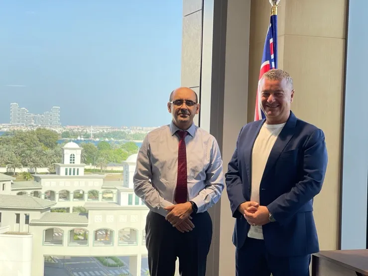

**Lakeba Group, a leading Australian company in AI for financial services, and the University of Wollongong in Dubai, a branch of the prestigious Australian university, have signed a memorandum of understanding to collaborate on joint R&D projects and internship opportunities for students.**

Lakeba Group and University of Wollongong in Dubai (UOWD) are pleased  to announce that they have entered a memorandum of understanding (MOU) to establish a framework for collaboration in the field of artificial intelligence (AI) for financial services.  
  
This groundbreaking collaboration represents a dynamic fusion of academic excellence and industry prowess, aimed at pushing the boundaries of what's possible in the world of AI and Finance. 

The MOU aims to leverage the complementary strengths and expertise of both parties in AI, data science, and financial technology and to foster innovation and social impact through joint research and development (R&D) projects, academic and technical exchange, and internship opportunities for UOWD students at Lakeba offices around the world.

Lakeba Group is a company that specialises in developing and deploying AI solutions for the financial services industry, such as fraud detection, credit scoring, and customer segmentation and more. Lakeba has offices in Australia, India, Italy, the UK, and the USA and serves clients across the globe.

UOWD is a branch of the University of Wollongong, Australia, one of the world’s top 250 universities, with a campus in Dubai Knowledge Park. UOWD offers internationally recognised degrees in business, engineering, information technology, and arts and humanities and strongly focuses on research excellence and industry engagement.

Mr. Porcelli said:  
***“We are delighted to partner with UOWD, a leading academic institution in the region, to advance the frontiers of AI for financial services. This collaboration will enable us to access the rich talent pool and cutting-edge research capabilities of UOWD and to offer valuable learning and career opportunities for UOWD students.”***

Professor Salem said:  
***“This partnership is a testament to our commitment to fostering a culture of innovation and collaboration with industry partners, such as Lakeba Group, who are at the forefront of AI and fintech. This collaboration will enhance our research impact and relevance and will provide our students with exposure to real-world challenges and solutions in the rapidly evolving field of AI for financial services.”***  
  
This collaboration marks a pivotal moment in the trajectory of AI and financial services, as two entities with distinct strengths converge to create a powerhouse of innovation. The partnership's success will undoubtedly have far-reaching implications, shaping the future of AI in finance and contributing to the global knowledge pool.

The MOU was signed by Mr Giuseppe Porcelli, CEO and Founder of Lakeba Group, and Professor Mohamed Salem, President of UOWD in March 2024.

**Author**:

BlueChip Communication  
Sydney NSW 2000

 [Download PDF Here](../files/PR-Release-Lakeba-and-University-of-Wollongong-in-Dubai-13-March-2023-v3-1.pdf)
