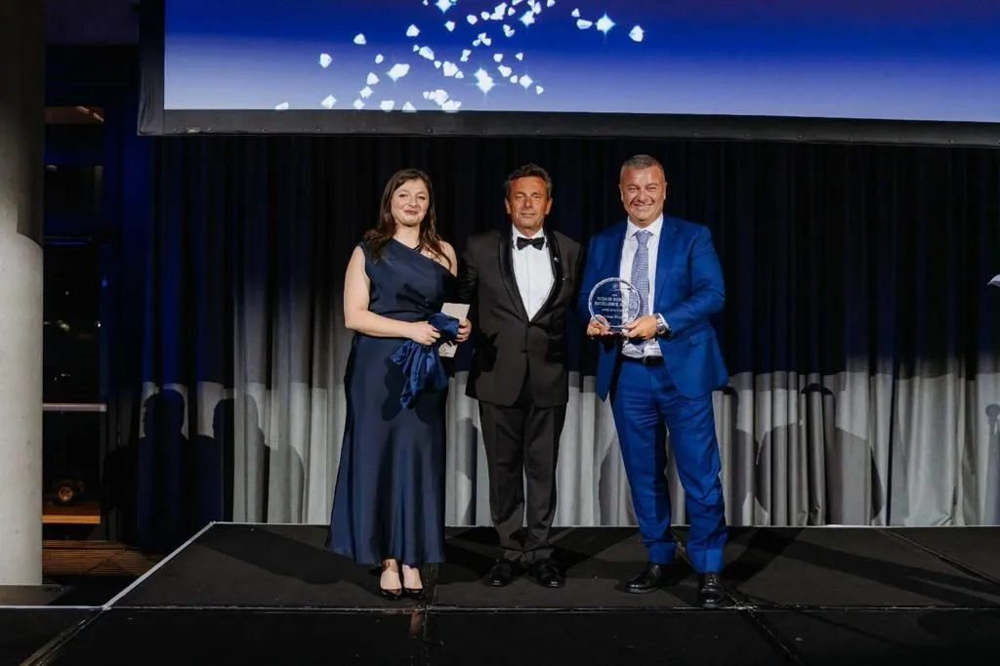

Global venture studio Lakeba Group has been awarded the Business Excellence Award at the Italian Chamber of Commerce and Industry Australia (ICCIAUS) awards, celebrating its commitment to innovation and excellence in the Australian business landscape. 

Lakeba Group, headquartered in Manly, has been at the forefront of technological innovation, working to support cutting-edge ventures in the fintech, artificial intelligence, and blockchain sectors for more than a decade. 

The ICCIAUS Business Excellence Award is a testament to Lakeba Group's exemplary performance, leadership, and relentless pursuit of innovative solutions in the technology and business space.

The award ceremony, attended by business leaders, officials, and dignitaries, highlighted Lakeba Group's achievements and positive influence on the Australian business network. 

Giuseppe Porcelli, Chairman and Founder of Lakeba Group said: "Receiving the Business Excellence Award from the Italian Chamber of Commerce and Industry Australia is a significant honour for us." 

“We are proud of our Italian heritage and are committed to continuing to drive innovation, create opportunities, and make a positive impact on the Australian business community." 

Lakeba Group extends its gratitude to the Italian Chamber of Commerce Australia for this recognition and looks forward to continuing the growth of its digital ventures across the world.

For media inquiries, please contact:  

**Author:** 

BlueChip Communication  
Sydney NSW 2000

[Download PDF H](../files/Media-Release-Lakeba-Group-takes-out-top-Business-Excellence-Award-30-November-2023.pdf)[ere](../files/Media-Release-Lakeba-Group-takes-out-top-Business-Excellence-Award-30-November-2023.pdf)
