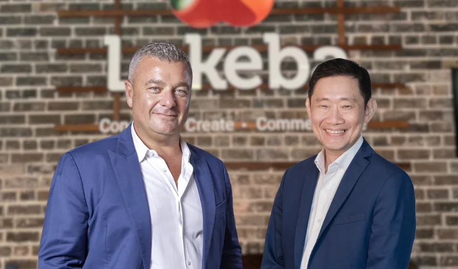

Sydney, Australia – Lakeba Group, is excited to announce the appointment of Kevin Wo, Microsoft’s Managing Director for Global Partner Solutions in the Asia Pacific, to its Board of Directors. This strategic move aligns with Lakeba's vision to deepen its presence in Southeast Asia and drive forward its ambitious growth plans.

Kevin Wo brings a wealth of experience from his tenure at Microsoft, where he oversaw cloud AI business partnerships and previously managed commercial and cloud operations in Singapore. His addition to the board complements the expertise of existing member Mark Ritson, a marketing specialist with a close professional and personal connection to Lakeba’s CEO, Giuseppe Porcelli.

Lakeba has been at the forefront of developing innovative artificial intelligence solutions, including a groundbreaking tool that accelerates digitisation processes for major financial institutions like ANZ, Macquarie Bank, and Perpetual.

Kevin Wo expressed his enthusiasm for joining Lakeba, stating, ***“I’m responsible for the cloud AI business through our partners. Prior to this role, I was the country MD for Microsoft Singapore, overseeing the commercial and cloud business across Singapore. My extensive career in professional services will contribute to Lakeba’s growth and innovation.”***

Giuseppe Porcelli, CEO of Lakeba, highlighted the significance of this appointment, saying, ***“In Australia, our partnership with Perpetual accelerates our visibility and credibility with large organisations. Now, it’s time to focus on exporting our technology to other regions.”***

[Click here to read the full exclusive article.](https://www.theaustralian.com.au/subscribe/news/1/?sourceCode=TAWEB_WRE170_a_LIN&dest=https%3A%2F%2Fwww.theaustralian.com.au%2Fbusiness%2Ftechnology%2Fsydney-firm-lakeba-appoints-microsoft-executive-to-board-as-it-looks-to-export-its-tech%2Fnews-story%2Fda3ad6ef166fabb9628c84586075a78c&memtype=anonymous&mode=premium&v21=HIGH-Segment-1-SCORE&V21spcbehaviour=append)  
By Jared Lynch, Technology Editor. **The Australian**.

[See LinkedIn Announcement here](https://www.linkedin.com/posts/giuseppeporcelli_leadership-innovation-lakeba-activity-7211122212831907841-t-ax?utm_source=share&utm_medium=member_desktop)
