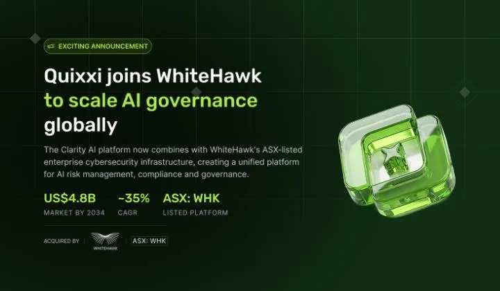

Sydney, 13 April 2026 — Lakeba Group ("Lakeba") confirms that WhiteHawk Limited (ASX: WHK) has entered into an agreement to acquire Quixxi, a Lakeba venture and developer of the Clarity AI platform, which enables organisations to discover, monitor and govern artificial intelligence systems across enterprise environments.

The transaction reflects Lakeba's venture catalyst model of conceiving, building and commercialising technology businesses to the point of strategic value realisation.

Quixxi was developed within Lakeba's venture ecosystem, leveraging the Group's proprietary AI capability, shared services infrastructure, and commercialisation methodology. Under Lakeba's stewardship, Quixxi built an international customer base across government, financial services and enterprise sectors, secured two U.S. patent applications for mobile application security technologies, and developed the Clarity AI platform to address the rapidly emerging market for AI governance.

Industry research estimates the global AI governance market will grow from approximately US$309 million in 2025 to more than US$4.8 billion by 2034, representing a compound annual growth rate of approximately 35%.

**Transaction Structure**

The acquisition is structured as a scrip-for-scrip transaction in which Lakeba receives consideration in WhiteHawk shares, aligning the interests of both parties around the long-term commercial success of the Clarity AI platform within WhiteHawk's listed cybersecurity business.

Under the terms of the agreement, WhiteHawk will issue a total of 500 million shares to Lakeba, comprising:

-   250 million fully paid ordinary shares as upfront consideration on completion of the acquisition; and
-   250 million Performance Shares, structured across defined commercial milestones designed to incentivise continued growth and successful integration of the Clarity AI platform within WhiteHawk's operations.

The milestone structure ensures that value is realised progressively as Clarity AI achieves revenue targets within the combined platform, reinforcing long-term alignment between Lakeba and WhiteHawk shareholders.

For Lakeba and its shareholders, the transaction delivers several strategic outcomes:

-   Quixxi's technology and intellectual property are now housed within a publicly listed vehicle on the Australian Securities Exchange, providing access to public market capital, institutional distribution and enhanced commercial visibility.
-   The scrip-for-scrip structure preserves Lakeba's ongoing economic interest in the venture it conceived and built, ensuring that Lakeba shareholders continue to participate in the upside as Clarity AI scales globally.
-   WhiteHawk's established enterprise cybersecurity customer base, public market infrastructure and existing platform capabilities provide the commercialisation runway that a private venture structure alone could not deliver at the same pace.
-   Lakeba retains its existing strategic shareholding in WhiteHawk, reinforcing the alignment between both organisations as the integration progresses.

The transaction is subject to customary conditions, including shareholder approvals as required under the ASX Listing Rules.

**Giuseppe Porcelli, Founder of Lakeba** , said: "*Quixxi is the latest example of Lakeba's model in action — conceive a venture around a genuine market need, build the technology, prove commercial traction, and transition it into the right platform for scale. The scrip-for-scrip structure means Lakeba and its shareholders remain invested in the outcome. We built Clarity AI because we believed AI governance would become a board-level priority for every enterprise deploying artificial intelligence — and that conviction doesn't end at the point of transaction. WhiteHawk's cybersecurity infrastructure and public market access provide the foundation for Clarity AI to reach its full potential as this market matures globally.*"

**About Lakeba Group**

Lakeba Group is a global venture catalyst that conceives, creates and commercialises digital technology ventures. Founded by Giuseppe Porcelli, Lakeba has conceived, created and commercialised 15 ventures to date, with strategic partnerships spanning Microsoft, FUJIFILM, Perpetual and other global organisations.

For more information, visit lakeba.com

Media Contact: Lakeba Group — marketing@lakeba.com
