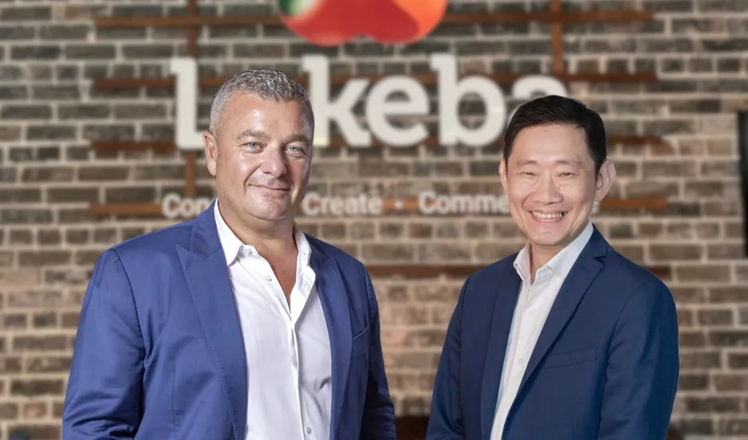

[DoxAI](https://doxai.co/), a leading provider of AI-powered automation solutions, is pleased to announce  the appointment of Kevin Wo as a Non-Executive Director to its board. 

Kevin brings with him over 29 years of leadership experience in the information  technology sector, having held senior executive roles at globally recognised companies  including Microsoft, Oracle, IBM, and PwC. Currently serving as Microsoft’s Chief Partner Officer for ASEAN, Kevin is responsible for driving the growth and adoption of Microsoft  Cloud services across the region through strategic partnerships and digital innovation. 

In addition to his role at Microsoft, Kevin is a Senior Accredited Director with the  Singapore Institute of Directors and contributes his expertise to several prominent  boards, including Lakeba Group—DoxAI’s parent company. 

“We’re thrilled to welcome Kevin to the DoxAI board,” said Giuseppe Porcelli, Chairman  of DoxAI. “His extensive experience in digital strategy, partner ecosystems, and  governance will be instrumental as we continue to scale our AI-driven solutions globally.  Kevin’s appointment signals our commitment to accelerating innovation and delivering  transformative outcomes for our clients.” 

This leadership transition also marks the departure of Sarah Carney from the board.  Sarah has played a key role in DoxAI’s early growth, offering invaluable guidance and  strategic direction throughout her tenure. 

“We sincerely thank Sarah for her dedication and the impact she’s had on DoxAI’s  journey,” said Alfonso Porcelli. “Her contributions have helped lay a strong foundation for  the future.” 

With Kevin’s appointment, DoxAI strengthens its leadership team as it continues to  expand its global footprint and pioneer the future of intelligent automation. 

For media enquiries or partnership opportunities, please contact **[s.shakir@doxai.co](mailto:s.shakir@doxai.co)**. To learn more about our solutions, visit **[www.doxai.co](https://doxai.co)**
