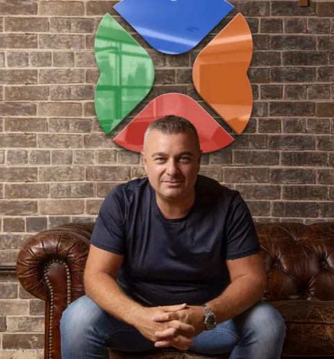

This media release was originally published at Microsoft, click [HERE](https://news.microsoft.com/en-au/features/unlocking-the-future-of-e-signatures-doxai-introduces-gpt-4-enhanced-document-intelligence/)

***DoxAI (a Venture of Lakeba) uses Microsoft Azure OpenAI Service to revolutionise document comprehension for users, transforming digital signatures and witnessing processes.*** 

DoxAI (a Venture of Lakeba), an artificial intelligence-focused company that helps small businesses and enterprises embrace technology, optimise, and digitalise their processes, has announced the integration of OpenAI's GPT-4 through Microsoft Azure OpenAI Service into its e-signature AI solution. This collaboration is set to revolutionise the way users comprehend complex and lengthy documents, enabling them to ask specific questions and receive clear answers before digitally signing or witnessing documents. 

DoxAI's e-signature AI is an innovation that demonstrates the company's commitment to making document handling more accessible and efficient for its clients. By simplifying the document signing and witnessing process, users can save time and resources, ultimately leading to increased productivity and cost savings for businesses. 

Some of the key benefits that clients can expect from DoxAI's e-signature AI solution include: 

Improved document comprehension through GPT-4 integration, allowing users to ask specific questions and receive clear, concise answers before making crucial decisions. 

Streamlined digital transactions, making the process more accessible and user-friendly across a wide range of industries. 

Secure and seamless integration with Microsoft Azure Cloud Services, ensuring data protection and privacy for clients. 

Enhanced scalability and adaptability, with the potential to expand AI-driven solutions across various applications and industries through the DoxAI Virtual Assistant. 

DoxAI offers a wide range of services and products, including e-Signature e-witnessing, Redact AI, Categorise AI, Extract AI, Data Exchange, Asset Verification and more.  

Giuseppe Porcelli, CEO and Founder of Lakeba and Chairman of DoxAI says:

***“The integration of GPT-4, OpenAI’s most advanced AI language model, through Microsoft’s Azure OpenAI Service, will empower DoxAI's e-signature AI to transform the user experience. This powerful natural language technology can be helpful for tasks including content creation, conversation, document search and analysis.”***

Vanessa Sorenson, Chief Partner Officer ANZ MD Microsoft NZ says: 

***“We are incredibly pleased to see DoxAI integrate Microsoft Azure OpenAI Service. Microsoft continues to support businesses in optimising their processes and adopting the latest technologies, like the large language models offered in Azure OpenAI Service, to stay ahead in the rapidly changing digital landscape.”*** 

As businesses continue to navigate the challenges of an increasingly digital world, solutions like DoxAI's e-signature AI will play a crucial role in streamlining processes, improving efficiency, and driving growth. 

For more information on DoxAI's revolutionary e-signature AI solution, visit [www.doxai.co](http://www.doxai.co/)  

**About DoxAI** 

DoxAI is an artificial intelligence-focused company that helps small businesses and enterprises embrace technology, optimise, and digitalise their processes. The company offers a comprehensive suite of services and products, including e-Signature e-witnessing, Redact AI, Categorise AI, Extract AI, Data Exchange, Asset Verification and more. DoxAI is committed to delivering innovative solutions that streamline digital transactions and enhance user experiences. 

**About Microsoft**  

Microsoft (Nasdaq: MSFT; @microsoft) enables digital transformation for the era of an intelligent cloud and an intelligent edge. Its mission is to empower every person and every organisation on the planet to achieve more.

**Author**:

BlueChip Communication  
Sydney NSW 2000
